# Diagramas de Arquitetura, Casos de Uso e Fluxos — Cortex Backend

Este documento apresenta a especificação visual e comportamental completa do backend do **Cortex**, contendo:
1. **Diagrama de Classes**: Modelo de domínio com todas as entidades, enums e relacionamentos mapeados no Entity Framework Core e PostgreSQL.
2. **Diagrama de Objetos**: Snapshot de instâncias em tempo de execução demonstrando **Tarefa Atribuída**, **Meta** e **Ticket de Reporte**.
3. **Diagrama de Casos de Uso**: Visão funcional com atores do sistema, fronteira da aplicação, matriz de especificação e **cenários detalhados (ótimos e alternativos)**.
4. **Diagramas de Sequência**:
   - **Criar Tarefa** (`sd CriarTarefa`)
   - **Criar Sugestão de Alteração** (`sd CriarSugestao`)
   - **Criar Meta** (`sd CriarMeta`)
   - **Envio de Notificações** (Push FCM/APNs, E-mail SMTP e SMS)
5. **Diagrama de Componentes**: Visão modular em 4 camadas (Apresentação com Front-end Web, Negócio / API, Persistência e Serviços Externos).
6. **Diagrama de Aplicação e Implantação (`pkg`)**: Topologia de nós (`<<desktop>> Navegador`, `<<servidor de aplicacao>> WEB`, `<<Servidor DB>> PostgreSQL`) sobre `TCP/IP`.
7. **Matriz de Rastreabilidade de Regras de Negócio (RN, RF e RNF)**
8. **Modelo Conceitual do Banco de Dados (MER)**: Entidades conceituais, relacionamentos semânticos e cardinalidades (1:1, 1:N, N:N).
9. **Modelo Lógico do Banco de Dados (DER / Relacional)**: Normalização 3FN, chaves primárias/estrangeiras, tipos PostgreSQL e integridade referencial.
10. **Dicionário de Dados do Sistema**: Especificação exaustiva de colunas, tipos, constraints, defaults e tipos enumerados (ENUMs).
11. **Ferramentas Utilizadas**: Tecnologias, frameworks e bibliotecas adotadas no desenvolvimento (Next.js/React, ASP.NET Core/.NET 10, PostgreSQL, EF Core, etc.) e suas justificativas técnicas.

---

## 1. Diagrama de Classes do Projeto

O modelo de domínio do Cortex foi projetado seguindo os princípios de isolamento de domínio, integridade referencial e suporte a regras críticas de negócio (RBAC, auditoria, gamificação e workflow colaborativo).

Para garantir máxima legibilidade e eliminar o cruzamento desordenado de linhas ("teia de aranha") sem perder qualquer atributo, tipo ou multiplicidade:
1. **Tipagem Direta nos Atributos**: Os tipos enumerados são declarados diretamente nos atributos das entidades (ex.: `+Status Status`, `+Cargo Cargo`), dispensando setas pontilhadas redundantes que cortavam o centro do diagrama.
2. **Diagrama Consolidado Otimizado (Mermaid)**: Visão macro limpa com fluxo vertical de leitura.
3. **Diagrama Estruturado em Pacotes (PlantUML)**: Visão formal com delimitação de pacotes e linhas ortogonais (`skinparam linetype ortho`).
4. **Visões Modulares por Subdomínio**: Recortes focados para leitura precisa de cada contexto de negócio.

---

### 1.1. Diagrama Consolidado do Modelo de Domínio (Mermaid)

```mermaid
classDiagram
    direction TB

    %% Enums do Sistema
    class Status {
        <<enumeration>>
        Pendente
        Atrasada
        Concluida
    }

    class Prioridade {
        <<enumeration>>
        Baixa
        Media
        Alta
        Urgente
    }

    class Cargo {
        <<enumeration>>
        Dono
        Admin
        Membro
    }

    class TipoEntidade {
        <<enumeration>>
        Tarefa
        ResponsavelTarefa
        Usuario
    }

    class CanalNotificacao {
        <<enumeration>>
        Email
        Push
        Sms
    }

    class StatusSugestao {
        <<enumeration>>
        Pendente
        Aprovada
        Rejeitada
    }

    %% Identidade e Governança
    class Usuario {
        +int Id
        +string Nome
        +string Telefone
        +string Email
        +string SenhaHash
        +bool EmailVerificado
        +string CodigoVerificacaoHash
        +DateTime CodigoVerificacaoExpiracao
        +DateTime DataCriacao
    }

    class Equipe {
        +int Id
        +string Nome
        +DateTime DataCriacao
    }

    class MembroEquipe {
        +int Id
        +DateTime DataEntrada
        +Cargo Cargo
        +int UsuarioId
        +int EquipeId
    }

    %% Núcleo de Tarefas e Colaboração
    class Tarefa {
        +int Id
        +string Titulo
        +string Descricao
        +DateTime DataVencimento
        +int Pontuacao
        +Status Status
        +Prioridade Prioridade
        +int CriadorId
    }

    class ResponsavelTarefa {
        +int Id
        +int UsuarioId
        +int TarefaId
    }

    class RespostaTarefa {
        +int Id
        +DateTime DataResposta
        +int UsuarioId
        +int TarefaId
    }

    class Sugestao {
        +int Id
        +string Descricao
        +DateTime DataCriacao
        +StatusSugestao Status
        +int TarefaId
        +int UsuarioId
    }

    class TicketReporte {
        +int Id
        +string Descricao
        +bool Ativo
        +DateTime DataCriacao
        +int TarefaId
        +int UsuarioId
    }

    %% Metas e Gamificação
    class Meta {
        +int Id
        +string Nome
        +DateTime DataFechamento
        +bool Concluida
        +int TarefaId
        +int UsuarioId
    }

    class MetaTarefa {
        +int Id
        +int MetaId
        +int TarefaId
    }

    %% Suporte, Anexos e Notificações
    class Anexo {
        +int Id
        +string UrlCaminho
        +string NomeOriginal
        +string MimeType
        +DateTime DataEnvio
        +TipoEntidade TipoEntidade
        +int UsuarioId
        +int TarefaId
        +int RespostaTarefaId
    }

    class PreferenciaNotificacao {
        +int Id
        +int UsuarioId
        +CanalNotificacao Canal
        +int AntecedenciaHoras
        +bool AtivoNovaAtribuicao
        +bool AtivoVencimento
        +bool AtivoConclusaoMeta
        +bool AtivoTicket
    }

    class AlertaEnviado {
        +int Id
        +int UsuarioId
        +int TarefaId
        +CanalNotificacao Canal
        +DateTime EnviadoEm
    }

    %% Relacionamentos de Identidade e Equipes
    Usuario "1" --> "*" Tarefa : cria
    Usuario "1" --> "*" MembroEquipe : possui
    Equipe "1" --> "*" MembroEquipe : congrega

    %% Relacionamentos de Execução e Workflow
    Usuario "1" --> "*" ResponsavelTarefa : atribuido
    Tarefa "1" --> "*" ResponsavelTarefa : possui
    Usuario "1" --> "*" RespostaTarefa : responde
    Tarefa "1" --> "*" RespostaTarefa : historico

    Usuario "1" --> "*" Sugestao : submete
    Tarefa "1" --> "*" Sugestao : vinculada
    Usuario "1" --> "*" TicketReporte : reporta
    Tarefa "1" --> "*" TicketReporte : possui_impedimento

    %% Relacionamentos de Metas
    Usuario "1" --> "*" Meta : proprietario
    Tarefa "1" --> "*" Meta : tarefa_referencia
    Meta "1" --> "*" MetaTarefa : contem
    Tarefa "1" --> "*" MetaTarefa : vinculada

    %% Relacionamentos de Anexos
    Usuario "1" --> "0..1" Anexo : foto_perfil
    Tarefa "1" --> "*" Anexo : anexos_documentos
    RespostaTarefa "1" --> "*" Anexo : anexos_resposta

    %% Relacionamentos de Notificações
    Usuario "1" --> "*" PreferenciaNotificacao : configura
    Usuario "1" --> "*" AlertaEnviado : recebe
    Tarefa "1" --> "*" AlertaEnviado : alerta_origem
```

---

### 1.2. Diagrama Estruturado em Pacotes com Linhas Ortogonais (PlantUML)

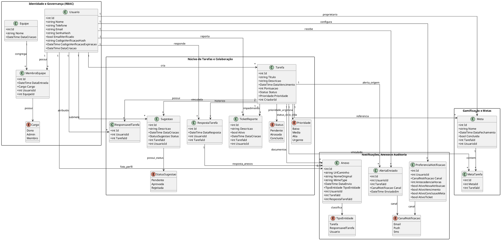

---

### 1.3. Visões Modulares por Subdomínio

#### Subdomínio A: Workflow de Tarefas, Colaboração e Anexos

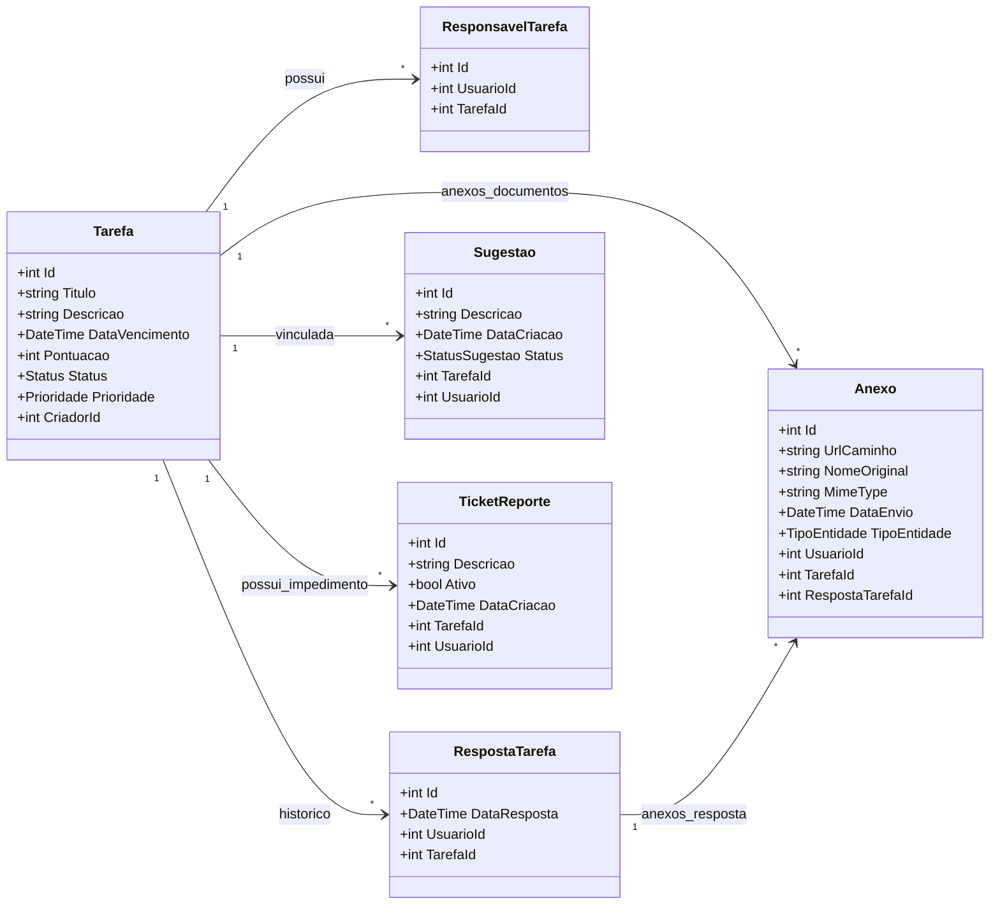

#### Subdomínio B: Governança de Equipes e Preferências de Alertas

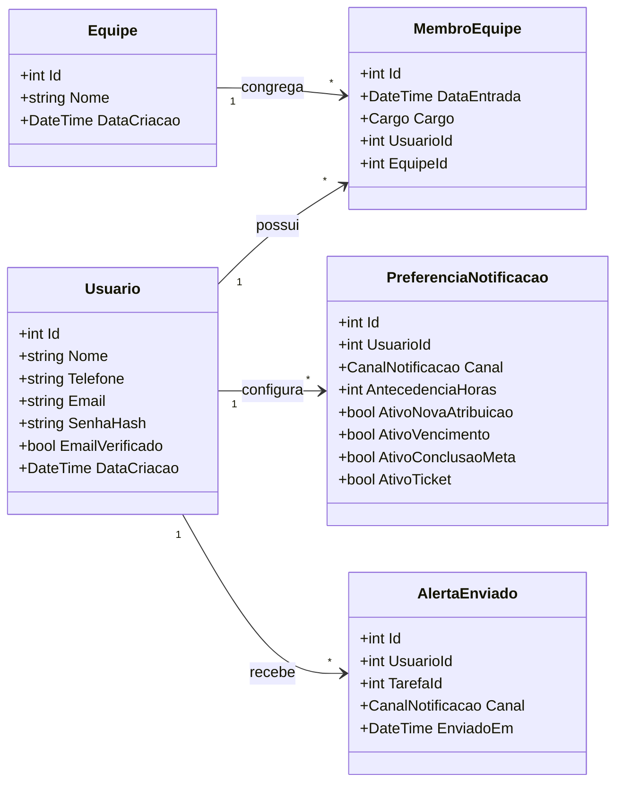

#### Subdomínio C: Metas e Gamificação

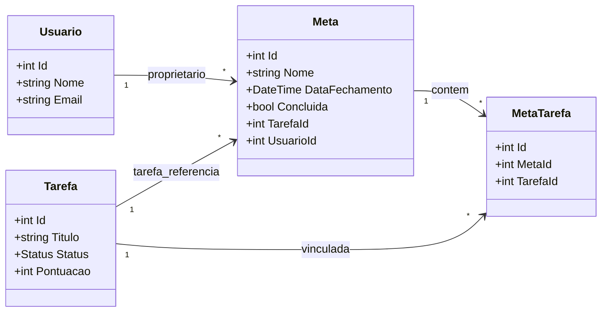

### Detalhamento dos Mapeamentos e Restrições de Domínio

| Entidade | Tabela | Descrição e Regras Chave |
| :--- | :--- | :--- |
| **`Usuario`** | `Usuarios` | Contém credenciais com hash BCrypt (`SenhaHash`), flag de verificação de e-mail (RN13) e índice único no e-mail (RN01). Não pode ser excluído caso possua tarefas pendentes (RN05). |
| **`Tarefa`** | `Tarefas` | Núcleo do sistema. Controla status, prioridade e vencimento. Atualizações de status recalculam metas (RN08) e tarefas com prazo vencido transicionam para `Atrasada` (RN06). |
| **`Equipe`** | `Equipes` | Agrupamento corporativo de usuários. |
| **`MembroEquipe`**| `MembrosEquipe` | Tabela associativa com controle de cargos RBAC (`Dono`, `Admin`, `Membro`). Apenas donos alteram cargos (RN03) e apenas donos/admins gerenciam membros (RN04). |
| **`ResponsavelTarefa`** | `ResponsaveisTarefa` | Usuários responsáveis pela execução da tarefa. Permite atribuição unitária ou em lote por equipe. |
| **`Sugestao`** | `Sugestoes` | Permite que responsáveis sugiram ajustes de escopo/prazo. Exige aprovação explícita do criador da tarefa (RN14 / RF004). |
| **`Meta`** | `Metas` | Metas vinculadas a tarefas (RN07). Validade máxima de 12 meses (RN15) e conclusão automática baseada no status de todas as tarefas vinculadas (RN08). |
| **`MetaTarefa`** | `MetasTarefas` | Tabela associativa N:N entre `Meta` e `Tarefa`. |
| **`TicketReporte`** | `TicketReporte` | Chamado de impedimento aberto pelo executor da tarefa direcionado a administradores e donos (RF008). |
| **`Anexo`** | `Anexos` | Armazenamento de metadados e caminhos físicos de arquivos associados a tarefas, respostas ou usuários. |
| **`PreferenciaNotificacao`** | `PreferenciasNotificacao` | Configurações personalizadas por canal (Email, Push, SMS) e janela de antecedência entre 1h e 168h (RN11). |
| **`AlertaEnviado`** | `AlertasEnviados` | Registro de disparos efetuados para evitar notificações duplicadas ou fora da janela válida (RN12). |

---

## 2. Diagrama de Objetos (Instâncias em Tempo de Execução)

O diagrama de objetos abaixo ilustra um **cenário real de execução** no Cortex Backend:
- Uma **Tarefa Atribuída** (`tarefa101`), criada por um usuário administrador (`usuarioCriador`) e atribuída a um desenvolvedor (`usuarioExecutor`) através do objeto associativo `respTarefa50`.
- Um **Ticket de Reporte** (`ticketReporte7`), aberto pelo executor para alertar a liderança sobre um impedimento técnico impeditivo (**RF008**).
- Uma **Meta Corporativa** (`metaQ4`), criada pela administradora e associada à tarefa através de `metaTarefaLink` (**RN07**). O estado atual reflete a **RN08**: como a tarefa associada ainda está com `Status = Pendente`, o atributo `Concluida` da meta permanece `false`.

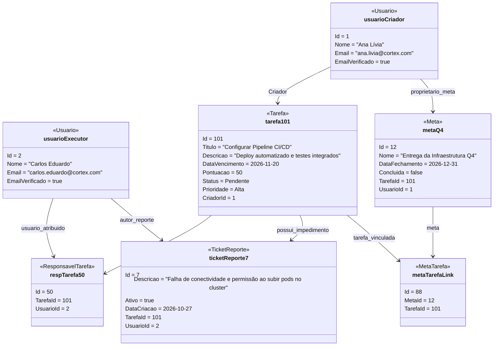

### Especificação dos Objetos e Valores de Estado

| Instância do Objeto | Classe de Origem | Papel no Cenário | Atributos e Estado em Tempo de Execução |
| :--- | :--- | :--- | :--- |
| **`usuarioCriador`** | `Usuario` | Criadora da Tarefa e Gestora da Meta | `Id: 1`, `Nome: "Ana Lívia"`, `Email: "ana.livia@cortex.com"`, `EmailVerificado: true`. |
| **`usuarioExecutor`** | `Usuario` | Executor Atribuído e Autor do Ticket | `Id: 2`, `Nome: "Carlos Eduardo"`, `Email: "carlos.eduardo@cortex.com"`, `EmailVerificado: true`. |
| **`tarefa101`** | `Tarefa` | Tarefa em Andamento com Impedimento | `Id: 101`, `Titulo: "Configurar Pipeline CI/CD"`, `Status: Pendente`, `Prioridade: Alta`, `Pontuacao: 50`, `CriadorId: 1`. |
| **`respTarefa50`** | `ResponsavelTarefa` | Vínculo de Atribuição da Tarefa | `Id: 50`, `TarefaId: 101`, `UsuarioId: 2`. Liga o executor `usuarioExecutor` à tarefa. |
| **`ticketReporte7`** | `TicketReporte` | Chamado de Bloqueio Técnico (**RF008**) | `Id: 7`, `Descricao: "Falha de conectividade..."`, `Ativo: true`, `TarefaId: 101`, `UsuarioId: 2`. Roteado para a gestão. |
| **`metaQ4`** | `Meta` | Meta Corporativa Vinculada (**RF007**) | `Id: 12`, `Nome: "Entrega da Infraestrutura Q4"`, `DataFechamento: 2026-12-31`, `Concluida: false` (regra **RN08**), `UsuarioId: 1`. |
| **`metaTarefaLink`** | `MetaTarefa` | Vínculo Associativo N:N (**RN07**) | `Id: 88`, `MetaId: 12`, `TarefaId: 101`. Garante que a meta possui pelo menos uma tarefa associada. |

---

## 3. Diagrama de Casos de Uso do Sistema

Para garantir **alta legibilidade**, organização visual e aderência às melhores práticas de engenharia de software da UML, a modelagem de casos de uso do **Cortex** é apresentada em duas camadas:
1. **Visão Macrossistêmica**: Relaciona os atores aos 3 grandes pacotes funcionais sem cruzamentos de linhas.
2. **Visões Especializadas por Módulo**:
   - **3.1 Módulo de Tarefas, Colaboração e Impedimentos** (fluxo operacional de tarefas, sugestões e tickets).
   - **3.2 Módulo de Governança de Equipes e Identidade** (RBAC, membros, cargos e conta).
   - **3.3 Módulo de Metas, Relatórios e Serviços em Background** (gamificação, métricas e automações).
3. **Matriz Geral de Casos de Uso**.
4. **Especificação Textual Detalhada (Cenários Ótimos e Alternativos)**.

---

### Visão Macrossistêmica (Atores e Pacotes Funcionais)

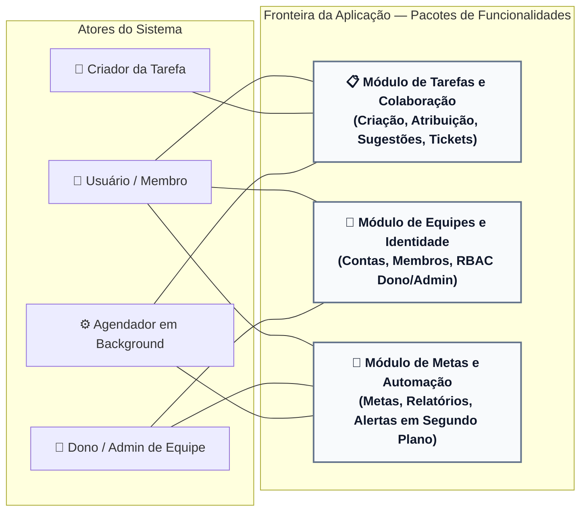

---

### 3.1 Módulo de Tarefas, Colaboração e Impedimentos

Este diagrama detalha o ciclo operacional completo da tarefa: criação com anexos, atribuição, colaboração através de sugestões e abertura de chamados técnicos de impedimento.

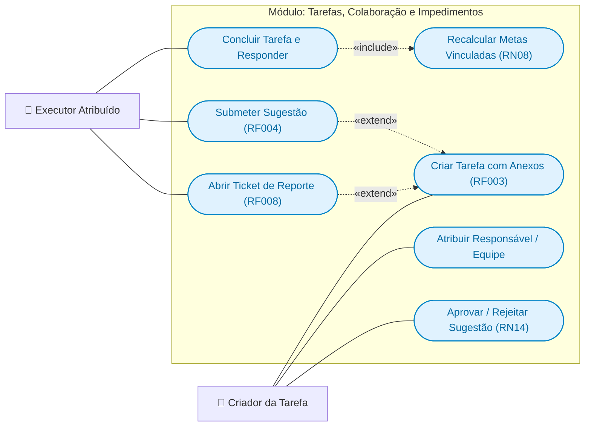

---

### 3.2 Módulo de Governança de Equipes e Identidade (RBAC)

Apresenta as operações de gestão de conta, preferências e o controle de acesso baseado em papéis corporativos (`Dono`, `Admin`, `Membro`), destacando as regras de concessão e modificação de cargos.

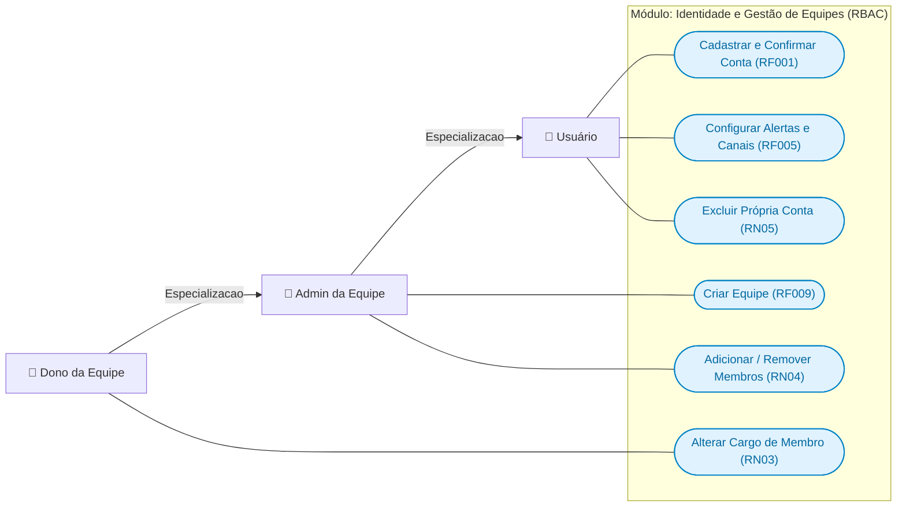

---

### 3.3 Módulo de Metas, Relatórios e Automação em Background

Exibe o acompanhamento de metas vinculadas a tarefas, a restrição de visibilidade de relatórios de produtividade e os serviços autônomos em segundo plano.

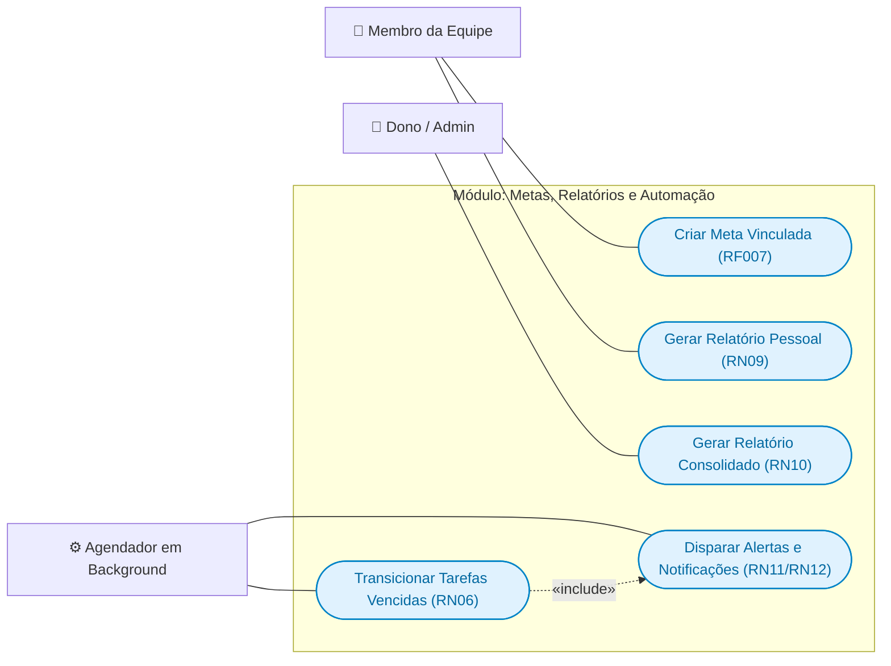

---

### Especificação dos Casos de Uso Principais

| Código | Caso de Uso | Ator Primário | Regras de Negócio Chave |
| :--- | :--- | :--- | :--- |
| **UC01** | Cadastrar e Confirmar Conta | Usuário Não Autenticado | **RN01** (e-mail único), **RN02** (complexidade de senha), **RN13** (código de verificação). |
| **UC02** | Configurar Alertas e Canais | Usuário | **RN11** (janela de antecedência entre 1h e 168h), canais (Email, Push, SMS). |
| **UC03** | Excluir Própria Conta | Usuário | **RN05** (bloqueio se houver tarefas ativas ou pendentes atribuídas). |
| **UC04** | Criar Equipe | Dono / Admin | **RF009** (criação da equipe e inserção inicial como Dono). |
| **UC05** | Gerenciar Membros | Dono / Admin | **RN04** (somente Dono e Admin adicionam ou removem membros da equipe). |
| **UC06** | Alterar Cargo de Membro | Dono | **RN03** (somente o Dono da equipe pode alterar cargo de outro membro). |
| **UC07** | Criar Tarefa com Anexos | Usuário | **RF003** (controle de prazo UTC, anexos com validação de tipo e tamanho). |
| **UC08** | Atribuir Responsável / Equipe | Criador da Tarefa / Admin | Atribuição individual (`ResponsavelTarefa`) ou em lote por equipe. |
| **UC09** | Concluir Tarefa / Enviar Resposta | Responsável | Dispara atualização automática de metas vinculadas (**RN08**). |
| **UC10** | Submeter Sugestão de Alteração | Responsável | **RF004** (apenas responsáveis pela tarefa podem submeter sugestões). |
| **UC11** | Aprovar / Rejeitar Sugestão | Criador da Tarefa | **RN14** (aprovação explícita do criador da tarefa para surtir efeito). |
| **UC12** | Abrir Ticket de Reporte | Responsável | **RF008** (reporta impedimento técnico diretamente aos administradores). |
| **UC13** | Criar Meta Vinculada | Usuário | **RN07** (mínimo 1 tarefa válida), **RN15** (fechamento em até 12 meses). |
| **UC14** | Gerar Relatório Pessoal | Membro | **RN09** (membros comuns só acessam métricas de suas próprias tarefas). |
| **UC15** | Gerar Relatório Consolidado | Dono / Admin | **RN10** (extração de relatórios consolidados por equipe, período e status). |
| **UC16** | Transicionar Tarefas Atrasadas | Agendador (Sistema) | **RN06** (marca `Atrasada` quando `DataVencimento < UtcNow` e notifica). |
| **UC17** | Disparar Notificações | Agendador (Sistema) | **RN12** (descarta alertas expirados), **RNF10** (envio assíncrono). |
| **UC18** | Recalcular Conclusão de Metas | Agendador / TarefaService | **RN08** (conclui meta quando todas as tarefas vinculadas estão concluídas). |

---

### 3.4. Cenários Ótimos e Alternativos do Sistema

Os cenários ótimos e alternativos são utilizados para realizar a avaliação dos requisitos e verificá-los por meio de cenários o que aconteceria no melhor fluxo e o que aconteceria no pior deles.

Um cenário ótimo refere-se a uma situação ideal ou resultado desejado para o projeto. É a condição em que todas as variáveis e fatores estão alinhados para atender ou exceder as expectativas do projeto.

Já os cenários alternativos referem-se a diferentes condições ou eventos que podem ocorrer durante a execução do projeto, divergindo do plano original. Esses cenários são preparados para garantir que a equipe do projeto esteja pronta para lidar com mudanças e desafios. A seguir, estão listados ambos os cenários para as funcionalidades deste projeto.

#### 3.4.1. Cenários Ótimos — Colaborador / Membro

1. O Colaborador irá efetuar o acesso à plataforma:
   1.1 RF01 – O sistema exibe ao colaborador os campos para inserir suas informações de login e senha, também podendo criar sua conta para primeiro acesso e o botão "Esqueci minha senha".
   1.2 RF02 – O colaborador efetua login com as credenciais cadastradas e o sistema gera o token de autenticação seguro.
   1.3 RF01 – O colaborador solicita recuperação de acesso. O sistema encaminhará um e-mail com código de validação para redefinição da senha.

2. O Colaborador seleciona a opção desejada no painel de Tarefas:
   Caso opção Início / Tarefas o colaborador poderá:
   'Pesquisar e Filtrar':
   2.1 RF03 – O sistema habilita campos de busca e filtros por status, prioridade e responsáveis para seleção direta da atividade.
   'Visualizar Tarefa':
   2.2 RF03 – O sistema exibe os detalhes da tarefa, prazos, pontuação, histórico e arquivos anexados.
   'Concluir Tarefa':
   2.3 RF03 – O colaborador confirma a conclusão da tarefa e envia comentários ou arquivos comprobatórios.
   2.4 RF03 – O sistema atualiza o status para concluída e armazena os dados deixados pelo colaborador.
   'Sugerir Alteração':
   2.5 RF04 – O colaborador informa a descrição e justificativa de ajuste na tarefa e confirma o envio.
   2.6 RF04 – O sistema armazena a sugestão com status pendente e notifica o criador da tarefa.
   'Reportar Impedimento':
   2.7 RF08 – O colaborador preenche o motivo do bloqueio técnico e submete o ticket de reporte.
   2.8 RF08 – O sistema registra o chamado como ativo e alerta as lideranças da equipe.

3. Caso opção Metas e Produtividade o colaborador poderá:
   'Visualizar Metas':
   3.1 RF07 – O sistema exibe a lista de metas vinculadas e o percentual atingido com base no término das tarefas.
   'Gerar Relatório':
   3.2 RF06 – O sistema gera o relatório pessoal contendo o histórico de tarefas concluídas e pontos acumulados.

4. Caso opção Configurações de Conta:
   'Configurar Notificações':
   4.1 RF05 – O colaborador seleciona os canais de recebimento (E-mail, Push, SMS) e define as horas de antecedência dos alertas.
   'Excluir Conta':
   4.2 RF01 – O colaborador confirma a exclusão de seu perfil mediante confirmação da senha cadastrada.

#### 3.4.2. Cenários Alternativos — Colaborador / Membro

1. **E-mail já cadastrado na plataforma**:
   O sistema identifica que o e-mail informado já existe na base e exibe mensagem em tela "E-mail já está cadastrado", conduzindo o usuário a retornar ao login ou utilizar a recuperação de senha.

2. **Arquivo de anexo com tamanho ou formato incompatível**:
   O colaborador anexa arquivo que excede o limite de 10MB ou com extensão não permitida. O sistema exibe mensagem de erro na tela e recusa o envio do documento.

3. **Submissão de sugestão sem ser responsável pela tarefa**:
   O colaborador tenta sugerir alterações em uma atividade que não está sob sua responsabilidade. O sistema bloqueia a ação e exibe mensagem de permissão negada.

4. **Tentativa de exclusão de conta com tarefas pendentes**:
   O colaborador solicita a exclusão de conta possuindo tarefas pendentes ou atrasadas atribuídas a ele. O sistema impede a exclusão e exibe mensagem em tela orientando a concluir ou reatribuir as tarefas antes de encerrar o perfil.

5. **Código de verificação incorreto ou expirado**:
   O colaborador insere código de recuperação de senha vencido ou incorreto. O sistema emite mensagem de validação inválida e disponibiliza opção para reenvio.

#### 3.4.3. Cenários Ótimos — Administrador / Gestor

1. O sistema recebe, processa e autentica as informações do Administrador:
   1.1 RF02 – Login: O sistema valida as credenciais de acesso, confirma permissão de liderança e libera o painel administrativo.
   1.2 RF09 – Gestão de Equipes: O sistema identifica as equipes vinculadas ao administrador, listando integrantes e respectivos cargos.

2. O Administrador gerencia o fluxo de trabalho e tarefas:
   'Criar Tarefa':
   2.1 RF03 – O administrador preenche título, descrição, data de vencimento futura, nível de prioridade e anexa arquivos complementares.
   2.2 RF03 – O sistema armazena a tarefa com status inicial pendente.
   'Atribuir Responsáveis':
   2.3 RF03 – O administrador seleciona o colaborador ou equipe inteira para execução da tarefa.
   2.4 RF03 – O sistema vincula os responsáveis e encaminha notificação aos designados.
   'Avaliar Sugestões':
   2.5 RF04 – O criador da tarefa avalia a sugestão enviada pelo colaborador e confirma a aprovação.
   2.6 RF04 – O sistema atualiza a descrição da tarefa principal, define a sugestão como aprovada e notifica o solicitante.
   'Tratar Impedimentos':
   2.7 RF08 – O administrador analisa o chamado de impedimento e, após solucionar o bloqueio, marca o ticket como concluído.

3. O Administrador gerencia metas e relatórios corporativos:
   'Criar Meta':
   3.1 RF07 – O gestor define o nome da meta, data limite de fechamento de até 12 meses e seleciona as tarefas vinculadas.
   3.2 RF07 – O sistema valida os vínculos, calcula o estado inicial de conclusão e armazena a meta.
   'Emitir Relatório Consolidado':
   3.3 RF06 – O sistema processa os filtros por período, equipe e colaboradores, gerando a listagem analítica com taxas de entrega e produtividade.

4. O sistema processa rotinas automáticas em segundo plano:
   4.1 RF03 / RF05 – O sistema monitora as datas de vencimento, atualiza tarefas vencidas para o status atrasada e dispara alertas nos canais configurados.

#### 3.4.4. Cenários Alternativos — Administrador / Gestor

1. **Alteração de cargo por usuário sem perfil de Dono**:
   Um administrador comum tenta alterar o nível de acesso de outro integrante. O sistema valida as permissões e exibe mensagem em tela informando que apenas o Dono da equipe pode alterar cargos.

2. **Criação de meta sem tarefas associadas**:
   O gestor tenta salvar uma meta sem selecionar ao menos uma tarefa de referência. O sistema emite mensagem de aviso informando a obrigatoriedade de vincular tarefas válidas.

3. **Prazo de fechamento de meta superior a 12 meses**:
   O gestor informa data de conclusão superior a 1 ano. O sistema barra o salvamento e apresenta mensagem de correção da data limite.

4. **Atribuição duplicada de colaborador**:
   O gestor tenta atribuir um colaborador que já consta como responsável pela tarefa. O sistema emite mensagem em tela informando que o usuário já está atribuído.

5. **Prazo de entrega retroativo**:
   O gestor tenta cadastrar tarefa com data anterior ao momento atual. O sistema valida os dados e orienta o preenchimento de uma data de vencimento futura.

## 4. Diagramas de Sequência (Padrão BCE com Métodos Reais do Código)

Os diagramas de sequência a seguir seguem o formato de **Análise de Robustez / BCE (Boundary - Control - Entity)** da referência, utilizando os **métodos, entidades, DTOs e serviços reais implementados no backend do Cortex**:
- **Fronteira (`:AppCortex`)**: Interface / camada de apresentação que consome a API REST.
- **Controle (`:Controle`)**: Controlador e serviço de aplicação (`TarefaService`, `SugestaoService`, `MetaService`).
- **Entidades (`:Usuario`, `:Anexo`, `:Tarefa`, `:ResponsavelTarefa`, `:Sugestao`, `:Meta`, `:MetaTarefa`)**: Entidades de domínio e repositórios de persistência.

---

### 4.1. `sd CriarTarefa`

Fluxo real de criação de tarefa:
1. `AppCortex` solicita a resolução do usuário criador autenticado via `ObterUsuarioPorIdAsync(criadorId)`.
2. Se houver anexos (`IFormFile`), aciona a validação de arquivo via `ValidarAnexoTarefa(arquivo)`.
3. Executa a criação e persistência da tarefa via `AdicionarTarefaAsync(tarefa)`, retornando o DTO consolidado `ConsultaTarefaDTO`.

#### Renderização Mermaid:
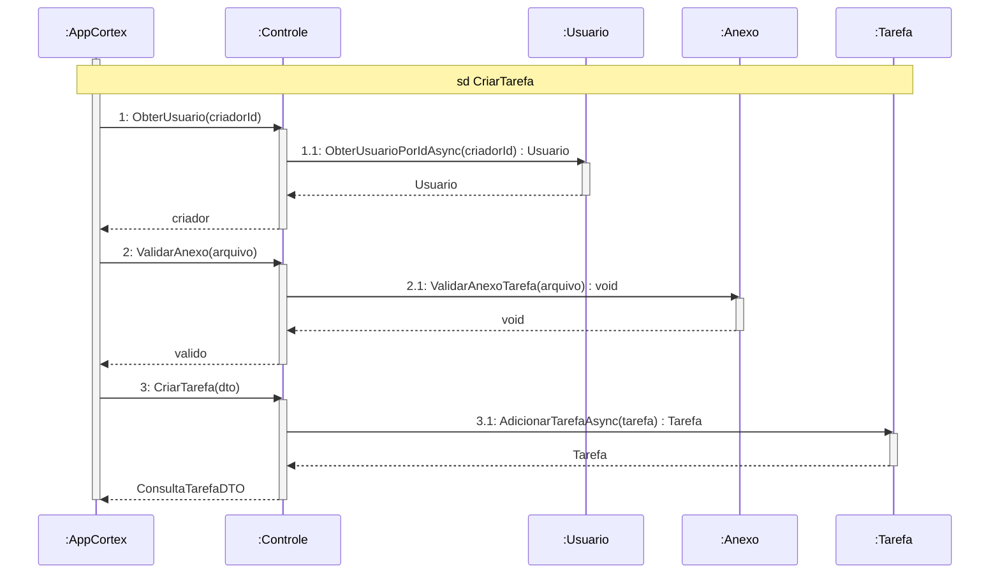

#### Código PlantUML (Ícones Nativos BCE):
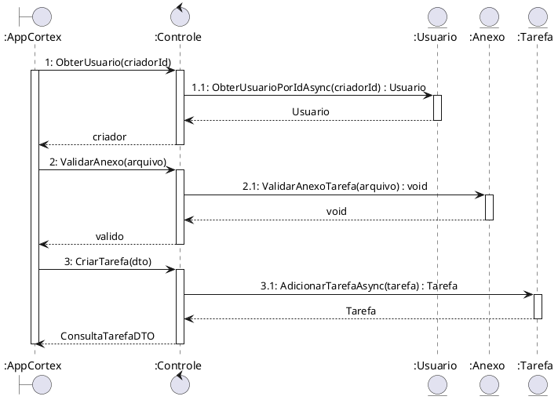

---

### 4.2. `sd CriarSugestao`

Fluxo real de criação de sugestão de alteração (requisito **RF004**):
1. `AppCortex` solicita a busca da tarefa alvo via `ObterTarefaPorIdAsync(tarefaId)`.
2. Valida se o solicitante autenticado é de fato um responsável atribuído à tarefa via `ResponsavelJaAtribuidoAsync(tarefaId, usuarioId)`.
3. Registra a nova sugestão de alteração com status pendente via `AdicionarSugestaoAsync(sugestao)`, retornando `ConsultaSugestaoDTO`.

#### Renderização Mermaid:
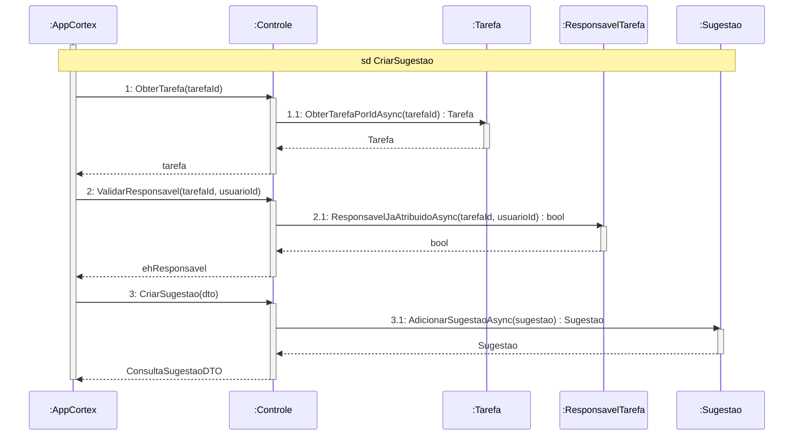

#### Código PlantUML (Ícones Nativos BCE):
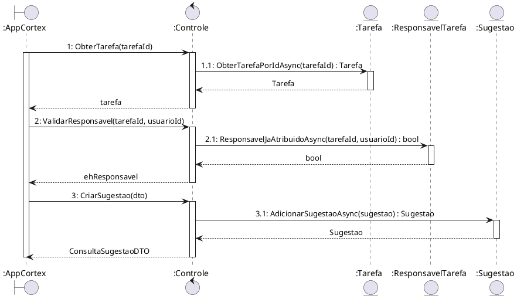

---

### 4.3. `sd CriarMeta`

Fluxo real de criação de meta (requisito **RF007**):
1. `AppCortex` requisita a verificação e obtenção das tarefas vinculadas via `ObterTarefaPorIdAsync(tarefaId)`.
2. Cria os objetos de relacionamento associativo N:N via `AdicionarMetaTarefa(tarefaId)` (**RN07**).
3. Persiste a meta com cálculo do status concluído (**RN08**) via `AdicionarMetaAsync(meta)`, retornando `ConsultaMetaDTO`.

#### Renderização Mermaid:
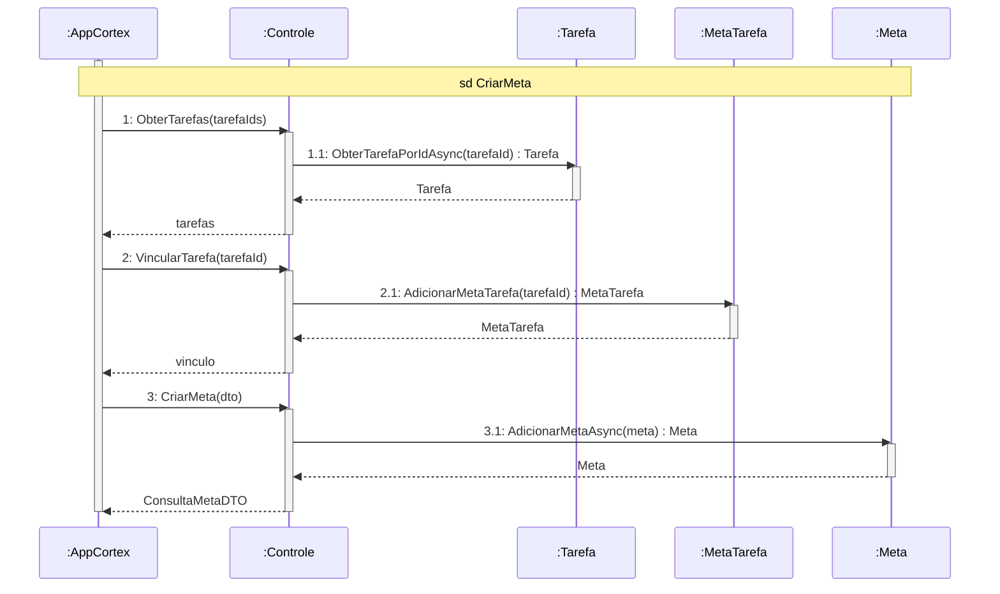

#### Código PlantUML (Ícones Nativos BCE):
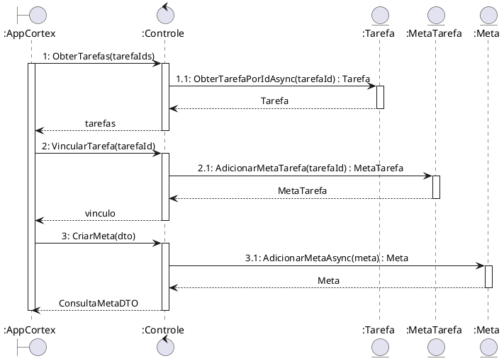

---

### 4.4. Diagramas de Sequência — Envio de Notificações (Push, E-mail e SMS)

Os diagramas a seguir representam o ciclo de envio assíncrono de notificações ([RNF10](file:///c:/Users/yuma2/Repositorios/Cortex-backend/AGENTS.md)) para os três canais suportados pelo Cortex Backend ([CanalNotificacao](file:///c:/Users/yuma2/Repositorios/Cortex-backend/Entities/ENUMS/CanalNotificacao.cs): `Push`, `Email` e `Sms`), seguindo a arquitetura de interação entre o **Colaborador**, o **App Cortex**, o **Servidor de Backend** e os **Gateways Externos** de comunicação.

---

#### 4.4.1. Envio de Notificação Push (FCM / APNs)

Mapeia o registro do token do dispositivo no primeiro logon do colaborador e o disparo de notificação push quando uma tarefa é atribuída ou quando um alerta de vencimento é processado.

##### Renderização Mermaid:
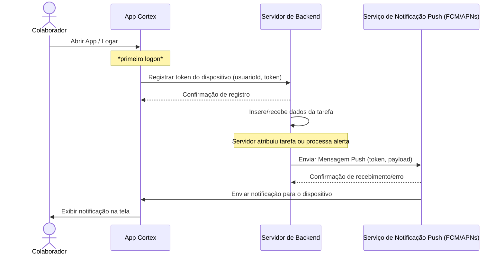

##### Código PlantUML:
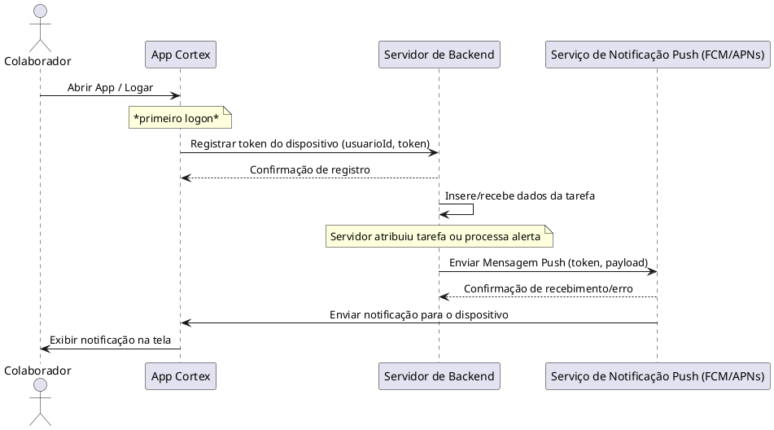

---

#### 4.4.2. Envio de Notificação por E-mail (SMTP / SendGrid)

Mapeia o ciclo de entrega de alertas por e-mail com a validação mandatória da regra **RN13** (o envio só é autorizado caso o e-mail do colaborador esteja com `EmailVerificado == true`).

##### Renderização Mermaid:
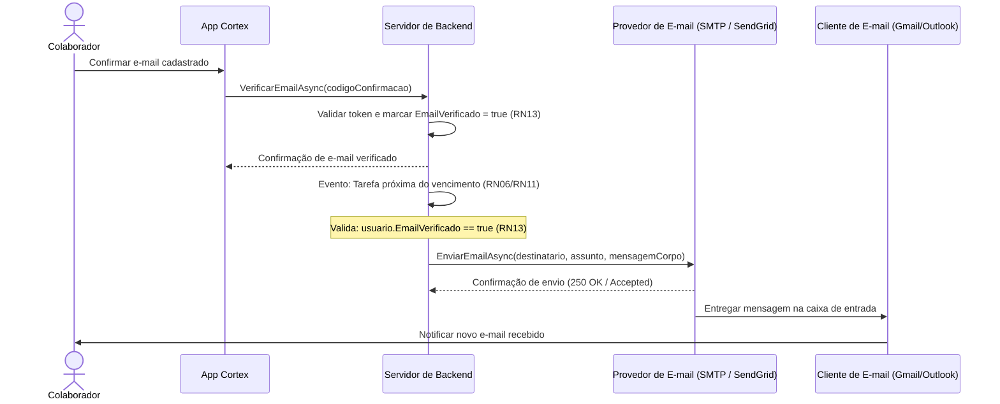

##### Código PlantUML:
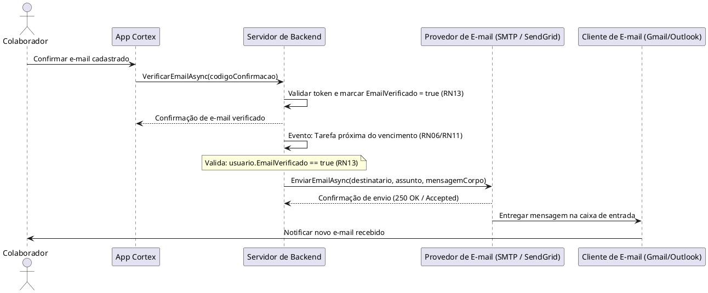

---

#### 4.4.3. Envio de Notificação por SMS (Gateway de Telefonia)

Mapeia o envio de mensagens SMS via operadora de telefonia para eventos críticos (como abertura de chamado técnico de impedimento - **RF008** ou prazos iminentes), validando o número telefônico cadastrado.

##### Renderização Mermaid:
```mermaid
sequenceDiagram
    actor Colaborador as Colaborador
    participant AppCortex as App Cortex
    participant Backend as Servidor de Backend
    participant SmsGateway as Gateway de SMS (Twilio/Zenvia)
    participant Celular as Dispositivo Móvel (Rede Celular)

    Colaborador->>AppCortex: Cadastrar telefone celular no perfil
    AppCortex->>Backend: AtualizarUsuarioAsync(telefone)
    Backend-->>AppCortex: Confirmação de perfil atualizado

    Backend->>Backend: Evento: Ticket de Reporte aberto / Alerta de Prazo
    Note over Backend: Valida: telefone presente e canal SMS ativo

    Backend->>SmsGateway: EnviarSmsAsync(telefone, mensagem)
    SmsGateway-->>Backend: Confirmação de despacho / MessageId
    SmsGateway->>Celular: Transmitir SMS via operadora
    Celular->>Colaborador: Exibir mensagem SMS na tela
```

##### Código PlantUML:
```plantuml
@startuml
skinparam sequenceMessageAlign center
actor Colaborador
participant "App Cortex" as AppCortex
participant "Servidor de Backend" as Backend
participant "Gateway de SMS (Twilio/Zenvia)" as SmsGateway
participant "Dispositivo Móvel (Rede Celular)" as Celular

Colaborador -> AppCortex : Cadastrar telefone celular no perfil
AppCortex -> Backend : AtualizarUsuarioAsync(telefone)
Backend --> AppCortex : Confirmação de perfil atualizado

Backend -> Backend : Evento: Ticket de Reporte aberto / Alerta de Prazo
note over Backend : Valida: telefone presente e canal SMS ativo

Backend -> SmsGateway : EnviarSmsAsync(telefone, mensagem)
SmsGateway --> Backend : Confirmação de despacho / MessageId
SmsGateway -> Celular : Transmitir SMS via operadora
Celular -> Colaborador : Exibir mensagem SMS na tela
@enduml
```

---

#### 4.4.4. Visão Arquitetural Unificada — Roteamento Multi-Canal (`NotificacaoService`)

Consolidação da lógica interna do método `EnviarNotificacaoAsync` no `NotificacaoService`, mostrando o roteamento assíncrono para cada gateway conforme as preferências do usuário ([RN11](file:///c:/Users/yuma2/Repositorios/Cortex-backend/AGENTS.md)) e persistência do histórico em `AlertasEnviados`.

##### Renderização Mermaid:
```mermaid
sequenceDiagram
    participant Backend as Cortex Backend (NotificacaoService)
    participant DB as PostgreSQL (Preferencias / Alertas)
    participant Push as IPushGateway (FCM/APNs)
    participant Email as IEmailGateway (SMTP)
    participant SMS as ISmsGateway (Twilio)

    Backend->>DB: ObterPreferenciasAsync(usuarioId)
    DB-->>Backend: PreferenciaNotificacao (Canal, Antecedencia, Ativo)

    alt Canal == Push
        Backend->>Push: EnviarPushAsync(usuarioId, assunto, mensagem)
        Push-->>Backend: bool sucesso
    else Canal == Email (Valida RN13: EmailVerificado)
        Backend->>Email: EnviarEmailAsync(email, assunto, mensagem)
        Email-->>Backend: bool sucesso
    else Canal == Sms (Valida telefone presente)
        Backend->>SMS: EnviarSmsAsync(telefone, mensagem)
        SMS-->>Backend: bool sucesso
    end

    opt Envio bem-sucedido
        Backend->>DB: RegistrarAlertaEnviadoAsync(usuarioId, tarefaId, canal)
    end
```

---

## 5. Diagrama de Componentes (4.4.7 Diagrama de Componentes)

O diagrama de componentes abaixo segue estritamente a modelagem arquitetural apresentada na especificação do sistema, estruturado em **4 pacotes principais** com o ator **Administrador** interagindo com a camada de apresentação:

1. **Camada de Apresentação**: Componente `Front-end Web` (contendo formulários e visualização de tarefas).
2. **Camada de Negócio / API**: Serviços de aplicação (`Serviço de Categorias`, `Serviço de Autenticação`, `Serviço de Usuários`, `Serviço de Tarefas`, `Serviço de Sugestões`, `Serviço de Relatórios`, `Serviço de Equipes`, `Serviço de Metas` e `Serviço de Tickets`).
3. **Camada de Persistência**: Componentes representando as tabelas do banco de dados relacional (`Tabela Usuário`, `Tabela Tarefa`, `Tabela Cargo`, `Tabela Prioridade`, `Tabela Anexo`, `Tabela Categoria`, `Tabela Status`, `Tabela Meta`, `Tabela Sugestão`, `Tabela TicketReport`).
4. **Serviços Externos**: Provedores de integração assíncrona (`Serviço de E-mail`, `Serviço de SMS`, `Serviço de Calendário`, `Serviço de Backup` e `Serviço de Push`).

### Diagrama em Mermaid

```mermaid
flowchart TB
    Admin(("👤 Administrador"))

    subgraph CamadaApresentacao["Camada de Apresentação"]
        Frontend["<b>Front-end Web</b><br/>• Formulários<br/>• Visualização de tarefas"]
    end

    subgraph CamadaNegocio["Camada de Negócio / API"]
        direction TB
        S_Cat["Serviço de Categorias"]
        S_Auth["Serviço de Autenticação"]
        S_User["Serviço de Usuários"]
        S_Tarefa["Serviço de Tarefas"]
        S_Sug["Serviço de Sugestões"]
        S_Rel["Serviço de Relatórios"]
        S_Equipe["Serviço de Equipes"]
        S_Meta["Serviço de Metas"]
        S_Ticket["Serviço de Tickets / Reportes"]
    end

    subgraph CamadaPersistencia["Camada de Persistência"]
        direction TB
        T_User["Tabela Usuário"]
        T_Tarefa["Tabela Tarefa"]
        T_Cargo["Tabela Cargo"]
        T_Prioridade["Tabela Prioridade"]
        T_Anexo["Tabela Anexo"]
        T_Cat["Tabela Categoria"]
        T_Status["Tabela Status"]
        T_Meta["Tabela Meta"]
        T_Sug["Tabela Sugestão"]
        T_Ticket["Tabela TicketReport"]
    end

    subgraph ServicosExternos["Serviços Externos"]
        direction TB
        Ext_Email["Serviço de E-mail"]
        Ext_SMS["Serviço de SMS"]
        Ext_Cal["Serviço de Calendário"]
        Ext_Backup["Serviço de Backup"]
        Ext_Push["Serviço de Push (FCM/APNs)"]
    end

    Admin --> Frontend
    Frontend --> CamadaNegocio
    CamadaNegocio --> CamadaPersistencia
    CamadaNegocio --> ServicosExternos
```

### Especificação no Padrão PlantUML

```plantuml
@startuml
skinparam componentStyle uml2
skinparam packageStyle rectangle

title Diagrama de Componentes

actor "Administrador" as Admin

package "Camada de Apresentação" {
    component "Front-end Web" as Frontend {
        note as N1
            • Formulários
            • Visualização de tarefas
        end note
    }
}

package "Camada de Negócio / API" {
    component "Serviço de Categorias" as S_Cat
    component "Serviço de Autenticação" as S_Auth
    component "Serviço de Usuários" as S_User
    component "Serviço de Tarefas" as S_Tarefa
    component "Serviço de Sugestões" as S_Sug
    component "Serviço de Relatórios" as S_Rel
    component "Serviço de Equipes" as S_Equipe
    component "Serviço de Metas" as S_Meta
    component "Serviço de Tickets" as S_Ticket
}

package "Camada de Persistência" {
    component "Tabela Usuário" as T_User
    component "Tabela Tarefa" as T_Tarefa
    component "Tabela Cargo" as T_Cargo
    component "Tabela Prioridade" as T_Prioridade
    component "Tabela Anexo" as T_Anexo
    component "Tabela Categoria" as T_Cat
    component "Tabela Status" as T_Status
    component "Tabela Meta" as T_Meta
    component "Tabela Sugestão" as T_Sug
    component "Tabela TicketReport" as T_Ticket
}

package "Serviços Externos" {
    component "Serviço de E-mail" as Ext_Email
    component "Serviço de SMS" as Ext_SMS
    component "Serviço de Calendário" as Ext_Cal
    component "Serviço de Backup" as Ext_Backup
}

Admin --> Frontend
Frontend --> "Camada de Negócio / API"
"Camada de Negócio / API" --> "Camada de Persistência"
"Camada de Negócio / API" --> "Serviços Externos"
@enduml
```

### Mapeamento dos Componentes para o Código do Backend

| Camada no Diagrama | Componente | Implementação Real no Projeto Cortex | Responsabilidade no Sistema |
| :--- | :--- | :--- | :--- |
| **Camada de Apresentação** | `Front-end Web` | SPA Web / App Mobile | Interface do usuário contendo formulários de criação/edição e telas de visualização e filtro de tarefas. |
| **Camada de Negócio / API** | `Serviço de Autenticação` | `TokenService` / `PasswordService` / `AuthController` | Geração de tokens JWT, hashing seguro via BCrypt e controle de sessão. |
| **Camada de Negócio / API** | `Serviço de Usuários` | `UsuarioService` / `UsuarioController` | Gerenciamento de perfil, cadastro e verificação de e-mail (**RN01**, **RN05**). |
| **Camada de Negócio / API** | `Serviço de Tarefas` | `TarefaService` / `TarefaController` | Workflow de criação, edição, delegação e conclusão de tarefas (**RF003**). |
| **Camada de Negócio / API** | `Serviço de Equipes` | `EquipeService` / `EquipeAuthorizationService` | Gestão de grupos e permissões baseadas em cargo: Dono, Admin, Membro (**RN03**, **RN04**). |
| **Camada de Negócio / API** | `Serviço de Metas` | `MetaService` / `MetaController` | Acompanhamento de metas vinculadas a tarefas e fechamento automático (**RN07**, **RN08**, **RN15**). |
| **Camada de Negócio / API** | `Serviço de Sugestões` | `SugestaoService` / `SugestaoController` | Submissão de propostas de alteração com aprovação pelo criador (**RF004**, **RN14**). |
| **Camada de Negócio / API** | `Serviço de Relatórios` | `RelatorioService` / `RelatorioController` | Emissão de relatórios e métricas com restrição de visibilidade por perfil (**RN09**, **RN10**). |
| **Camada de Negócio / API** | `Serviço de Tickets` | `TicketReporteService` / `TicketReporteController` | Canal de suporte e relato de impedimentos diretamente aos líderes (**RF008**). |
| **Camada de Persistência** | `Tabelas (Usuário, Tarefa, Meta, etc.)` | `CortexDbContext` & Repositórios EF Core 10 | Mapeamento relacional contra tabelas do PostgreSQL 16 com Enums nativos e constraints. |
| **Serviços Externos** | `Serviço de E-mail` | `IEmailGateway` (`EmailGatewayStub` / SMTP) | Disparo assíncrono de e-mails de confirmação e alertas de vencimento (**RN13**). |
| **Serviços Externos** | `Serviço de SMS` | `ISmsGateway` (`SmsGatewayStub` / Twilio) | Envio de mensagens curtas SMS para alertas críticos e tokens. |
| **Serviços Externos** | `Serviço de Calendário` | `AlertaVencimentoBackgroundService` | Agendamento e cálculo de janelas de vencimento (1 hora a 7 dias — **RN11**, **RN12**). |
| **Serviços Externos** | `Serviço de Backup` | Armazenamento de Anexos (`wwwroot/uploads`) | Persistência e backup de documentos e mídias anexadas às tarefas. |

---

## 6. Diagrama de Aplicação e Implantação (pkg)

O diagrama de aplicação abaixo reproduz com exatidão a modelagem de implantação física/lógica do exemplo de referência, inserido dentro do pacote **`pkg`**, evidenciando os nós computacionais com seus respectivos estereótipos UML (`<<desktop>>`, `<<servidor de aplicacao>>` e `<<Servidor DB>>`) e o protocolo de interconexão de rede **`TCP/IP`**.

### Diagrama em Mermaid

```mermaid
flowchart LR
    subgraph pkg["pkg"]
        direction LR
        Navegador["«desktop»<br/><b>Navegador</b>"]
        WEB["«servidor de aplicacao»<br/><b>WEB</b>"]
        PostgreSQL["«Servidor DB»<br/><b>PostgreSQL</b>"]

        Navegador ---|"TCP/IP"| WEB
        WEB ---|"TCP/IP"| PostgreSQL
    end
```

### Especificação no Padrão PlantUML

```plantuml
@startuml
skinparam nodeStyle uml2

package "pkg" {
    node "<<desktop>>\nNavegador" as Desktop
    node "<<servidor de aplicacao>>\nWEB" as AppServer
    node "<<Servidor DB>>\nPostgreSQL" as DbServer

    Desktop -- AppServer : TCP/IP
    AppServer -- DbServer : TCP/IP
}
@enduml
```

### Detalhamento dos Nós de Execução

| Nó no Diagrama | Estereótipo | Tecnologia e Runtime no Projeto | Descrição e Protocolos |
| :--- | :--- | :--- | :--- |
| **Navegador** | `<<desktop>>` | Browser Web (SPA React / Vue) | Dispositivo cliente do usuário final. Executa a interface web e estabelece conexão com a aplicação via protocolo HTTP/HTTPS sobre a pilha **TCP/IP** (Porta padrão 443/80). |
| **WEB** | `<<servidor de aplicacao>>` | ASP.NET Core Web API (.NET 10 / Kestrel) | Servidor de aplicação backend. Hospeda o pipeline de middlewares, controladores REST, serviços de negócio e *workers* em segundo plano, processando requisições e regras de negócio. |
| **PostgreSQL** | `<<Servidor DB>>` | PostgreSQL 16 Server Engine | Servidor de banco de dados relacional. Responsável pela persistência transacional ACID das tabelas e tipos Enums nativos, comunicando-se com a aplicação via driver Npgsql sobre **TCP/IP** (Porta 5432). |

---

## 7. Matriz de Rastreabilidade de Regras de Negócio Representadas

| Regra / Requisito | Título / Descrição | Como está refletida nos Diagramas |
| :--- | :--- | :--- |
| **RN01** | E-mail Único | Constraint e índice único no diagrama de classes na entidade `Usuario`, caso de uso `UC01` e validação no `UsuarioService`. |
| **RN02** | Complexidade de Senha | Criptografia com salt via `PasswordService` (`BCrypt.Net`), diagrama de componentes e caso de uso `UC01`. |
| **RN03 / RN04**| Cargos e Permissões em Equipes | Modelagem de `MembroEquipe` (`Dono`, `Admin`, `Membro`), serviço `EquipeAuthorizationService` e casos de uso `UC05` e `UC06`. |
| **RN05** | Impedimento de Exclusão de Conta | Caso de uso `UC03` com bloqueio se existirem tarefas ativas/pendentes atribuídas, validado em `UsuarioService`. |
| **RN06** | Tarefa Atrasada e Notificações | Enum `Status.Atrasada`, componente `TarefaStatusBackgroundService` e caso de uso `UC16`. |
| **RN07** | Vínculo Mínimo de Metas | No Diagrama de Objetos (`metaTarefaLink`), fluxo de Criação de Metas, `MetaService` e caso de uso `UC13`. |
| **RN08** | Conclusão Automática de Metas | No Diagrama de Objetos (`metaQ4.Concluida = false`), no fluxo de Criação de Metas, `MetaService` e caso de uso `UC18`. |
| **RN11** | Antecedência de Alertas | Configuração em `PreferenciaNotificacao` (1 a 168 horas), componente `AlertaVencimentoBackgroundService` e caso de uso `UC02`. |
| **RN12** | Descarte de Alertas Expirados | Validação temporal em `NotificacaoService` e descarte de disparos retroativos. |
| **RN13** | Confirmação de E-mail para Alertas | Validação em `NotificacaoService` e diagrama de sequência de notificações multi-canal. |
| **RN14** | Aprovação de Sugestões | No fluxo de Sugestões: estado `Pendente` com aprovação posterior exclusiva do criador (`UC11`) via `SugestaoService`. |
| **RN15** | Validade Máxima de Metas | No fluxo de Criação de Metas: validação de data limite de 12 meses no `MetaService` e caso de uso `UC13`. |
| **RF001** | Gerenciar Usuários | CRUD completo com `UsuarioController`, `UsuarioService` e `UsuarioRepository`. |
| **RF003** | Gerenciar Tarefas | CRUD com delegação em lote ou individual via `TarefaService` e `ResponsavelTarefaService`. |
| **RF004** | Permissão de Sugestão | No fluxo de Sugestões e caso de uso `UC10`: apenas responsáveis atribuídos podem sugerir. |
| **RF008** | Ticket de Reporte | No Diagrama de Objetos (`ticketReporte7`), associado à tarefa e ao executor, e no caso de uso `UC12`. |
| **RNF01** | Segurança & Autenticação | `JwtAuthenticationMiddleware`, extração segura de cookie HttpOnly e Bearer token. |
| **RNF04** | Concorrência e Transações | Execução assíncrona (`async/await`) em todas as camadas e isolamento no PostgreSQL via EF Core. |
| **RNF05** | Auditoria & Rastreabilidade | `Serilog` configurado no `Program.cs` gravando logs estruturados com rotação diária em `logs/cortex-.json`. |
| **RNF07** | Persistência PostgreSQL | Mapeamento integral no `CortexDbContext` com Enums nativos registrados via Npgsql. |
| **RNF08** | Desenvolvimento Seguro | `ExceptionHandlingMiddleware` padronizando RFC 7807 (`ProblemDetails`) e `RateLimitingMiddleware`. |
| **RNF09** | Performance de Ações Críticas | Queries LINQ otimizadas, connection pooling do Npgsql e indexação única e relacional. |
| **RNF10** | Serviço de Notificações Assíncrono | `IHostedService` rodando em segundo plano e gateways desacoplados de mensageria. |

---

## 8. Modelo Conceitual do Banco de Dados (MER)

O **Modelo Entidade-Relacionamento Conceitual (MER)** representa a visão abstrata e semântica do domínio de dados do **Cortex**, independente de particularidades físicas de implementação ou do SGBD PostgreSQL. O modelo descreve as entidades do negócio, seus atributos conceituais e os relacionamentos com suas respectivas cardinalidades (mínima e máxima).

### 8.1. Diagrama Conceitual (Mermaid)

```mermaid
erDiagram
    USUARIO {
        int id PK "Identificador único do usuário"
        string nome "Nome completo"
        string email UK "E-mail institucional único"
        string senha "Hash de autenticação"
        string telefone "Telefone para SMS"
        datetime data_criacao "Data de cadastro"
    }

    EQUIPE {
        int id PK "Identificador único da equipe"
        string nome "Nome da equipe"
        datetime data_criacao "Data de criação da equipe"
    }

    TAREFA {
        int id PK "Identificador único da tarefa"
        string titulo "Título sucinto da atividade"
        string descricao "Detalhamento e requisitos"
        datetime data_vencimento "Prazo limite para conclusão"
        int pontuacao "Pontuação de gamificação"
        enum status "Pendente, Atrasada ou Concluida"
        enum prioridade "Baixa, Media, Alta ou Urgente"
    }

    SUGESTAO {
        int id PK "Identificador único da sugestão"
        string descricao "Texto descritivo do ajuste sugerido"
        datetime data_criacao "Data de submissão"
        enum status "Pendente, Aprovada ou Rejeitada"
    }

    TICKET_REPORTE {
        int id PK "Identificador único do ticket"
        string descricao "Relato de impedimento ou problema"
        boolean ativo "Indicador de chamado ativo"
        datetime data_criacao "Data de abertura"
    }

    META {
        int id PK "Identificador único da meta"
        string nome "Objetivo estratégico"
        datetime data_fechamento "Prazo limite (máx 12 meses)"
        boolean concluida "Status de alcance da meta"
    }

    ANEXO {
        int id PK "Identificador único do anexo"
        string url_caminho "Localizador físico do arquivo"
        string nome_original "Nome original do arquivo"
        string mime_type "Tipo MIME validado"
        datetime data_envio "Timestamp do upload"
        enum tipo_entidade "Tarefa, ResponsavelTarefa, Usuario"
    }

    PREFERENCIA_NOTIFICACAO {
        int id PK "Identificador das preferências"
        enum canal "Email, Push ou Sms"
        int antecedencia_horas "Janela de alerta (1 a 168 horas)"
        boolean ativo_nova_atribuicao "Alerta para nova tarefa"
        boolean ativo_vencimento "Alerta para tarefa próxima do fim"
        boolean ativo_conclusao_meta "Alerta para alcance de meta"
        boolean ativo_ticket "Alerta para abertura de ticket"
    }

    ALERTA_ENVIADO {
        int id PK "Identificador do registro de envio"
        enum canal "Canal utilizado no disparo"
        datetime enviado_em "Timestamp de entrega no gateway"
    }

    %% Relacionamentos Semânticos
    USUARIO ||--o{ TAREFA : "cria"
    USUARIO }o--o{ EQUIPE : "integra (MembroEquipe: cargo, data)"
    USUARIO }o--o{ TAREFA : "atua_como_responsavel"
    USUARIO ||--o{ SUGESTAO : "submete"
    TAREFA ||--o{ SUGESTAO : "recebe"
    USUARIO ||--o{ TICKET_REPORTE : "abre"
    TAREFA ||--o{ TICKET_REPORTE : "origina_impedimento_em"
    USUARIO ||--o{ META : "gerencia"
    META }o--o{ TAREFA : "vincula_para_conclusao"
    USUARIO ||--o{ PREFERENCIA_NOTIFICACAO : "configura"
    USUARIO ||--o{ ALERTA_ENVIADO : "recebe"
    TAREFA ||--o{ ALERTA_ENVIADO : "gera_alerta"
    TAREFA ||--o{ ANEXO : "possui_documento"
    USUARIO ||--o| ANEXO : "possui_foto_perfil"
```

### 8.2. Especificação no Padrão PlantUML Conceitual

```plantuml
@startuml
skinparam linetype ortho
skinparam packageStyle rectangle

title Modelo Conceitual do Banco de Dados (MER) — Cortex

entity "USUARIO" as Usuario {
    * id : int <<PK>>
    --
    nome : string
    email : string <<UK>>
    senha : string
    telefone : string
    data_criacao : datetime
}

entity "EQUIPE" as Equipe {
    * id : int <<PK>>
    --
    nome : string
    data_criacao : datetime
}

entity "TAREFA" as Tarefa {
    * id : int <<PK>>
    --
    titulo : string
    descricao : string
    data_vencimento : datetime
    pontuacao : int
    status : enum
    prioridade : enum
}

entity "SUGESTAO" as Sugestao {
    * id : int <<PK>>
    --
    descricao : string
    data_criacao : datetime
    status : enum
}

entity "TICKET_REPORTE" as Ticket {
    * id : int <<PK>>
    --
    descricao : string
    ativo : boolean
    data_criacao : datetime
}

entity "META" as Meta {
    * id : int <<PK>>
    --
    nome : string
    data_fechamento : datetime
    concluida : boolean
}

entity "ANEXO" as Anexo {
    * id : int <<PK>>
    --
    url_caminho : string
    nome_original : string
    mime_type : string
    data_envio : datetime
    tipo_entidade : enum
}

entity "PREFERENCIA_NOTIFICACAO" as PrefNotif {
    * id : int <<PK>>
    --
    canal : enum
    antecedencia_horas : int
    ativo_vencimento : boolean
}

entity "ALERTA_ENVIADO" as Alerta {
    * id : int <<PK>>
    --
    canal : enum
    enviado_em : datetime
}

' Relacionamentos
Usuario "1" -- "0..*" Tarefa : cria >
Usuario "0..*" -- "1..*" Equipe : participa >
Usuario "0..*" -- "1..*" Tarefa : executa >
Usuario "1" -- "0..*" Sugestao : submete >
Tarefa "1" -- "0..*" Sugestao : recebe >
Usuario "1" -- "0..*" Ticket : relata >
Tarefa "1" -- "0..*" Ticket : vincula >
Usuario "1" -- "0..*" Meta : define >
Meta "0..*" -- "1..*" Tarefa : associa >
Usuario "1" -- "0..*" PrefNotif : configura >
Usuario "1" -- "0..*" Alerta : recebe >
Tarefa "1" -- "0..*" Alerta : dispara >
Tarefa "1" -- "0..*" Anexo : contém >
Usuario "1" -- "0..1" Anexo : possui foto >
@enduml
```

### 8.3. Tabela de Cardinalidades Conceituais e Regras Semânticas

| Entidade Origem | Cardinalidade | Relacionamento | Cardinalidade | Entidade Destino | Regra de Negócio Associada |
| :--- | :---: | :---: | :---: | :--- | :--- |
| **USUARIO** | $1,1$ | *cria* | $0,N$ | **TAREFA** | Toda tarefa possui obrigatoriamente um único usuário criador (**RF003**). |
| **USUARIO** | $0,N$ | *integra* | $1,N$ | **EQUIPE** | Relacionamento N:N: usuário pode estar em várias equipes com cargos distintos (`Dono`, `Admin`, `Membro` — **RN03**, **RN04**). |
| **USUARIO** | $0,N$ | *atua como* | $1,N$ | **TAREFA** | Relacionamento N:N resolvido via `ResponsavelTarefa` para suporte à delegação individual ou coletiva. |
| **USUARIO** | $1,1$ | *submete* | $0,N$ | **SUGESTAO** | Apenas usuários atribuídos à tarefa podem emitir propostas de alteração (**RF004**, **RN14**). |
| **TAREFA** | $1,1$ | *origina* | $0,N$ | **TICKET_REPORTE** | Canal de reporte de impedimentos vinculado à tarefa específica e roteado aos donos/administradores (**RF008**). |
| **META** | $0,N$ | *vincula* | $1,N$ | **TAREFA** | Toda meta deve conter no mínimo uma tarefa válida (**RN07**) e é concluída quando 100% das tarefas finalizarem (**RN08**). |
| **USUARIO** | $1,1$ | *configura* | $0,N$ | **PREFERENCIA_NOTIFICACAO** | Configuração de canal (Push, E-mail, SMS) e antecedência de 1h a 168h (**RN11**). |
| **TAREFA** | $1,1$ | *gera* | $0,N$ | **ALERTA_ENVIADO** | Registro de alertas disparados para evitar repetições retroativas (**RN12**). |
| **USUARIO** | $1,1$ | *possui foto* | $0,1$ | **ANEXO** | Vínculo opcional de anexo para foto de perfil do usuário. |

---

## 9. Modelo Lógico do Banco de Dados (DER / Relacional)

O **Modelo Lógico (DER Relacional)** traduz o modelo conceitual para a arquitetura relacional normalizada em **Terceira Forma Normal (3FN)**, estruturada especificamente para o motor **PostgreSQL 16**.

Nesta etapa:
1. Todos os relacionamentos muitos-para-muitos ($N:N$) são resolvidos com tabelas associativas físicas (`MembroEquipe`, `ResponsavelTarefa`, `MetaTarefa`).
2. São especificadas todas as **Chaves Primárias (PK)** com sequência automática (`SERIAL / IDENTITY`).
3. São mapeadas todas as **Chaves Estrangeiras (FK)** com as respectivas regras de integridade referencial (`ON DELETE CASCADE` ou `ON DELETE NO ACTION`).
4. Tipos de dados PostgreSQL estritos são aplicados (`INTEGER`, `VARCHAR`, `TIMESTAMPTZ`, `BOOLEAN` e `ENUMs`).

### 9.1. Diagrama Lógico Relacional (Mermaid Crow's Foot)

```mermaid
erDiagram
    Usuario ||--o{ Tarefa : "CriadorId -> Id [CASCADE]"
    Usuario ||--o{ MembroEquipe : "UsuarioId -> Id [CASCADE]"
    Equipe ||--o{ MembroEquipe : "EquipeId -> Id [CASCADE]"
    
    Usuario ||--o{ ResponsavelTarefa : "UsuarioId -> Id [CASCADE]"
    Tarefa ||--o{ ResponsavelTarefa : "TarefaId -> Id [CASCADE]"
    
    Usuario ||--o{ RespostaTarefa : "UsuarioId -> Id [CASCADE]"
    Tarefa ||--o{ RespostaTarefa : "TarefaId -> Id [CASCADE]"
    
    Usuario ||--o{ Sugestao : "UsuarioId -> Id [CASCADE]"
    Tarefa ||--o{ Sugestao : "TarefaId -> Id [CASCADE]"
    
    Usuario ||--o{ TicketReporte : "UsuarioId -> Id [NO ACTION]"
    Tarefa ||--o{ TicketReporte : "TarefaId -> Id [NO ACTION]"
    
    Usuario ||--o{ Meta : "UsuarioId -> Id [CASCADE]"
    Tarefa ||--o{ Meta : "TarefaId -> Id [CASCADE]"
    
    Meta ||--o{ MetaTarefa : "MetaId -> Id [CASCADE]"
    Tarefa ||--o{ MetaTarefa : "TarefaId -> Id [CASCADE]"
    
    Usuario ||--o{ Anexo : "UsuarioId -> Id [CASCADE]"
    Tarefa ||--o{ Anexo : "TarefaId -> Id [CASCADE]"
    RespostaTarefa ||--o{ Anexo : "RespostaTarefaId -> Id [CASCADE]"
    
    Usuario ||--o{ PreferenciaNotificacao : "UsuarioId -> Id [CASCADE]"
    Usuario ||--o{ AlertaEnviado : "UsuarioId -> Id [CASCADE]"
    Tarefa ||--o{ AlertaEnviado : "TarefaId -> Id [CASCADE]"

    Usuario {
        int Id PK
        varchar(255) Nome "NOT NULL"
        varchar(255) Email UK "NOT NULL, UNIQUE"
        varchar(255) SenhaHash "NOT NULL"
        varchar(20) Telefone "NULL"
        boolean EmailVerificado "NOT NULL DEFAULT false"
        varchar(255) CodigoVerificacaoHash "NULL"
        timestamptz CodigoVerificacaoExpiracao "NULL"
        timestamptz DataCriacao "NOT NULL DEFAULT CURRENT_TIMESTAMP"
    }

    Equipe {
        int Id PK
        varchar(255) Nome "NOT NULL"
        timestamptz DataCriacao "NOT NULL DEFAULT CURRENT_TIMESTAMP"
    }

    MembroEquipe {
        int Id PK
        int UsuarioId FK "NOT NULL"
        int EquipeId FK "NOT NULL"
        Cargo Cargo "NOT NULL (ENUM)"
        timestamptz DataEntrada "NOT NULL DEFAULT CURRENT_TIMESTAMP"
    }

    Tarefa {
        int Id PK
        varchar(255) Titulo "NOT NULL"
        varchar(1000) Descricao "NULL"
        timestamptz DataVencimento "NOT NULL, INDEX"
        int Pontuacao "NULL"
        Status Status "NOT NULL, INDEX (ENUM)"
        Prioridade Prioridade "NOT NULL, INDEX (ENUM)"
        int CriadorId FK "NOT NULL, INDEX"
    }

    ResponsavelTarefa {
        int Id PK
        int UsuarioId FK "NOT NULL"
        int TarefaId FK "NOT NULL"
    }

    RespostaTarefa {
        int Id PK
        timestamptz DataResposta "NOT NULL DEFAULT CURRENT_TIMESTAMP"
        int UsuarioId FK "NOT NULL"
        int TarefaId FK "NOT NULL"
    }

    Sugestao {
        int Id PK
        varchar(1000) Descricao "NOT NULL"
        timestamptz DataCriacao "NOT NULL DEFAULT CURRENT_TIMESTAMP"
        StatusSugestao Status "NOT NULL DEFAULT 'Pendente' (ENUM)"
        int TarefaId FK "NOT NULL"
        int UsuarioId FK "NOT NULL"
    }

    TicketReporte {
        int Id PK
        varchar(1000) Descricao "NOT NULL"
        boolean Ativo "NOT NULL DEFAULT true"
        timestamptz DataCriacao "NOT NULL DEFAULT CURRENT_TIMESTAMP"
        int TarefaId FK "NOT NULL"
        int UsuarioId FK "NOT NULL"
    }

    Meta {
        int Id PK
        varchar(255) Nome "NOT NULL"
        timestamptz DataFechamento "NULL"
        boolean Concluida "NOT NULL DEFAULT false"
        int TarefaId FK "NOT NULL"
        int UsuarioId FK "NOT NULL"
    }

    MetaTarefa {
        int Id PK
        int MetaId FK "NOT NULL"
        int TarefaId FK "NOT NULL"
    }

    Anexo {
        int Id PK
        varchar(255) UrlCaminho "NOT NULL"
        varchar(255) NomeOriginal "NOT NULL"
        varchar(100) MimeType "NOT NULL"
        timestamptz DataEnvio "NOT NULL DEFAULT CURRENT_TIMESTAMP"
        TipoEntidade TipoEntidade "NOT NULL (ENUM)"
        int UsuarioId FK "NULL"
        int TarefaId FK "NULL"
        int RespostaTarefaId FK "NULL"
    }

    PreferenciaNotificacao {
        int Id PK
        int UsuarioId FK "NOT NULL"
        CanalNotificacao Canal "NOT NULL (ENUM)"
        int AntecedenciaHoras "NOT NULL DEFAULT 24"
        boolean AtivoNovaAtribuicao "NOT NULL DEFAULT true"
        boolean AtivoVencimento "NOT NULL DEFAULT true"
        boolean AtivoConclusaoMeta "NOT NULL DEFAULT true"
        boolean AtivoTicket "NOT NULL DEFAULT true"
    }

    AlertaEnviado {
        int Id PK
        int UsuarioId FK "NOT NULL"
        int TarefaId FK "NOT NULL"
        CanalNotificacao Canal "NOT NULL (ENUM)"
        timestamptz EnviadoEm "NOT NULL DEFAULT CURRENT_TIMESTAMP"
    }
```

### 9.2. Especificação no Padrão PlantUML Lógico-Relacional

```plantuml
@startuml
skinparam linetype ortho
skinparam roundcorner 5
skinparam classAttributeIconSize 0

title Modelo Lógico do Banco de Dados (DER) — Cortex

entity "Usuario" as Usuario {
    * Id : INTEGER <<PK>>
    --
    * Nome : VARCHAR(255)
    * Email : VARCHAR(255) <<UK>>
    * SenhaHash : VARCHAR(255)
    Telefone : VARCHAR(20)
    * EmailVerificado : BOOLEAN
    CodigoVerificacaoHash : VARCHAR(255)
    CodigoVerificacaoExpiracao : TIMESTAMPTZ
    * DataCriacao : TIMESTAMPTZ
}

entity "Equipe" as Equipe {
    * Id : INTEGER <<PK>>
    --
    * Nome : VARCHAR(255)
    * DataCriacao : TIMESTAMPTZ
}

entity "MembroEquipe" as MembroEquipe {
    * Id : INTEGER <<PK>>
    --
    * UsuarioId : INTEGER <<FK>>
    * EquipeId : INTEGER <<FK>>
    * Cargo : ENUM Cargo
    * DataEntrada : TIMESTAMPTZ
}

entity "Tarefa" as Tarefa {
    * Id : INTEGER <<PK>>
    --
    * Titulo : VARCHAR(255)
    Descricao : VARCHAR(1000)
    * DataVencimento : TIMESTAMPTZ
    Pontuacao : INTEGER
    * Status : ENUM Status
    * Prioridade : ENUM Prioridade
    * CriadorId : INTEGER <<FK>>
}

entity "ResponsavelTarefa" as ResponsavelTarefa {
    * Id : INTEGER <<PK>>
    --
    * UsuarioId : INTEGER <<FK>>
    * TarefaId : INTEGER <<FK>>
}

entity "RespostaTarefa" as RespostaTarefa {
    * Id : INTEGER <<PK>>
    --
    * DataResposta : TIMESTAMPTZ
    * UsuarioId : INTEGER <<FK>>
    * TarefaId : INTEGER <<FK>>
}

entity "Sugestao" as Sugestao {
    * Id : INTEGER <<PK>>
    --
    * Descricao : VARCHAR(1000)
    * DataCriacao : TIMESTAMPTZ
    * Status : ENUM StatusSugestao
    * TarefaId : INTEGER <<FK>>
    * UsuarioId : INTEGER <<FK>>
}

entity "TicketReporte" as TicketReporte {
    * Id : INTEGER <<PK>>
    --
    * Descricao : VARCHAR(1000)
    * Ativo : BOOLEAN
    * DataCriacao : TIMESTAMPTZ
    * TarefaId : INTEGER <<FK>>
    * UsuarioId : INTEGER <<FK>>
}

entity "Meta" as Meta {
    * Id : INTEGER <<PK>>
    --
    * Nome : VARCHAR(255)
    DataFechamento : TIMESTAMPTZ
    * Concluida : BOOLEAN
    * TarefaId : INTEGER <<FK>>
    * UsuarioId : INTEGER <<FK>>
}

entity "MetaTarefa" as MetaTarefa {
    * Id : INTEGER <<PK>>
    --
    * MetaId : INTEGER <<FK>>
    * TarefaId : INTEGER <<FK>>
}

entity "Anexo" as Anexo {
    * Id : INTEGER <<PK>>
    --
    * UrlCaminho : VARCHAR(255)
    * NomeOriginal : VARCHAR(255)
    * MimeType : VARCHAR(100)
    * DataEnvio : TIMESTAMPTZ
    * TipoEntidade : ENUM TipoEntidade
    UsuarioId : INTEGER <<FK>>
    TarefaId : INTEGER <<FK>>
    RespostaTarefaId : INTEGER <<FK>>
}

entity "PreferenciaNotificacao" as PreferenciaNotificacao {
    * Id : INTEGER <<PK>>
    --
    * UsuarioId : INTEGER <<FK>>
    * Canal : ENUM CanalNotificacao
    * AntecedenciaHoras : INTEGER
    * AtivoNovaAtribuicao : BOOLEAN
    * AtivoVencimento : BOOLEAN
    * AtivoConclusaoMeta : BOOLEAN
    * AtivoTicket : BOOLEAN
}

entity "AlertaEnviado" as AlertaEnviado {
    * Id : INTEGER <<PK>>
    --
    * UsuarioId : INTEGER <<FK>>
    * TarefaId : INTEGER <<FK>>
    * Canal : ENUM CanalNotificacao
    * EnviadoEm : TIMESTAMPTZ
}

' Relações com Cardinalidade
Usuario ||--o{ Tarefa : "CriadorId"
Usuario ||--o{ MembroEquipe : "UsuarioId"
Equipe ||--o{ MembroEquipe : "EquipeId"

Usuario ||--o{ ResponsavelTarefa : "UsuarioId"
Tarefa ||--o{ ResponsavelTarefa : "TarefaId"

Usuario ||--o{ RespostaTarefa : "UsuarioId"
Tarefa ||--o{ RespostaTarefa : "TarefaId"

Usuario ||--o{ Sugestao : "UsuarioId"
Tarefa ||--o{ Sugestao : "TarefaId"

Usuario ||--o{ TicketReporte : "UsuarioId"
Tarefa ||--o{ TicketReporte : "TarefaId"

Usuario ||--o{ Meta : "UsuarioId"
Tarefa ||--o{ Meta : "TarefaId"

Meta ||--o{ MetaTarefa : "MetaId"
Tarefa ||--o{ MetaTarefa : "TarefaId"

Usuario ||--o{ Anexo : "UsuarioId"
Tarefa ||--o{ Anexo : "TarefaId"
RespostaTarefa ||--o{ Anexo : "RespostaTarefaId"

Usuario ||--o{ PreferenciaNotificacao : "UsuarioId"
Usuario ||--o{ AlertaEnviado : "UsuarioId"
Tarefa ||--o{ AlertaEnviado : "TarefaId"
@enduml
```

### 9.3. Integridade Referencial e Estratégia de Deleção

| Tabela Filha | Chave Estrangeira (FK) | Tabela Pai | Ação ON DELETE | Justificativa de Negócio e Segurança |
| :--- | :--- | :--- | :---: | :--- |
| `Tarefa` | `CriadorId` | `Usuario(Id)` | `CASCADE` | Tarefas pertencem ao criador; exclusões de contas são bloqueadas se houver pendências (**RN05**). |
| `MembroEquipe` | `UsuarioId`, `EquipeId` | `Usuario(Id)`, `Equipe(Id)` | `CASCADE` | A exclusão do usuário ou equipe encerra automaticamente o vínculo de associação. |
| `ResponsavelTarefa`| `UsuarioId`, `TarefaId` | `Usuario(Id)`, `Tarefa(Id)` | `CASCADE` | Limpeza automática da fila de execução quando uma tarefa é removida. |
| `RespostaTarefa` | `UsuarioId`, `TarefaId` | `Usuario(Id)`, `Tarefa(Id)` | `CASCADE` | Histórico e mensagens da tarefa são purgados com a exclusão da mesma. |
| `Sugestao` | `UsuarioId`, `TarefaId` | `Usuario(Id)`, `Tarefa(Id)` | `CASCADE` | Propostas de alteração expiram junto com a tarefa de origem. |
| `TicketReporte` | `UsuarioId`, `TarefaId` | `Usuario(Id)`, `Tarefa(Id)` | **`NO ACTION`** | **RNF05 (Auditoria)**: Tickets de reporte a superiores são registros formais de auditoria e não podem ser apagados silenciosamente em cascata. |
| `Meta` | `UsuarioId`, `TarefaId` | `Usuario(Id)`, `Tarefa(Id)` | `CASCADE` | Metas vinculadas acompanham a integridade do seu proprietário e tarefa base. |
| `MetaTarefa` | `MetaId`, `TarefaId` | `Meta(Id)`, `Tarefa(Id)` | `CASCADE` | Vínculos N:N mantidos em sincronia automática. |
| `Anexo` | `UsuarioId`, `TarefaId`, `RespostaTarefaId` | Tabelas de vínculo | `CASCADE` | Quando a entidade de origem é excluída, os metadados do anexo são deletados (com limpeza do arquivo físico em `wwwroot/uploads`). |
| `PreferenciaNotificacao` | `UsuarioId` | `Usuario(Id)` | `CASCADE` | Configurações personalizadas vinculadas estritamente ao ciclo de vida da conta. |
| `AlertaEnviado` | `UsuarioId`, `TarefaId` | `Usuario(Id)`, `Tarefa(Id)` | `CASCADE` | Registro transitório de disparos efetuados. |

---

### 9.4. Visões do Modelo Lógico por Subdomínio

Para facilitar a leitura e inspeção modular do banco de dados, o modelo lógico é subdividido em quatro recortes contextuais correspondentes aos principais fluxos de negócio do sistema:

#### Subdomínio 1: Identidade, Equipes e Permissões (RBAC)
Mapeia o cadastro de contas, credenciais com hash, verificação de e-mail e a tabela associativa de membros de equipes com controle de cargos (**RN01**, **RN03**, **RN04**, **RN05**).

```mermaid
erDiagram
    Usuario ||--o{ MembroEquipe : "possui (UsuarioId -> Id)"
    Equipe ||--o{ MembroEquipe : "congrega (EquipeId -> Id)"

    Usuario {
        int Id PK "Identificador único"
        varchar(255) Nome "NOT NULL"
        varchar(255) Email UK "NOT NULL, UNIQUE (RN01)"
        varchar(255) SenhaHash "NOT NULL (BCrypt RN02)"
        varchar(20) Telefone "NULL (para SMS)"
        boolean EmailVerificado "NOT NULL DEFAULT false (RN13)"
        varchar(255) CodigoVerificacaoHash "NULL"
        timestamptz CodigoVerificacaoExpiracao "NULL"
        timestamptz DataCriacao "NOT NULL"
    }

    Equipe {
        int Id PK "Identificador único"
        varchar(255) Nome "NOT NULL (RF009)"
        timestamptz DataCriacao "NOT NULL"
    }

    MembroEquipe {
        int Id PK "Identificador associativo"
        int UsuarioId FK "NOT NULL (Usuario.Id)"
        int EquipeId FK "NOT NULL (Equipe.Id)"
        Cargo Cargo "NOT NULL (Dono, Admin, Membro - RN03/RN04)"
        timestamptz DataEntrada "NOT NULL"
    }
```

#### Subdomínio 2: Workflow de Tarefas, Colaboração e Anexos
Mapeia a atividade central (`Tarefa`), a atribuição de executores, o histórico de respostas técnicas, propostas de alteração com aprovação (**RN14**), canal de impedimentos (**RF008**) e persistência de arquivos.

```mermaid
erDiagram
    Tarefa ||--o{ ResponsavelTarefa : "possui_executores (TarefaId)"
    Tarefa ||--o{ RespostaTarefa : "historico_respostas (TarefaId)"
    Tarefa ||--o{ Sugestao : "vinculada (TarefaId)"
    Tarefa ||--o{ TicketReporte : "origina_impedimento (TarefaId)"
    Tarefa ||--o{ Anexo : "documentos (TarefaId)"
    RespostaTarefa ||--o{ Anexo : "evidencias (RespostaTarefaId)"

    Tarefa {
        int Id PK "Identificador único"
        varchar(255) Titulo "NOT NULL"
        varchar(1000) Descricao "NULL"
        timestamptz DataVencimento "NOT NULL, INDEX (RN06)"
        int Pontuacao "NULL (Gamificação)"
        Status Status "NOT NULL, INDEX (Pendente, Atrasada, Concluida)"
        Prioridade Prioridade "NOT NULL, INDEX (Baixa, Media, Alta, Urgente)"
        int CriadorId FK "NOT NULL (Usuario.Id)"
    }

    ResponsavelTarefa {
        int Id PK "Identificador associativo"
        int UsuarioId FK "NOT NULL (Usuario.Id)"
        int TarefaId FK "NOT NULL (Tarefa.Id)"
    }

    RespostaTarefa {
        int Id PK "Identificador único"
        timestamptz DataResposta "NOT NULL"
        int UsuarioId FK "NOT NULL (Usuario.Id)"
        int TarefaId FK "NOT NULL (Tarefa.Id)"
    }

    Sugestao {
        int Id PK "Identificador único"
        varchar(1000) Descricao "NOT NULL (RF004)"
        timestamptz DataCriacao "NOT NULL"
        StatusSugestao Status "NOT NULL (Pendente, Aprovada, Rejeitada - RN14)"
        int TarefaId FK "NOT NULL (Tarefa.Id)"
        int UsuarioId FK "NOT NULL (Usuario.Id)"
    }

    TicketReporte {
        int Id PK "Identificador único"
        varchar(1000) Descricao "NOT NULL (RF008)"
        boolean Ativo "NOT NULL DEFAULT true"
        timestamptz DataCriacao "NOT NULL"
        int TarefaId FK "NOT NULL (Tarefa.Id)"
        int UsuarioId FK "NOT NULL (Usuario.Id)"
    }

    Anexo {
        int Id PK "Identificador único"
        varchar(255) UrlCaminho "NOT NULL (/wwwroot/uploads)"
        varchar(255) NomeOriginal "NOT NULL"
        varchar(100) MimeType "NOT NULL"
        timestamptz DataEnvio "NOT NULL"
        TipoEntidade TipoEntidade "NOT NULL (Tarefa, ResponsavelTarefa, Usuario)"
        int TarefaId FK "NULL (Tarefa.Id)"
        int RespostaTarefaId FK "NULL (RespostaTarefa.Id)"
        int UsuarioId FK "NULL (Usuario.Id)"
    }
```

#### Subdomínio 3: Gamificação e Metas
Mapeia o relacionamento $N:N$ entre Metas e múltiplas Tarefas via tabela associativa `MetaTarefa`, controlando os prazos limites de 12 meses (**RN15**) e a conclusão automática calculada (**RN08**).

```mermaid
erDiagram
    Usuario ||--o{ Meta : "proprietario (UsuarioId)"
    Tarefa ||--o{ Meta : "tarefa_base (TarefaId)"
    Meta ||--o{ MetaTarefa : "contem (MetaId)"
    Tarefa ||--o{ MetaTarefa : "vinculada (TarefaId)"

    Usuario {
        int Id PK "Identificador único"
        varchar(255) Nome "NOT NULL"
        varchar(255) Email UK "NOT NULL"
    }

    Tarefa {
        int Id PK "Identificador único"
        varchar(255) Titulo "NOT NULL"
        Status Status "NOT NULL (Pendente, Atrasada, Concluida)"
        int Pontuacao "NULL"
    }

    Meta {
        int Id PK "Identificador único"
        varchar(255) Nome "NOT NULL (RF007)"
        timestamptz DataFechamento "NULL (máx 12 meses - RN15)"
        boolean Concluida "NOT NULL DEFAULT false (RN08)"
        int TarefaId FK "NOT NULL (Tarefa.Id - RN07)"
        int UsuarioId FK "NOT NULL (Usuario.Id)"
    }

    MetaTarefa {
        int Id PK "Identificador associativo N:N"
        int MetaId FK "NOT NULL (Meta.Id)"
        int TarefaId FK "NOT NULL (Tarefa.Id)"
    }
```

#### Subdomínio 4: Notificações, Alertas e Idempotência
Mapeia a configuração de canais e antecedência de cada usuário (**RN11**) e o registro histórico dos alertas disparados para garantia de idempotência e descarte de notificações expiradas (**RN12**).

```mermaid
erDiagram
    Usuario ||--o{ PreferenciaNotificacao : "configura (UsuarioId)"
    Usuario ||--o{ AlertaEnviado : "recebe (UsuarioId)"
    Tarefa ||--o{ AlertaEnviado : "origina (TarefaId)"

    Usuario {
        int Id PK "Identificador único"
        varchar(255) Nome "NOT NULL"
        varchar(255) Email "NOT NULL (RN13)"
        varchar(20) Telefone "NULL (SMS)"
    }

    Tarefa {
        int Id PK "Identificador único"
        varchar(255) Titulo "NOT NULL"
        timestamptz DataVencimento "NOT NULL"
        Status Status "NOT NULL"
    }

    PreferenciaNotificacao {
        int Id PK "Identificador único"
        int UsuarioId FK "NOT NULL (Usuario.Id)"
        CanalNotificacao Canal "NOT NULL (Email, Push, Sms)"
        int AntecedenciaHoras "NOT NULL DEFAULT 24 (1h a 168h - RN11)"
        boolean AtivoVencimento "NOT NULL DEFAULT true"
        boolean AtivoNovaAtribuicao "NOT NULL DEFAULT true"
        boolean AtivoConclusaoMeta "NOT NULL DEFAULT true"
        boolean AtivoTicket "NOT NULL DEFAULT true"
    }

    AlertaEnviado {
        int Id PK "Identificador único"
        int UsuarioId FK "NOT NULL (Usuario.Id)"
        int TarefaId FK "NOT NULL (Tarefa.Id)"
        CanalNotificacao Canal "NOT NULL (Email, Push, Sms)"
        timestamptz EnviadoEm "NOT NULL (Idempotência - RN12)"
    }
```

---

## 10. Dicionário de Dados do Sistema

O **Dicionário de Dados** documenta minuciosamente a estrutura de armazenamento físico do banco de dados relacional **PostgreSQL 16** utilizado pelo **Cortex**, contendo tipos, chaves, valores padrão, obrigatoriedade e regras de negócio para cada coluna.

---

### 10.1. Tabela: `Usuario`
Armazena as informações cadastrais, de autenticação e credenciais dos usuários do sistema.

| Coluna | Tipo PostgreSQL | Chave | Nulo? | Padrão | Descrição & Regras de Negócio |
| :--- | :--- | :---: | :---: | :---: | :--- |
| `Id` | `INTEGER` | **PK** | NÃO | `IDENTITY` | Identificador único primário do usuário. |
| `Nome` | `VARCHAR(255)` | - | NÃO | - | Nome completo do usuário. |
| `Telefone` | `VARCHAR(20)` | - | SIM | `NULL` | Número de telefone com DDD para envio de SMS (**RN11**). |
| `Email` | `VARCHAR(255)` | **UK** | NÃO | - | Endereço de e-mail corporativo único. Índice exclusivo (**RN01**). |
| `SenhaHash` | `VARCHAR(255)` | - | NÃO | - | Hash criptográfico gerado via `BCrypt.Net` com Salt (**RN02**, **RNF01**). |
| `EmailVerificado` | `BOOLEAN` | - | NÃO | `false` | Indica se o e-mail foi validado para ativação de alertas (**RN13**). |
| `CodigoVerificacaoHash` | `VARCHAR(255)` | - | SIM | `NULL` | Hash do código de segurança de 6 dígitos enviado por e-mail. |
| `CodigoVerificacaoExpiracao` | `TIMESTAMPTZ` | - | SIM | `NULL` | Data e hora limite de expiração do código de verificação (janela de 15 min). |
| `DataCriacao` | `TIMESTAMPTZ` | - | NÃO | `CURRENT_TIMESTAMP` | Data e hora UTC em que o cadastro foi efetuado. |

---

### 10.2. Tabela: `Equipe`
Armazena os grupos de trabalho corporativos criados no Cortex.

| Coluna | Tipo PostgreSQL | Chave | Nulo? | Padrão | Descrição & Regras de Negócio |
| :--- | :--- | :---: | :---: | :---: | :--- |
| `Id` | `INTEGER` | **PK** | NÃO | `IDENTITY` | Identificador único primário da equipe. |
| `Nome` | `VARCHAR(255)` | - | NÃO | - | Nome identificador da equipe (**RF009**). |
| `DataCriacao` | `TIMESTAMPTZ` | - | NÃO | `CURRENT_TIMESTAMP` | Timestamp UTC da criação da equipe. |

---

### 10.3. Tabela: `MembroEquipe`
Tabela associativa que gerencia a participação de usuários em equipes e seus papéis hierárquicos (RBAC).

| Coluna | Tipo PostgreSQL | Chave | Nulo? | Padrão | Descrição & Regras de Negócio |
| :--- | :--- | :---: | :---: | :---: | :--- |
| `Id` | `INTEGER` | **PK** | NÃO | `IDENTITY` | Identificador primário do registro associativo. |
| `UsuarioId` | `INTEGER` | **FK** | NÃO | - | Referência à tabela `Usuario(Id)`. Exclusão em cascata. |
| `EquipeId` | `INTEGER` | **FK** | NÃO | - | Referência à tabela `Equipe(Id)`. Exclusão em cascata. |
| `Cargo` | `Cargo` (ENUM) | - | NÃO | - | Cargo na equipe: `Dono`, `Admin` ou `Membro` (**RN03**, **RN04**). |
| `DataEntrada` | `TIMESTAMPTZ` | - | NÃO | `CURRENT_TIMESTAMP` | Timestamp UTC de ingresso do usuário na equipe. |

---

### 10.4. Tabela: `Tarefa`
Entidade central do sistema responsável pelo ciclo de vida das atividades administrativas e colaborativas.

| Coluna | Tipo PostgreSQL | Chave | Nulo? | Padrão | Descrição & Regras de Negócio |
| :--- | :--- | :---: | :---: | :---: | :--- |
| `Id` | `INTEGER` | **PK** | NÃO | `IDENTITY` | Identificador primário da tarefa. |
| `Titulo` | `VARCHAR(255)` | - | NÃO | - | Título descritivo da tarefa (**RF003**). |
| `Descricao` | `VARCHAR(1000)` | - | SIM | `NULL` | Descrição detalhada dos critérios de aceite da atividade. |
| `DataVencimento` | `TIMESTAMPTZ` | **INDEX**| NÃO | - | Data e hora UTC de prazo final da tarefa. Índice de busca (**RN06**). |
| `Pontuacao` | `INTEGER` | - | SIM | `NULL` | Pontuação de gamificação atribuída à conclusão da tarefa. |
| `Status` | `Status` (ENUM) | **INDEX**| NÃO | - | Ciclo da tarefa: `Pendente`, `Atrasada` ou `Concluida` (**RN06**). |
| `Prioridade` | `Prioridade` (ENUM)| **INDEX**| NÃO | - | Nível de urgência: `Baixa`, `Media`, `Alta` ou `Urgente`. |
| `CriadorId` | `INTEGER` | **FK** | NÃO | - | Referência a `Usuario(Id)`. Dono original da tarefa (**RN14**). |

---

### 10.5. Tabela: `ResponsavelTarefa`
Tabela associativa que vincula executores a tarefas (atribuição individual ou em equipe).

| Coluna | Tipo PostgreSQL | Chave | Nulo? | Padrão | Descrição & Regras de Negócio |
| :--- | :--- | :---: | :---: | :---: | :--- |
| `Id` | `INTEGER` | **PK** | NÃO | `IDENTITY` | Identificador primário do registro de atribuição. |
| `UsuarioId` | `INTEGER` | **FK** | NÃO | - | Usuário designado executor (`Usuario(Id)`). |
| `TarefaId` | `INTEGER` | **FK** | NÃO | - | Tarefa vinculada (`Tarefa(Id)`). |

---

### 10.6. Tabela: `RespostaTarefa`
Registra interações, comentários e respostas técnicas submetidas pelos responsáveis durante a execução da tarefa.

| Coluna | Tipo PostgreSQL | Chave | Nulo? | Padrão | Descrição & Regras de Negócio |
| :--- | :--- | :---: | :---: | :---: | :--- |
| `Id` | `INTEGER` | **PK** | NÃO | `IDENTITY` | Identificador primário da resposta. |
| `DataResposta` | `TIMESTAMPTZ` | - | NÃO | `CURRENT_TIMESTAMP` | Data e hora UTC do envio da resposta. |
| `UsuarioId` | `INTEGER` | **FK** | NÃO | - | Autor da resposta (`Usuario(Id)`). |
| `TarefaId` | `INTEGER` | **FK** | NÃO | - | Tarefa associada (`Tarefa(Id)`). |

---

### 10.7. Tabela: `Sugestao`
Gerencia o fluxo colaborativo de sugestões de alteração em tarefas (prazo, escopo, requisitos).

| Coluna | Tipo PostgreSQL | Chave | Nulo? | Padrão | Descrição & Regras de Negócio |
| :--- | :--- | :---: | :---: | :---: | :--- |
| `Id` | `INTEGER` | **PK** | NÃO | `IDENTITY` | Identificador primário da sugestão. |
| `Descricao` | `VARCHAR(1000)` | - | NÃO | - | Detalhes da alteração proposta pelo responsável (**RF004**). |
| `DataCriacao` | `TIMESTAMPTZ` | - | NÃO | `CURRENT_TIMESTAMP` | Timestamp UTC da proposta. |
| `Status` | `StatusSugestao` (ENUM) | - | NÃO | `'Pendente'` | Estado da proposta: `Pendente`, `Aprovada` ou `Rejeitada` (**RN14**). |
| `TarefaId` | `INTEGER` | **FK** | NÃO | - | Tarefa sobre a qual a alteração foi proposta (`Tarefa(Id)`). |
| `UsuarioId` | `INTEGER` | **FK** | NÃO | - | Responsável que submeteu a sugestão (`Usuario(Id)`). |

---

### 10.8. Tabela: `TicketReporte`
Canal formal de suporte e reporte de impedimentos graves nas tarefas diretamente a administradores e líderes.

| Coluna | Tipo PostgreSQL | Chave | Nulo? | Padrão | Descrição & Regras de Negócio |
| :--- | :--- | :---: | :---: | :---: | :--- |
| `Id` | `INTEGER` | **PK** | NÃO | `IDENTITY` | Identificador primário do ticket (**RF008**). |
| `Descricao` | `VARCHAR(1000)` | - | NÃO | - | Relato do impedimento técnico ou operacional encontrado. |
| `Ativo` | `BOOLEAN` | - | NÃO | `true` | Indicador se o chamado está aberto (`true`) ou resolvido (`false`). |
| `DataCriacao` | `TIMESTAMPTZ` | - | NÃO | `CURRENT_TIMESTAMP` | Timestamp UTC de abertura do chamado. |
| `TarefaId` | `INTEGER` | **FK** | NÃO | - | Tarefa que gerou o impedimento (`Tarefa(Id)`). |
| `UsuarioId` | `INTEGER` | **FK** | NÃO | - | Usuário executor que reportou o problema (`Usuario(Id)`). |

---

### 10.9. Tabela: `Meta`
Armazena metas de produtividade e gamificação individuais ou de equipe.

| Coluna | Tipo PostgreSQL | Chave | Nulo? | Padrão | Descrição & Regras de Negócio |
| :--- | :--- | :---: | :---: | :---: | :--- |
| `Id` | `INTEGER` | **PK** | NÃO | `IDENTITY` | Identificador primário da meta. |
| `Nome` | `VARCHAR(255)` | - | NÃO | - | Nome descritivo da meta estratégica (**RF007**). |
| `DataFechamento` | `TIMESTAMPTZ` | - | SIM | `NULL` | Data limite para conclusão (máximo de 12 meses — **RN15**). |
| `Concluida` | `BOOLEAN` | - | NÃO | `false` | Conclusão calculada automaticamente via tarefas vinculadas (**RN08**). |
| `TarefaId` | `INTEGER` | **FK** | NÃO | - | Tarefa primária de referência da meta (**RN07**). |
| `UsuarioId` | `INTEGER` | **FK** | NÃO | - | Proprietário gestor da meta (`Usuario(Id)`). |

---

### 10.10. Tabela: `MetaTarefa`
Tabela associativa que estabelece o relacionamento N:N entre Metas e múltiplas Tarefas.

| Coluna | Tipo PostgreSQL | Chave | Nulo? | Padrão | Descrição & Regras de Negócio |
| :--- | :--- | :---: | :---: | :---: | :--- |
| `Id` | `INTEGER` | **PK** | NÃO | `IDENTITY` | Identificador primário do vínculo associativo. |
| `MetaId` | `INTEGER` | **FK** | NÃO | - | Referência à tabela `Meta(Id)`. |
| `TarefaId` | `INTEGER` | **FK** | NÃO | - | Referência à tabela `Tarefa(Id)`. |

---

### 10.11. Tabela: `Anexo`
Armazena os metadados e os caminhos de persistência física dos arquivos e documentos anexados.

| Coluna | Tipo PostgreSQL | Chave | Nulo? | Padrão | Descrição & Regras de Negócio |
| :--- | :--- | :---: | :---: | :---: | :--- |
| `Id` | `INTEGER` | **PK** | NÃO | `IDENTITY` | Identificador primário do anexo. |
| `UrlCaminho` | `VARCHAR(255)` | - | NÃO | - | Caminho físico de armazenamento relativo em `wwwroot/uploads`. |
| `NomeOriginal` | `VARCHAR(255)` | - | NÃO | - | Nome original do arquivo enviado pelo usuário. |
| `MimeType` | `VARCHAR(100)` | - | NÃO | - | Tipo MIME validado (ex: `application/pdf`, `image/png`, etc.). |
| `DataEnvio` | `TIMESTAMPTZ` | - | NÃO | `CURRENT_TIMESTAMP` | Data e hora UTC do upload. |
| `TipoEntidade` | `TipoEntidade` (ENUM)| - | NÃO | - | Contexto do anexo: `Tarefa`, `ResponsavelTarefa` ou `Usuario`. |
| `UsuarioId` | `INTEGER` | **FK** | SIM | `NULL` | Vínculo se o anexo for foto de perfil (`Usuario(Id)`). |
| `TarefaId` | `INTEGER` | **FK** | SIM | `NULL` | Vínculo se o anexo for documento de tarefa (`Tarefa(Id)`). |
| `RespostaTarefaId` | `INTEGER` | **FK** | SIM | `NULL` | Vínculo se o anexo for evidência de resposta (`RespostaTarefa(Id)`). |

---

### 10.12. Tabela: `PreferenciaNotificacao`
Armazena as configurações customizadas de alerta e canais de cada usuário.

| Coluna | Tipo PostgreSQL | Chave | Nulo? | Padrão | Descrição & Regras de Negócio |
| :--- | :--- | :---: | :---: | :---: | :--- |
| `Id` | `INTEGER` | **PK** | NÃO | `IDENTITY` | Identificador primário da preferência (**RF005**). |
| `UsuarioId` | `INTEGER` | **FK** | NÃO | - | Usuário titular da configuração (`Usuario(Id)`). |
| `Canal` | `CanalNotificacao` (ENUM)| - | NÃO | - | Canal preferencial: `Email`, `Push` ou `Sms`. |
| `AntecedenciaHoras` | `INTEGER` | - | NÃO | `24` | Horas de antecedência do alerta (mín. 1h, máx. 168h — **RN11**). |
| `AtivoNovaAtribuicao` | `BOOLEAN` | - | NÃO | `true` | Ativa alerta ao receber nova tarefa atribuída. |
| `AtivoVencimento` | `BOOLEAN` | - | NÃO | `true` | Ativa alerta de proximidade de vencimento. |
| `AtivoConclusaoMeta` | `BOOLEAN` | - | NÃO | `true` | Ativa alerta ao atingir/concluir uma meta vinculada. |
| `AtivoTicket` | `BOOLEAN` | - | NÃO | `true` | Ativa alerta ao receber abertura de ticket de reporte. |

---

### 10.13. Tabela: `AlertaEnviado`
Registra os disparos de notificação concluídos para controle de idempotência e auditoria.

| Coluna | Tipo PostgreSQL | Chave | Nulo? | Padrão | Descrição & Regras de Negócio |
| :--- | :--- | :---: | :---: | :---: | :--- |
| `Id` | `INTEGER` | **PK** | NÃO | `IDENTITY` | Identificador primário do log de envio. |
| `UsuarioId` | `INTEGER` | **FK** | NÃO | - | Destinatário da mensagem (`Usuario(Id)`). |
| `TarefaId` | `INTEGER` | **FK** | NÃO | - | Tarefa de referência do alerta (`Tarefa(Id)`). |
| `Canal` | `CanalNotificacao` (ENUM)| - | NÃO | - | Canal utilizado no disparo (`Email`, `Push`, `Sms`). |
| `EnviadoEm` | `TIMESTAMPTZ` | - | NÃO | `CURRENT_TIMESTAMP` | Timestamp UTC do envio para evitar disparos retroativos (**RN12**). |

---

### 10.14. Tipos Enumerados Customizados do PostgreSQL (ENUMs)

O Cortex utiliza tipos `ENUM` nativos registrados no banco de dados via driver `Npgsql` para assegurar integridade de domínio estrita no nível de banco:

| Tipo ENUM | Valores Permitidos | Significado Funcional e Regras Associadas |
| :--- | :--- | :--- |
| **`Status`** | `'Pendente'`, `'Atrasada'`, `'Concluida'` | Controla o ciclo da tarefa. Transiciona para `Atrasada` automaticamente se `DataVencimento < UtcNow` (**RN06**). |
| **`Prioridade`** | `'Baixa'`, `'Media'`, `'Alta'`, `'Urgente'` | Nível de urgência e criticidade para ordenação nas filas de atendimento. |
| **`Cargo`** | `'Dono'`, `'Admin'`, `'Membro'` | Níveis hierárquicos RBAC da equipe. Apenas `Dono` altera cargos (**RN03**); apenas `Dono` e `Admin` adicionam/removem membros (**RN04**). |
| **`TipoEntidade`** | `'Tarefa'`, `'ResponsavelTarefa'`, `'Usuario'` | Define o vínculo polimórfico de armazenamento dos arquivos anexados. |
| **`CanalNotificacao`** | `'Email'`, `'Push'`, `'Sms'` | Provedores de mensageria assíncrona suportados pelo Cortex (**RN10**). |
| **`StatusSugestao`** | `'Pendente'`, `'Aprovada'`, `'Rejeitada'` | Fluxo de aprovação exclusivo sob decisão do criador da tarefa (**RN14**). |

---

## 11. Ferramentas Utilizadas

Para o desenvolvimento deste sistema e ecossistema de aplicação, foram utilizadas ferramentas nas quais melhor atenderam às necessidades de arquitetura para que a solução funcione com alta performance, responsividade e estabilidade tanto no formato web para computadores quanto no acesso mobile em smartphones e tablets, garantindo fácil interoperabilidade, segurança e compatibilidade entre plataformas. Visando esta facilidade de adaptação de ambientes, alta produtividade no desenvolvimento de interfaces e solidez transacional corporativa, as tecnologias **Next.js / React** no front-end, **.NET 10 / ASP.NET Core** no back-end e **PostgreSQL** para o armazenamento de dados foram as mais indicadas.

O **Next.js**[^1] se trata de uma estrutura e framework web de código aberto, baseado na biblioteca **React**[^2] (criada originalmente pela Meta/Facebook), que possui como objetivo o desenvolvimento de interfaces de usuário reativas, modulares e de alto desempenho. Alguns dos maiores atrativos em utilizar esta tecnologia residem na economia de recursos e agilidade de entrega para as equipes, visto que ela permite a construção de aplicações com renderização híbrida (Server-Side Rendering — SSR e Client-Side Rendering — CSR), resultando em tempos de carregamento mínimos e alta fidelidade visual em qualquer dispositivo (desktops, tablets e dispositivos móveis). Por ser fundamentado no ecossistema de **TypeScript**[^3] e JavaScript[^4], permitiu que desenvolvedores front-end realizassem a criação de fluxos de telas responsivas e componentes visuais ricos de forma mais rápida, tipada e com fácil integração assíncrona às APIs REST disponibilizadas pelo servidor.

Já o **.NET 10 / ASP.NET Core**[^5] se trata de uma plataforma moderna de código aberto e ambiente de execução de alto desempenho mantido pela Microsoft, que permite que o código escrito em **C#**[^6] seja executado no lado do servidor para a construção de Web APIs robustas e microsserviços. Diferente de soluções puramente interpretadas, o compilador e o runtime do .NET oferecem tipagem estática rigorosa, gerenciamento de memória otimizado e processamento assíncrono nativo (`async/await`), permitindo que a aplicação back-end funcione de maneira autônoma (*standalone*) como um serviço de alta concorrência via servidor HTTP Kestrel, sem necessidade de servidores legados pesados. Essa infraestrutura permitiu centralizar com máxima segurança e isolamento as regras de negócio complexas do sistema, como auditoria detalhada via Serilog, controle de acessos RBAC em equipes, envio de notificações assíncronas multicanal e cálculo de tarefas em segundo plano (*Background Services*).

Conforme mencionado anteriormente, o armazenamento de dados ficou a cargo do banco de dados relacional **PostgreSQL**[^7], devido à sua comprovada confiabilidade, conformidade estrita com as propriedades ACID (Atomicidade, Consistência, Isolamento e Durabilidade), alto desempenho sob concorrência e robustez para o armazenamento seguro dos dados. No projeto Cortex, o PostgreSQL destaca-se adicionalmente pelo suporte nativo a tipos enumerados customizados (`ENUM`), garantindo que regras de integridade (como status de tarefas, níveis de prioridade e cargos de equipe) sejam validadas e asseguradas diretamente no motor do banco de dados, impedindo qualquer estado inconsistente.

Como camada de abstração entre a aplicação back-end e o banco de dados, utilizou-se o **Entity Framework Core 10 (EF Core)**[^8] em conjunto com o provedor **Npgsql**[^9]. O EF Core viabiliza o mapeamento objeto-relacional (ORM) fluente, traduzindo classes e consultas LINQ tipadas do C# em instruções SQL altamente otimizadas, controlando migrações de esquema versionadas (*Migrations*) e prevenindo vulnerabilidades de injeção de SQL (*SQL Injection*). Para autenticação e segurança de tráfego, foram empregados **JWT (JSON Web Tokens)** trafegados em cookies seguros com a flag `HttpOnly` e a biblioteca **BCrypt.Net**[^10] para dispersão criptográfica irreversível (*hashing*) de senhas com *salt* dinâmico.

No que tange à segurança e governança de dados, o ecossistema do Cortex foi concebido em estrita conformidade com os princípios da **Lei Geral de Proteção de Dados Pessoais (LGPD — Lei nº 13.709/2018)**[^11]. Em atendimento aos preceitos de **segurança**, **confidencialidade** e **necessidade** (Art. 6º da LGPD), o sistema implementa medidas técnicas e administrativas robustas para salvaguardar os dados dos titulares: minimização da coleta cadastral ao estritamente essencial para a prestação do serviço (nome, e-mail e telefone), proteção criptográfica contra vazamentos (senhas salgadas e hasheadas sem armazenamento em texto plano), transporte seguro de credenciais via HTTPS/TLS e segregação de acessos por controle baseado em papéis (RBAC). Ademais, alinhando-se ao princípio da **prestação de contas e responsabilização** (*accountability*), o registro de logs estruturados com Serilog viabiliza trilhas de auditoria para operações críticas sem persistir dados sensíveis ou informações protegidas em texto puro, mitigando vulnerabilidades e assegurando total rastreabilidade transacional.

### Tabela Síntese das Ferramentas e Tecnologias

| Camada / Função | Ferramenta / Tecnologia | Versão Utilizada | Papel e Justificativa no Projeto Cortex |
| :--- | :--- | :---: | :--- |
| **Front-end Web & Mobile** | `Next.js` / `React` | 16.3 / 19.2 | Construção da SPA responsiva, SSR/CSR, painéis Kanban, gráficos e formulários adaptáveis a qualquer tela. |
| **Linguagem do Front-end** | `TypeScript` | 5.x | Tipagem estática, contratos de DTOs e detecção de inconsistências em tempo de compilação. |
| **Back-end / Web API** | `ASP.NET Core` (.NET) | 10.0 | API RESTful com pipeline de middlewares, injeção de dependência nativa e processamento assíncrono. |
| **Linguagem do Back-end** | `C#` | 13 (.NET 10) | Implementação das regras de negócio, serviços de domínio e controladores fortemente tipados. |
| **Banco de Dados (SGBD)** | `PostgreSQL` | 16.x | Persistência relacional transacional ACID, índices compostos e tipos enumerados (`ENUM`) nativos. |
| **Mapeador Relacional (ORM)**| `EF Core` / `Npgsql` | 10.0.9 / 10.0.2 | Mapeamento objeto-relacional fluente, consultas LINQ tipadas e controle de migrações automáticas. |
| **Autenticação & Segurança** | `JWT Bearer` + `BCrypt.Net` | 10.0 / 4.0.3 | Gestão de credenciais com hash criptográfico e emissão de tokens de sessão sem estado (*stateless*). |
| **Logging & Auditoria** | `Serilog` | 10.0.0 | Registro estruturado em JSON com rotação diária para monitoramento e auditoria de ações críticas (**RNF05**). |

---

[^1]: **Next.js** – Site oficial: https://nextjs.org/ — Acesso em: 28 out. 2026.  
[^2]: **React** – Site oficial: https://react.dev/ — Acesso em: 28 out. 2026.  
[^3]: **TypeScript** – Site oficial: https://www.typescriptlang.org/ — Acesso em: 28 out. 2026.  
[^4]: **JavaScript** – Documentação oficial MDN: https://developer.mozilla.org/pt-BR/docs/Web/JavaScript — Acesso em: 28 out. 2026.  
[^5]: **ASP.NET Core / .NET** – Site oficial da Microsoft: https://dotnet.microsoft.com/ — Acesso em: 28 out. 2026.  
[^6]: **Documentação da Linguagem C#** – Site oficial da Microsoft: https://learn.microsoft.com/dotnet/csharp/ — Acesso em: 28 out. 2026.  
[^7]: **PostgreSQL** – Site oficial: https://www.postgresql.org/ — Acesso em: 28 out. 2026.  
[^8]: **Entity Framework Core** – Documentação oficial: https://learn.microsoft.com/ef/core/ — Acesso em: 28 out. 2026.  
[^9]: **Npgsql (PostgreSQL provider for .NET)** – Site oficial: https://www.npgsql.org/ — Acesso em: 28 out. 2026.  
[^10]: **BCrypt.Net-Next** – Repositório e documentação oficial: https://github.com/BcryptNet/bcrypt.net — Acesso em: 28 out. 2026.  
[^11]: **Brasil. Lei nº 13.709, de 14 de agosto de 2018** – Lei Geral de Proteção de Dados Pessoais (LGPD). Diário Oficial da União: Brasília, DF. Disponível em: https://www.planalto.gov.br/ccivil_03/_ato2015-2018/2018/lei/l13709.htm — Acesso em: 28 out. 2026.


