# Diagramas de Arquitetura, Casos de Uso e Fluxos — Cortex Backend

Este documento apresenta a especificação visual e comportamental completa do backend do **Cortex**, contendo:
1. **Diagrama de Classes**: Modelo de domínio com todas as entidades, enums e relacionamentos mapeados no Entity Framework Core e PostgreSQL.
2. **Diagrama de Objetos**: Snapshot de instâncias em tempo de execução demonstrando **Tarefa Atribuída**, **Meta** e **Ticket de Reporte**.
3. **Diagrama de Casos de Uso**: Visão funcional com atores do sistema, fronteira da aplicação, matriz de especificação e **cenários detalhados (ótimos e alternativos)**.
4. **Diagramas de Sequência**:
   - **Diagramas de Sequência por Requisito Funcional (RF001 a RF013)**
   - **Fluxos Principais Atualizados** (`sd CriarTarefa`, `sd CriarSugestao`, `sd CriarMeta`)
   - **Casos de Uso Detalhados da Aplicação (UC01 a UC19)**
   - **Envio de Notificações Multicanal** (Push FCM/APNs, E-mail SMTP e SMS)
5. **Diagrama de Componentes**: Visão modular em 4 camadas (Apresentação com Front-end Web, Negócio / API, Persistência e Serviços Externos).
6. **Diagrama de Aplicação e Implantação (`pkg`)**: Topologia de nós (`<<desktop>> Navegador`, `<<servidor de aplicacao>> WEB`, `<<Servidor DB>> PostgreSQL`) sobre `TCP/IP`.
7. **Matriz de Rastreabilidade de Regras de Negócio (RN, RF e RNF)**
8. **Modelo Conceitual do Banco de Dados (MER)**: Entidades conceituais, relacionamentos semânticos e cardinalidades (1:1, 1:N, N:N).
9. **Modelo Lógico do Banco de Dados (DER / Relacional)**: Normalização 3FN, chaves primárias/estrangeiras, tipos PostgreSQL e integridade referencial.
10. **Dicionário de Dados do Sistema**: Especificação exaustiva de colunas, tipos, constraints, defaults e tipos enumerados (ENUMs).
11. **Ferramentas Utilizadas**: Tecnologias, frameworks e bibliotecas adotadas no desenvolvimento (Next.js/React, ASP.NET Core/.NET 10, PostgreSQL, EF Core, etc.) e suas justificativas técnicas.

---

## 1. Diagrama de Classes do Projeto

O modelo de domínio do Cortex foi projetado seguindo os princípios de isolamento de domínio, integridade referencial e suporte a regras críticas de negócio (RBAC, auditoria, gamificação e workflow colaborativo).

Para garantir máxima legibilidade e eliminar o cruzamento desordenado de linhas ("teia de aranha") sem perder qualquer atributo, tipo ou multiplicidade:
1. **Tipagem Direta nos Atributos**: Os tipos enumerados são declarados diretamente nos atributos das entidades (ex.: `+Status Status`, `+Cargo Cargo`), dispensando setas pontilhadas redundantes que cortavam o centro do diagrama.
2. **Diagrama Consolidado Otimizado (Mermaid)**: Visão macro limpa com fluxo vertical de leitura.
3. **Visões Modulares por Subdomínio**: Recortes focados para leitura precisa de cada contexto de negócio.

---

### 1.1. Diagrama Consolidado do Modelo de Domínio (Mermaid)

```mermaid
classDiagram
    direction TB

    %% Enums do Sistema
    class Status {
        <<enumeration>>
        Pendente
        Atrasada
        Concluida
    }

    class Prioridade {
        <<enumeration>>
        Baixa
        Media
        Alta
        Urgente
    }

    class Cargo {
        <<enumeration>>
        Dono
        Admin
        Membro
    }

    class TipoEntidade {
        <<enumeration>>
        Tarefa
        ResponsavelTarefa
        Usuario
    }

    class CanalNotificacao {
        <<enumeration>>
        Email
        Push
        Sms
    }

    class StatusSugestao {
        <<enumeration>>
        Pendente
        Aprovada
        Rejeitada
    }

    %% Identidade e Governança
    class Usuario {
        +int Id
        +string Nome
        +string Telefone
        +string Email
        +string SenhaHash
        +bool EmailVerificado
        +string CodigoVerificacaoHash
        +DateTime CodigoVerificacaoExpiracao
        +int Nivel
        +int Experiencia
        +DateTime DataCriacao
        +VerificarEmail(codigo: string) bool
        +AlterarSenha(novaSenhaHash: string) void
        +AtualizarFotoPerfil(anexoId: int) void
        +IncrementarXp(xp: int) void
    }

    class Equipe {
        +int Id
        +string Nome
        +DateTime DataCriacao
        +AdicionarMembro(usuarioId: int, cargo: Cargo) MembroEquipe
        +RemoverMembro(usuarioId: int) bool
        +AtribuirMeta(metaId: int) MetaEquipe
    }

    class MembroEquipe {
        +int Id
        +DateTime DataEntrada
        +Cargo Cargo
        +int UsuarioId
        +int EquipeId
        +AlterarCargo(novoCargo: Cargo) void
        +PossuiPermissaoGestao() bool
    }

    %% Núcleo de Tarefas e Colaboração
    class Tarefa {
        +int Id
        +string Titulo
        +string Descricao
        +DateTime DataVencimento
        +int Pontuacao
        +Status Status
        +Prioridade Prioridade
        +DateTime DataCriacao
        +int CriadorId
        +AtribuirResponsavel(usuarioId: int) ResponsavelTarefa
        +AtribuirEquipe(equipeId: int) void
        +Concluir(solicitanteId: int) void
        +CancelarConclusao(solicitanteId: int) void
        +ObterStatusEfetivo(usuarioId: int) Status
        +AdicionarAnexo(anexo: Anexo) void
    }

    class ResponsavelTarefa {
        +int Id
        +int UsuarioId
        +int TarefaId
        +Desvincular() void
    }

    class RespostaTarefa {
        +int Id
        +DateTime DataResposta
        +int? Nota
        +int UsuarioId
        +int TarefaId
        +AtribuirNota(nota: int) void
    }

    class Sugestao {
        +int Id
        +string Descricao
        +DateTime DataCriacao
        +StatusSugestao Status
        +int TarefaId
        +int UsuarioId
        +Aprovar() void
        +Rejeitar() void
    }

    class TicketReporte {
        +int Id
        +string Descricao
        +bool Ativo
        +DateTime DataCriacao
        +int TarefaId
        +int UsuarioId
        +Fechar() void
        +Reabrir() void
    }

    %% Metas e Gamificação
    class Meta {
        +int Id
        +string Nome
        +DateTime DataFechamento
        +bool Concluida
        +int UsuarioId
        +VincularTarefa(tarefaId: int) void
        +VincularEquipe(equipeId: int) MetaEquipe
        +AtribuirIntegrante(usuarioId: int) void
        +VerificarConclusao() bool
        +ValidarPrazoMaximo() bool
    }

    class MetaTarefa {
        +int Id
        +int MetaId
        +int TarefaId
        +Vincular(metaId: int, tarefaId: int) void
    }

    class MetaEquipe {
        +int Id
        +int MetaId
        +int EquipeId
        +int XpRecompensa
        +DateTime DataVinculo
        +Vincular(metaId: int, equipeId: int, xpRecompensa: int) void
    }

    %% Suporte, Anexos e Notificações
    class Anexo {
        +int Id
        +string UrlCaminho
        +string NomeOriginal
        +string MimeType
        +DateTime DataEnvio
        +TipoEntidade TipoEntidade
        +int UsuarioId
        +int TarefaId
        +int RespostaTarefaId
        +ValidarArquivo(tamanhoMax: long, extensoes: string[]) bool
    }

    class Notificacao {
        +int Id
        +int UsuarioId
        +string Tipo
        +string Titulo
        +string Mensagem
        +string Link
        +bool Lida
        +bool Destaque
        +int? TarefaId
        +DateTime DataCriacao
        +MarcarComoLida() void
        +EmpilharNotificacao(novoResponsavel: string) void
    }

    class PreferenciaNotificacao {
        +int Id
        +int UsuarioId
        +CanalNotificacao Canal
        +int AntecedenciaHoras
        +bool AtivoNovaAtribuicao
        +bool AtivoVencimento
        +bool AtivoConclusaoMeta
        +bool AtivoTicket
        +string Tema
        +bool AltoContraste
        +int TamanhoFonte
        +AtualizarCanais(canal: CanalNotificacao, ativo: bool) void
        +AtualizarAcessibilidade(tema: string, altoContraste: bool, fonte: int) void
    }

    class AlertaEnviado {
        +int Id
        +int UsuarioId
        +int TarefaId
        +CanalNotificacao Canal
        +DateTime EnviadoEm
        +RegistrarDisparo(canal: CanalNotificacao) void
    }

    %% Relacionamentos de Identidade e Equipes
    Usuario "1" --> "*" Tarefa : cria
    Usuario "1" --> "*" MembroEquipe : possui
    Equipe "1" --> "*" MembroEquipe : congrega

    %% Relacionamentos de Execução e Workflow
    Usuario "1" --> "*" ResponsavelTarefa : atribuido
    Tarefa "1" --> "*" ResponsavelTarefa : possui
    Usuario "1" --> "*" RespostaTarefa : responde
    Tarefa "1" --> "*" RespostaTarefa : historico

    Usuario "1" --> "*" Sugestao : submete
    Tarefa "1" --> "*" Sugestao : vinculada
    Usuario "1" --> "*" TicketReporte : reporta
    Tarefa "1" --> "*" TicketReporte : possui_impedimento

    %% Relacionamentos de Metas
    Usuario "1" --> "*" Meta : proprietario_ou_atribuido
    Meta "1" --> "*" MetaTarefa : contem
    Tarefa "1" --> "*" MetaTarefa : vinculada
    Equipe "1" --> "*" MetaEquipe : vinculada
    Meta "1" --> "*" MetaEquipe : compartilhada_com

    %% Relacionamentos de Anexos
    Usuario "1" --> "0..1" Anexo : foto_perfil
    Tarefa "1" --> "*" Anexo : anexos_documentos
    RespostaTarefa "1" --> "*" Anexo : anexos_resposta

    %% Relacionamentos de Notificações
    Usuario "1" --> "*" Notificacao : recebe
    Tarefa "1" --> "*" Notificacao : vinculada
    Usuario "1" --> "*" PreferenciaNotificacao : configura
    Usuario "1" --> "*" AlertaEnviado : recebe
    Tarefa "1" --> "*" AlertaEnviado : alerta_origem
```

---

### 1.2. Visões Modulares por Subdomínio

#### Subdomínio A: Workflow de Tarefas, Colaboração e Anexos

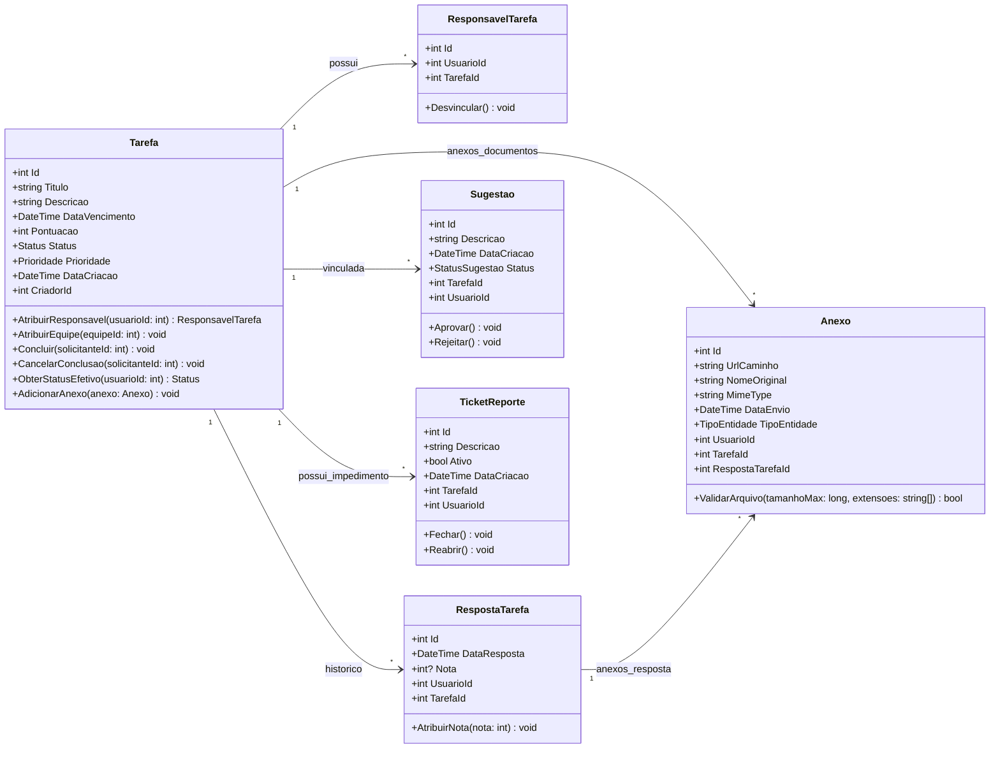

#### Subdomínio B: Governança de Equipes e Preferências de Alertas

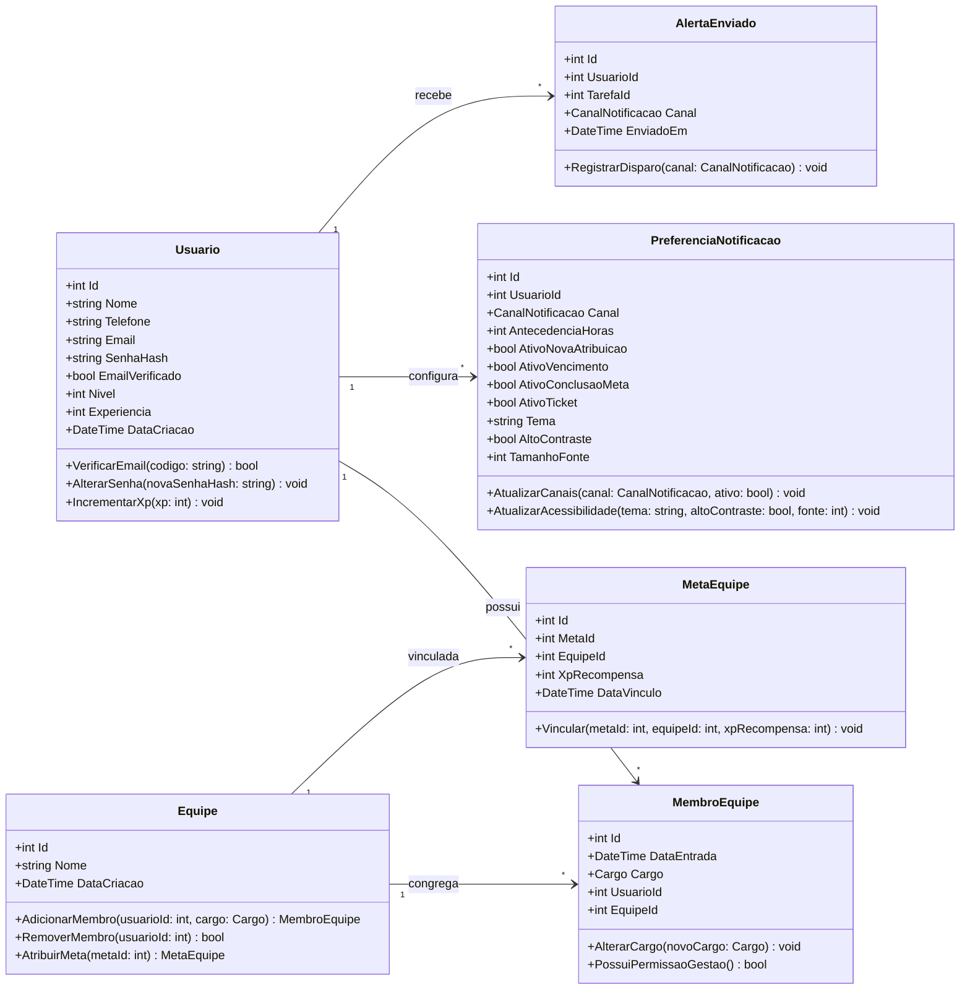

#### Subdomínio C: Metas e Gamificação

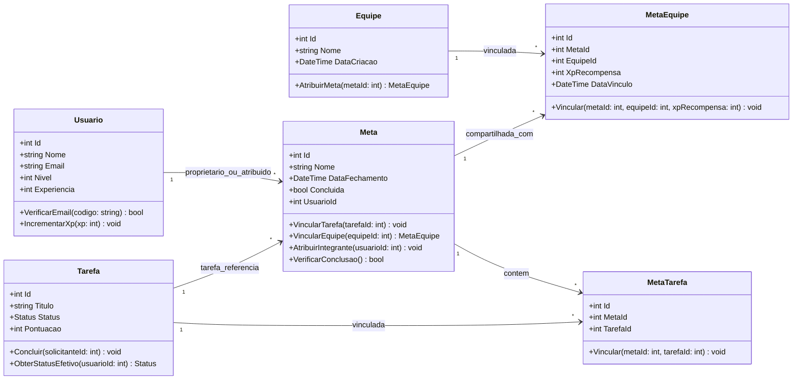

### Detalhamento dos Mapeamentos e Restrições de Domínio

| Entidade | Tabela | Descrição e Regras Chave |
| :--- | :--- | :--- |
| **`Usuario`** | `Usuarios` | Contém credenciais com hash BCrypt (`SenhaHash`), flag de verificação de e-mail (RN012), índice único no e-mail (RN001), nível e experiência da conta (sistema de gamificação). Não pode ser excluído caso possua tarefas pendentes ou atrasadas (RN005). |
| **`Tarefa`** | `Tarefas` | Núcleo do sistema. Controla status, prioridade e vencimento. Atualizações de status recalculam metas (RN008) e tarefas com prazo vencido transicionam para `Atrasada` (RN006). Suporta múltiplos responsáveis com conclusão individual e visão de status efetivo. |
| **`Equipe`** | `Equipes` | Agrupamento corporativo de usuários. |
| **`MembroEquipe`**| `MembrosEquipe` | Tabela associativa com controle de cargos RBAC (`Dono`, `Admin`, `Membro`). Apenas donos alteram cargos (RN003) e apenas donos/admins gerenciam membros (RN004) e atribuem tarefas e metas a integrantes respeitando a hierarquia de cargos. |
| **`ResponsavelTarefa`** | `ResponsaveisTarefa` | Usuários responsáveis pela execução da tarefa. Permite atribuição unitária ou em lote por equipe com respeito à hierarquia de liderança. |
| **`Sugestao`** | `Sugestoes` | Permite que responsáveis sugiram ajustes de escopo/prazo. Exige aprovação explícita do criador da tarefa (RN013 / RF004). |
| **`Meta`** | `Metas` | Metas vinculadas a tarefas (RN007). Validade máxima de 12 meses (RN014) e conclusão automática baseada no status de todas as tarefas vinculadas (RN008). Pode ser atribuída por donos/admins a integrantes específicos ou vinculada à equipe inteira. Metas puramente individuais não acumulam XP, enquanto metas de equipes concedem XP e progressão de nível (RN019). |
| **`MetaTarefa`** | `MetasTarefas` | Tabela associativa N:N entre `Meta` e `Tarefa`. |
| **`MetaEquipe`** | `MetaEquipe` | Tabela associativa N:N entre `Meta` e `Equipe`. Permite que donos e administradores atribuam metas a equipes, configurando o `XpRecompensa` para bonificação de nível dos usuários na conclusão (RN019). |
| **`TicketReporte`** | `TicketReporte` | Chamado de impedimento aberto pelo executor da tarefa direcionado a administradores e donos (RF005, RN016). |
| **`Anexo`** | `Anexos` | Armazenamento de metadados e caminhos físicos de arquivos associados a tarefas, respostas ou usuários. |
| **`RespostaTarefa`** | `RespostaTarefa` | Armazena entregas, respostas e devolutivas dos executores, incluindo avaliação e nota atribuída exclusivamente pelo criador da tarefa (RN015) e anexos comprobatórios. |
| **`Notificacao`** | `Notificacao` | Central de notificações in-app persistidas no banco com indicação de tipo, rota para navegação rápida, status de leitura e flags visuais de destaque (vencidas/urgentes). |
| **`PreferenciaNotificacao`** | `PreferenciasNotificacao` | Configurações personalizadas por canal (Email, Push, SMS) e janela de antecedência entre 1h e 168h (RN011). |
| **`AlertaEnviado`** | `AlertasEnviados` | Registro de disparos efetuados para evitar notificações duplicadas ou fora da janela válida (RN017). |

---

## 2. Diagrama de Objetos (Instâncias em Tempo de Execução)

O diagrama de objetos abaixo ilustra um **cenário real de execução** no Cortex Backend:
- Uma **Tarefa Atribuída** (`tarefa101`), criada por um usuário administrador (`usuarioCriador`) e atribuída a um desenvolvedor (`usuarioExecutor`) através do objeto associativo `respTarefa50`.
- Um **Ticket de Reporte** (`ticketReporte7`), aberto pelo executor para alertar a liderança sobre um impedimento técnico impeditivo (**RF005**, **RN016**).
- Uma **Meta Corporativa** (`metaQ4`), criada pela administradora e associada à tarefa através de `metaTarefaLink` (**RN007**). O estado atual reflete a **RN008**: como a tarefa associada ainda está com `Status = Pendente`, o atributo `Concluida` da meta permanece `false`.
- Uma vinculação de **Meta com Equipe** (`metaEquipeLink`), demonstrando a regra **RN019** com `XpRecompensa = 250` atribuída à equipe DevOps.
- Uma **Meta Corporativa** (`metaQ4`), criada pela administradora e associada à tarefa através de `metaTarefaLink` (**RN07**). O estado atual reflete a **RN08**: como a tarefa associada ainda está com `Status = Pendente`, o atributo `Concluida` da meta permanece `false`.

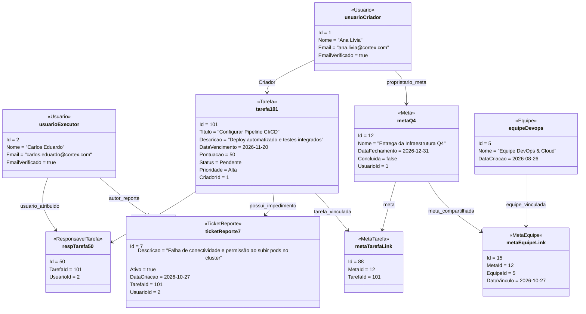

### Especificação dos Objetos e Valores de Estado

| Instância do Objeto | Classe de Origem | Papel no Cenário | Atributos e Estado em Tempo de Execução |
| :--- | :--- | :--- | :--- |
| **`usuarioCriador`** | `Usuario` | Criadora da Tarefa e Gestora da Meta | `Id: 1`, `Nome: "Ana Lívia"`, `Email: "ana.livia@cortex.com"`, `EmailVerificado: true`. |
| **`usuarioExecutor`** | `Usuario` | Executor Atribuído e Autor do Ticket | `Id: 2`, `Nome: "Carlos Eduardo"`, `Email: "carlos.eduardo@cortex.com"`, `EmailVerificado: true`. |
| **`equipeDevops`** | `Equipe` | Equipe de Engenharia Cloud | `Id: 5`, `Nome: "Equipe DevOps & Cloud"`. |
| **`tarefa101`** | `Tarefa` | Tarefa em Andamento com Impedimento | `Id: 101`, `Titulo: "Configurar Pipeline CI/CD"`, `Status: Pendente`, `Prioridade: Alta`, `Pontuacao: 50`, `CriadorId: 1`. |
| **`respTarefa50`** | `ResponsavelTarefa` | Vínculo de Atribuição da Tarefa | `Id: 50`, `TarefaId: 101`, `UsuarioId: 2`. Liga o executor `usuarioExecutor` à tarefa. |
| **`ticketReporte7`** | `TicketReporte` | Chamado de Bloqueio Técnico (**RF008**) | `Id: 7`, `Descricao: "Falha de conectividade..."`, `Ativo: true`, `TarefaId: 101`, `UsuarioId: 2`. Roteado para a gestão. |
| **`metaQ4`** | `Meta` | Meta Corporativa Vinculada (**RF007**) | `Id: 12`, `Nome: "Entrega da Infraestrutura Q4"`, `DataFechamento: 2026-12-31`, `Concluida: false` (regra **RN08**), `UsuarioId: 1`. |
| **`metaTarefaLink`** | `MetaTarefa` | Vínculo Associativo N:N (**RN07**) | `Id: 88`, `MetaId: 12`, `TarefaId: 101`. Garante que a meta possui pelo menos uma tarefa associada. |
| **`metaEquipeLink`** | `MetaEquipe` | Vínculo Associativo N:N com Equipe | `Id: 15`, `MetaId: 12`, `EquipeId: 5`. Compartilha e atribui a meta aos integrantes da equipe DevOps. |

---

## 3. Diagrama de Casos de Uso do Sistema

O modelo de casos de uso do **Cortex** reflete fielmente as necessidades de negócio estruturadas em **13 Requisitos Funcionais (RF001 a RF013)**, organizados nos **11 Casos de Uso canônicos (UC01 a UC11)**. A arquitetura funcional é apresentada em camadas para garantir alta legibilidade e expressividade:
1. **Visão Macrossistêmica**: Relaciona os atores aos 3 grandes pacotes funcionais sem cruzamentos de linhas.
2. **Visões Especializadas por Módulo**:
   - **3.1 Módulo: Identidade, Acessibilidade e Equipes** (`UC01`, `UC06`, `UC08`, `UC09`).
   - **3.2 Módulo: Tarefas, Entregas, Sugestões e Impedimentos** (`UC02`, `UC03`, `UC04`, `UC05`).
   - **3.3 Módulo: Metas, Relatórios Analíticos e Serviços Automáticos** (`UC07`, `UC10`, `UC11`).
3. **Quadro Canônico de Requisitos Funcionais e Casos de Uso Vinculados**.
4. **Matriz de Casos de Uso e Regras de Negócio Associadas**.
5. **Especificação Textual Detalhada (Cenários Ótimos e Alternativos)**.

---

### Visão Macrossistêmica (Atores e Pacotes Funcionais)

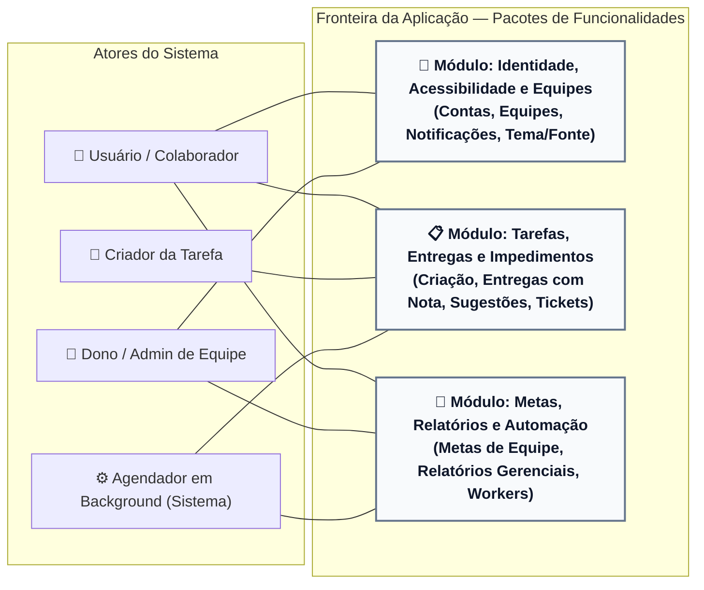

---

### 3.1 Módulo: Identidade, Acessibilidade e Equipes

Atende aos requisitos **RF001**, **RF006**, **RF008**, **RF009**, **RF012** e **RF013**, contemplando o ciclo de vida do perfil, upload de foto, governança RBAC de equipes, parametrização de canais de notificação, acessibilidade (tema e fonte) e o painel de notificações in-app.

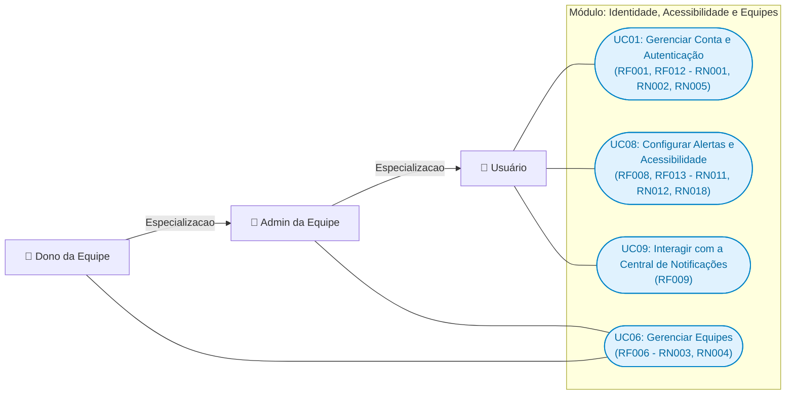

---

### 3.2 Módulo: Tarefas, Entregas, Sugestões e Impedimentos

Atende aos requisitos **RF002**, **RF003**, **RF004**, **RF005** e **RF012**, cobrindo o gerenciamento completo de atividades, anexos binários, delegação individual e por equipe, entrega de respostas técnicas com avaliação por notas (**RN015**), aprovação de alterações (**RN013**) e mediação de impedimentos operacionais (**RN016**).

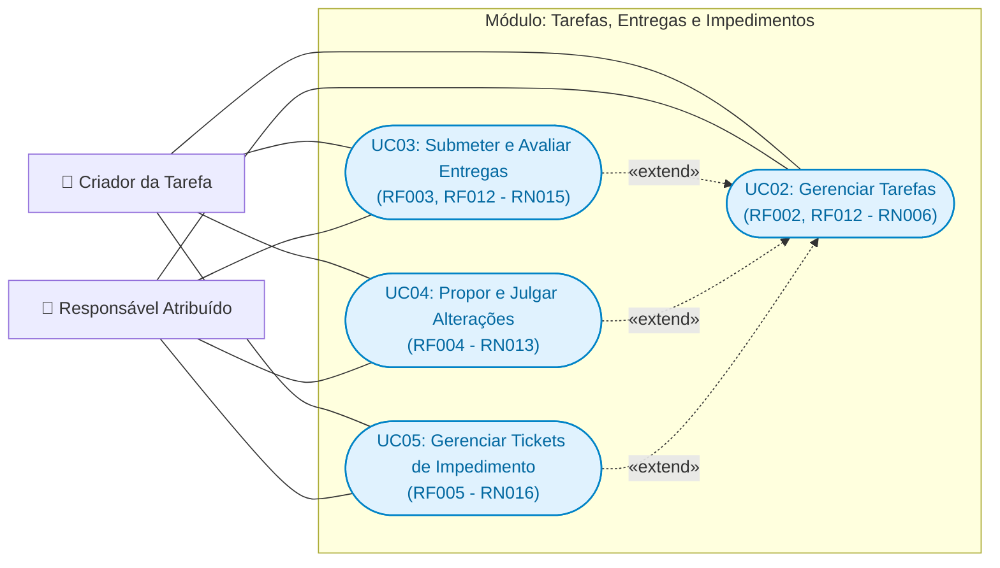

---

### 3.3 Módulo: Metas, Relatórios Analíticos e Serviços Automáticos

Atende aos requisitos **RF007**, **RF010** e **RF011**, detalhando o acompanhamento de metas vinculadas a tarefas e equipes (**RN007**, **RN008**, **RN014**, **RN019**), geração de relatórios com segregação de privacidade (**RN009**, **RN010**) e automações de segundo plano com idempotência de alertas (**RN006**, **RN017**).

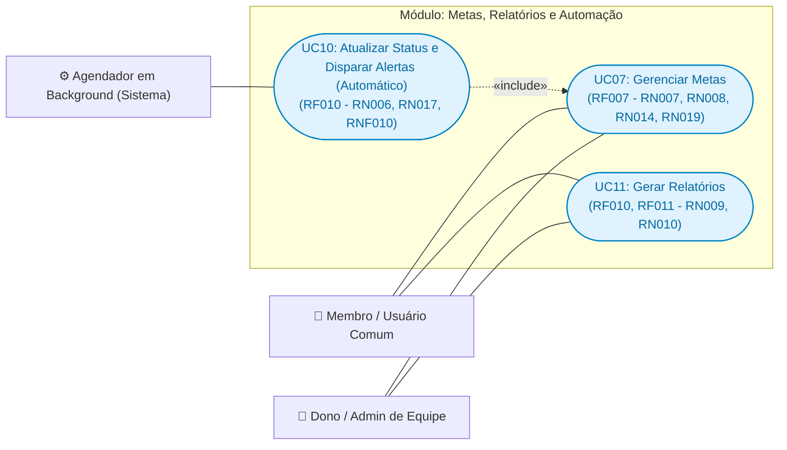

---

### Mapeamento Canônico: Requisitos Funcionais x Casos de Uso

#### Quadro 3 — Requisitos Funcionais
| Código | Descrição | Implementado? | Casos de Uso Vinculados |
| :--- | :--- | :---: | :--- |
| **RF001** | O sistema deve permitir cadastrar, consultar, atualizar e excluir usuários, autenticar por e-mail e senha, verificar o e-mail por código de seis dígitos e solicitar/redefinir senha por código enviado ao e-mail. Dados: nome, e-mail, telefone e foto de perfil; a senha e os códigos não devem ser expostos em consultas. | Sim | **UC01: Gerenciar Conta e Autenticação** |
| **RF002** | O sistema deve permitir criar, consultar, editar, excluir, concluir e reabrir tarefas, bem como atribuir e remover responsáveis individualmente ou por todos os membros de uma equipe. Dados: título, descrição, vencimento, pontuação, status, prioridade, criador, responsáveis e anexos. | Sim | **UC02: Gerenciar Tarefas** |
| **RF003** | O sistema deve permitir que um responsável envie entregas de uma tarefa, com arquivos anexos, e que o criador avalie cada entrega com uma nota. Dados: tarefa, responsável, data de envio, nota e anexos. | Sim | **UC03: Submeter e Avaliar Entregas** |
| **RF004** | O sistema deve permitir que responsáveis submetam sugestões de alteração de uma tarefa e que seu criador as aprove ou rejeite. Dados: tarefa, solicitante, descrição, data de criação e status. | Sim | **UC04: Propor e Julgar Alterações** |
| **RF005** | O sistema deve permitir que responsáveis abram tickets de impedimento em tarefas não concluídas, que o criador seja notificado e que o criador encerre o ticket. Dados: tarefa, autor, descrição, data de abertura e situação ativa/fechada. | Sim | **UC05: Gerenciar Tickets de Impedimento** |
| **RF006** | O sistema deve permitir criar, consultar, alterar e excluir equipes, bem como incluir, remover e listar membros. O criador torna-se dono; somente o dono pode alterar cargos, e dono/admin podem administrar membros. Dados: nome da equipe, data de criação, membro, cargo e dados de contato do usuário. | Sim | **UC06: Gerenciar Equipes** |
| **RF007** | O sistema deve permitir criar, consultar, alterar e excluir metas associadas a uma ou mais tarefas e a um usuário proprietário ou pertencente a uma equipe, calculando a conclusão conforme o status das tarefas vinculadas. O sistema deve atribuir pontos de experiência (XP) para evolução do nível da conta dos usuários exclusivamente quando a meta concluída estiver vinculada a uma equipe. Dados: nome, prazo de fechamento, proprietário, conclusão, tarefas vinculadas e XP de recompensa (apenas para equipes). | Sim | **UC07: Gerenciar Metas** |
| **RF008** | O sistema deve permitir configurar, por canal (e-mail, push e SMS), a antecedência de alertas e a ativação de notificações para nova atribuição, vencimento, conclusão de meta e ticket. Dados: canal, antecedência e indicadores de ativação por evento. | Parcialmente (somente e-mail) | **UC08: Configurar Alertas e Acessibilidade** |
| **RF009** | O sistema deve disponibilizar uma central de notificações no cabeçalho para listar notificações do usuário, indicar a quantidade de não lidas, marcar uma ou todas como lidas e remover notificações individuais ou o histórico. Dados: tipo, título, mensagem, link, data, leitura e destaque. | Sim | **UC09: Interagir com a Central de Notificações** |
| **RF010** | O sistema deve identificar tarefas pendentes vencidas e atualizá-las para “Atrasada”, além de alertar responsáveis quando uma tarefa estiver dentro da antecedência configurada. O registro de alertas deve impedir reenvio para o mesmo usuário, tarefa e canal dentro da janela aplicável. | Sim | **UC10: Atualizar Status e Disparar Alertas (Automático)** |
| **RF011** | O sistema deve gerar relatórios de tarefas com filtros por status, prioridade, período, responsável, criador e equipe. Usuários comuns devem acessar apenas seus próprios dados; donos/admins devem acessar relatórios das equipes autorizadas. Métricas: total, contagens por status, taxa de conclusão, distribuição por prioridade, média de notas e desempenho por responsável. | Sim | **UC11: Gerar Relatórios** |
| **RF012** | O sistema deve permitir anexar, consultar e excluir arquivos relacionados a tarefas, entregas e perfis de usuário, disponibilizando visualização ou download quando suportado. Dados: nome original, tipo MIME, caminho/URL, data de envio e entidade relacionada. | Sim | **UC01: Gerenciar Conta e Autenticação**<br/>**UC02: Gerenciar Tarefas**<br/>**UC03: Submeter e Avaliar Entregas** |
| **RF013** | O sistema deve permitir ao usuário configurar e persistir tema claro/escuro, alto contraste e tamanho de fonte entre 12 e 24 pixels, em valores pares. | Sim | **UC08: Configurar Alertas e Acessibilidade** |

*Fonte: Os autores.*

---

### Matriz de Casos de Uso e Regras de Negócio Chave

| Código | Caso de Uso | Requisitos Atendidos | Atores Principais | Regras de Negócio Associadas |
| :--- | :--- | :--- | :--- | :--- |
| **UC01** | Gerenciar Conta e Autenticação | RF001, RF012 | Usuário / Visitante | **RN001** (e-mail único), **RN002** (senha complexa $\ge 8$ caracteres), **RN005** (bloqueio de exclusão com tarefas 'Pendente' ou 'Atrasada'), **RN012** (verificação prévia de e-mail). |
| **UC02** | Gerenciar Tarefas | RF002, RF012 | Criador / Responsável | **RF002** (CRUD, prazos futuros UTC, atribuição individual/por equipe, conclusão e reabertura com recálculo de status), anexos validados. |
| **UC03** | Submeter e Avaliar Entregas | RF003, RF012 | Responsável / Criador | **RN015** (entregas só podem ser avaliadas com nota pelo criador da tarefa), anexos de comprovação. |
| **UC04** | Propor e Julgar Alterações | RF004 | Responsável / Criador | **RN013** (sugestões de alteração devem ser aprovadas ou recusadas pelo criador antes de serem aplicadas). |
| **UC05** | Gerenciar Tickets de Impedimento | RF005 | Responsável / Criador | **RN016** (tickets só em tarefas não concluídas e encerrados exclusivamente pelo criador da tarefa). |
| **UC06** | Gerenciar Equipes | RF006 | Dono / Admin / Membro | **RN003** (somente donos de equipes alteram cargos), **RN004** (somente donos e administradores adicionam/removem membros). |
| **UC07** | Gerenciar Metas | RF007 | Gestor / Integrante | **RN007** (mínimo 1 tarefa vinculada), **RN008** (conclusão em 100% das tarefas concluídas), **RN014** (prazo máximo de 12 meses), **RN019** (concessão de XP e aumento de nível exclusivamente para metas concluídas vinculadas a equipes; metas individuais não geram XP). |
| **UC08** | Configurar Alertas e Acessibilidade | RF008, RF013 | Usuário | **RN011** (janela de antecedência de 1h a 7 dias / 168h), **RN012** (e-mail confirmado antes do envio), **RN018** (tamanho de fonte acessível exclusivamente números pares entre 12 e 24px). |
| **UC09** | Interagir com a Central de Notificações | RF009 | Usuário | **RF009** (listagem em tempo real no cabeçalho, badge de não lidas, marcar individual/todas como lidas e remoção de notificações ou do histórico). |
| **UC10** | Atualizar Status e Disparar Alertas (Automático) | RF010 | Agendador (Sistema) | **RN006** (tarefas vencidas mudam automaticamente para 'Atrasada'), **RN017** (bloqueio de reenvio de alertas de vencimento para mesmo usuário, tarefa e canal na janela), **RNF010** (processamento assíncrono multi-canal). |
| **UC11** | Gerar Relatórios | RF011 | Usuário / Dono / Admin | **RN009** (usuário comum só acessa tarefas próprias), **RN010** (donos e administradores geram relatórios por equipe com métricas de desempenho). |

---

### 3.4. Cenários Ótimos e Alternativos do Sistema

#### 3.4.1. Cenários Ótimos — Colaborador / Membro
1. **Acesso à plataforma e Autenticação (UC01 / RF001)**:
   - 1.1 O sistema exibe os campos de credenciais, opção de cadastro inicial e botão de recuperação "Esqueci minha senha".
   - 1.2 O colaborador insere e-mail e senha cadastrados; o sistema autentica, emite o token JWT em cookie seguro e libera o dashboard.
   - 1.3 O colaborador solicita verificação ou redefinição de senha: o sistema gera código de 6 dígitos via SMTP e valida o acesso.
2. **Operações de Tarefas e Entregas (UC02, UC03, UC04, UC05 / RF002, RF003, RF004, RF005, RF012)**:
   - 2.1 O colaborador visualiza suas tarefas com filtros por status, prioridade e prazos.
   - 2.2 O colaborador submete resposta de entrega com arquivos anexos comprovando o trabalho (**UC03**).
   - 2.3 O criador analisa a entrega submetida e atribui nota numérica válida (**RN015**).
   - 2.4 Caso necessário, o responsável submete sugestão de ajuste de prazo/descrição (**UC04**) ou abre ticket de bloqueio (**UC05**).
3. **Metas, Produtividade e Relatórios (UC07, UC11 / RF007, RF011)**:
   - 3.1 O colaborador acompanha suas metas individuais e as metas atribuídas à sua equipe via `MetaEquipe` (**UC07**). Ao atingir 100% de conclusão de uma meta de equipe, o sistema credita pontos de experiência (XP) e eleva o nível da conta com persistência de excedente (**RN019**).
   - 3.2 O colaborador emite seu relatório pessoal consolidando contagem de entregas, notas e pontuação acumulada (**UC11**).
4. **Configurações de Alertas e Acessibilidade (UC08, UC09 / RF008, RF009, RF013)**:
   - 4.1 O colaborador seleciona canais ativos (Push, E-mail, SMS), define a antecedência de 1h a 7 dias (**RN011**) e ajusta o tema claro/escuro e fonte entre 12 e 24px pares (**RN018**).
   - 4.2 O colaborador interage com o modal de notificações no cabeçalho, lendo e arquivando alertas (**UC09**).

#### 3.4.2. Cenários Alternativos — Colaborador / Membro
1. **Tentativa de cadastro com e-mail já existente (RN001)**: O sistema identifica duplicidade, bloqueia a criação e orienta para o fluxo de login ou recuperação de senha.
2. **Senha fora do padrão de complexidade (RN002)**: O sistema rejeita senhas com menos de 8 caracteres ou sem mescla de maiúsculas, minúsculas, números e símbolos.
3. **Exclusão de conta com tarefas ativas pendentes ou atrasadas (RN005)**: O sistema barra a exclusão da conta exibindo aviso impeditivo para concluir ou reatribuir pendências.
4. **Tentativa de abertura de ticket em tarefa já concluída (RN016)**: O sistema impede a emissão de chamados de impedimento caso a tarefa já esteja finalizada.
5. **Configuração de tamanho de fonte ímpar ou fora da faixa (RN018)**: O sistema valida o range e rejeita valores ímpares (ex.: 15px) ou fora de 12px a 24px.

#### 3.4.3. Cenários Ótimos — Administrador / Liderança
1. **Gestão Organizacional de Equipes (UC06 / RF006)**:
   - 1.1 O criador funda uma equipe, assumindo imediatamente o cargo de `Dono` (**RN003**).
   - 1.2 O Dono ou Admin inclui membros na equipe e gerencia desvinculações (**RN004**).
   - 1.3 O Dono altera os cargos administrativos de outros membros conforme a estrutura da organização (**RN003**).
2. **Delegação e Avaliação de Tarefas (UC02, UC03, UC04, UC05 / RF002, RF003, RF004, RF005)**:
   - 2.1 O criador cadastra a tarefa com data futura UTC, prioridade e pontuação, anexando especificações.
   - 2.2 O criador atribui a atividade a um membro individual ou a toda uma equipe com um único comando.
   - 2.3 O criador aprova ou rejeita propostas de sugestão (**RN013**) e encerra tickets de impedimento resolvidos (**RN016**).
   - 2.4 O criador avalia respostas técnicas atribuindo notas compatíveis com a pontuação máxima (**RN015**).
3. **Gestão de Metas e Relatórios Corporativos (UC07, UC11 / RF007, RF011)**:
   - 3.1 A liderança define metas de até 12 meses (**RN014**) vinculando ao menos 1 tarefa (**RN007**), parametriza o XP de recompensa e as atribui a equipes via `MetaEquipe` (**RN019**).
   - 3.2 Donos e Administradores emitem relatórios consolidados de desempenho por equipe (**RN010**).
4. **Automação Contínua em Background (UC10 / RF010)**:
   - 4.1 O sistema atualiza periodicamente tarefas vencidas para "Atrasada" (**RN006**).
   - 4.2 O agendador dispara alertas dentro da janela de antecedência sem redundâncias (**RN017**) através de gateways assíncronos (**RNF010**).

#### 3.4.4. Cenários Alternativos — Administrador / Liderança
1. **Tentativa de alteração de cargo por Admin comum (RN003)**: O sistema rejeita a operação com código 403 Forbidden, informando que a prerrogativa é privativa do Dono da equipe.
2. **Tentativa de criação de meta sem tarefas associadas (RN007)**: O sistema bloqueia a gravação e exige ao menos uma tarefa vinculada.
3. **Definição de prazo de meta superior a 12 meses (RN014)**: O sistema recusa datas de conclusão além de 1 ano a partir da criação.
4. **Avaliação de nota por usuário que não seja o criador (RN015)**: O sistema impede a avaliação caso o solicitante não seja o criador original da tarefa.
5. **Tentativa de encerramento de ticket por usuário sem privilégio (RN016)**: O sistema bloqueia o encerramento do chamado se o solicitante não for o criador da tarefa.

---

## 4. Diagramas de Sequência (Interações Reais do Backend Cortex)

Esta seção apresenta os diagramas de sequência comportamentais do Cortex Backend.
A subseção **4.0** consolida a atualização dos fluxos de criação principais e o mapeamento sistemático dos **Requisitos Funcionais (RF001 a RF013)** conforme a arquitetura real em produção (`App Cortex` $\leftrightarrow$ `Controllers REST` $\leftrightarrow$ `Services` $\leftrightarrow$ `Repositories/PostgreSQL` $\leftrightarrow$ `Gateways`).
As subseções subsequentes detalham as interações aprofundadas dos **Casos de Uso (UC01 a UC19)** e canais de mensageria assíncrona.

---

### 4.0. Diagramas de Sequência Atualizados dos Requisitos Funcionais (RF001 a RF013)

#### 4.0.1. sd CriarTarefa (Atualizado)
Atualização do fluxo de criação de tarefas com persistência em banco relacional, anexo físico/metadados e despacho de notificações aos responsáveis via push/mensageria.

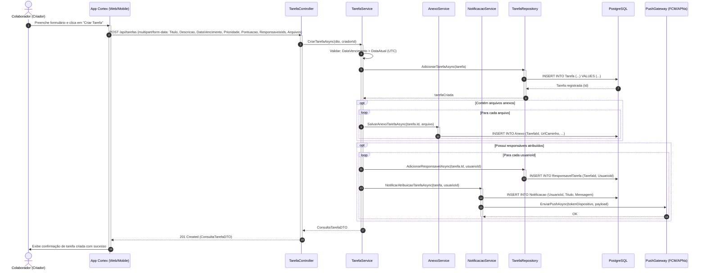

---

#### 4.0.2. sd CriarSugestao (Atualizado)
Atualização do fluxo de submissão de proposta de alteração de tarefa por um responsável atribuído, com validação e aviso ao criador.

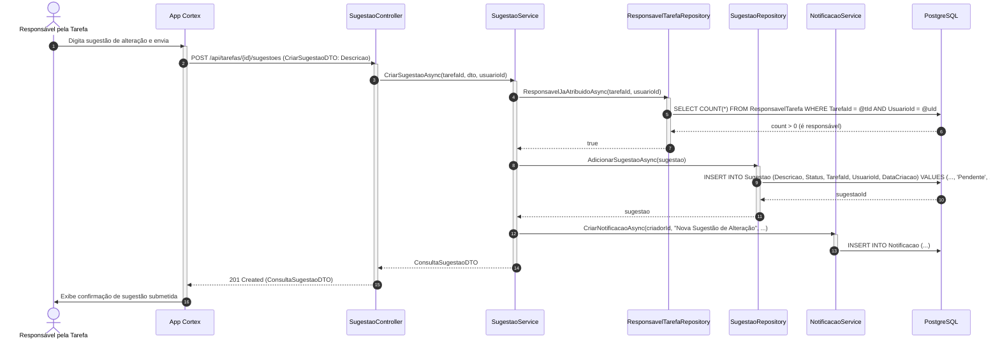

---

#### 4.0.3. sd CriarMeta (Atualizado)
Atualização do fluxo de cadastro de metas vinculadas com validação de vínculo mínimo a uma tarefa, cálculo inicial e vinculação a usuário/equipe.

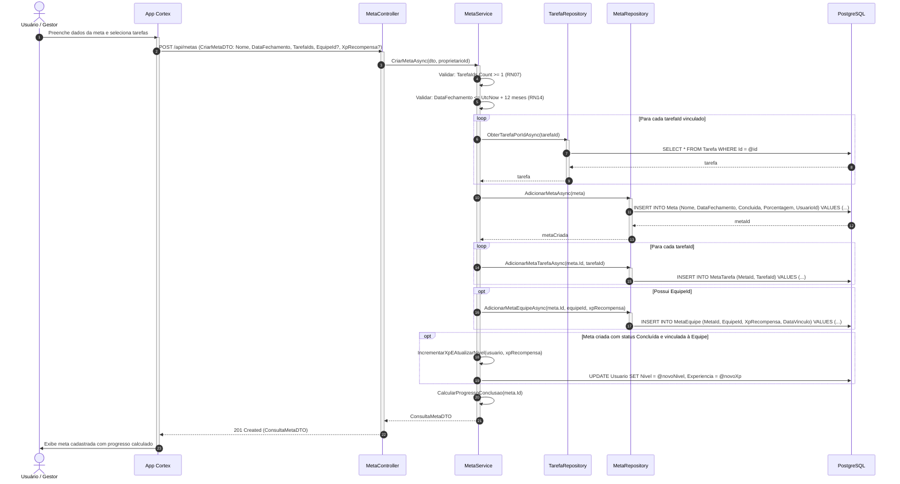

---

#### 4.0.4. sd RF001 - Gerenciar Usuários e Autenticação
Mapeia cadastro, consulta, atualização, exclusão, verificação por 6 dígitos e redefinição de credenciais sem exposição de senhas e hashes.

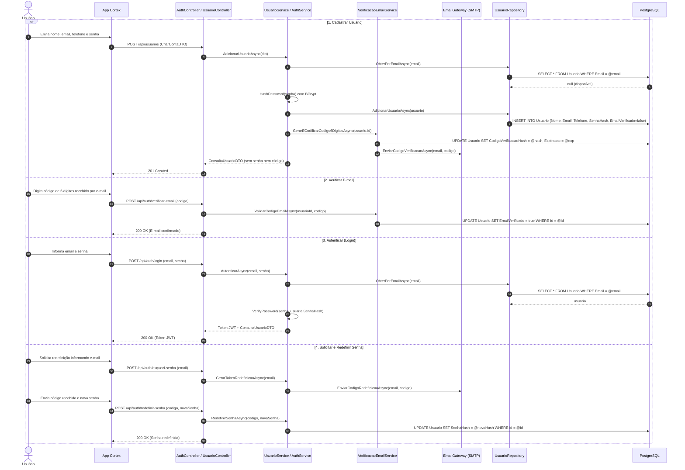

---

#### 4.0.5. sd RF002 - Gerenciar Tarefas e Atribuições
Mapeia criação, consulta, edição, exclusão, conclusão e reabertura de tarefas, além de atribuições individuais ou em lote para equipes.

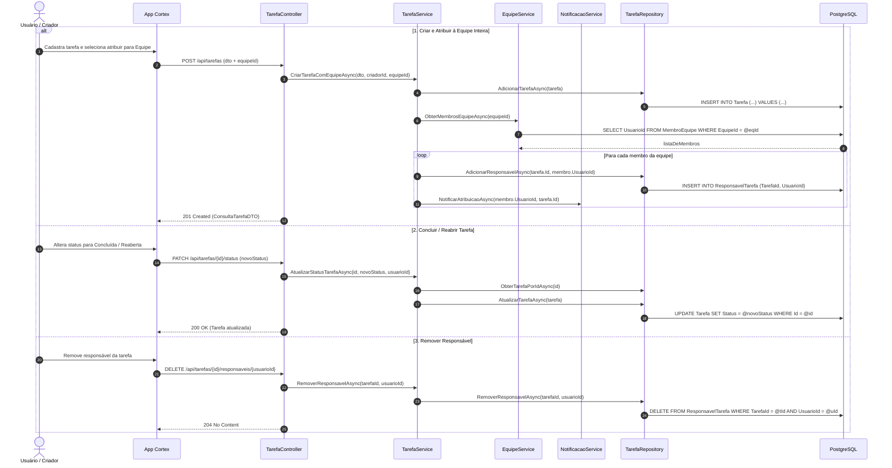

---

#### 4.0.6. sd RF003 - Enviar e Avaliar Entregas de Tarefas
Mapeia a submissão de respostas com anexos por responsáveis e a atribuição de notas pelo criador.

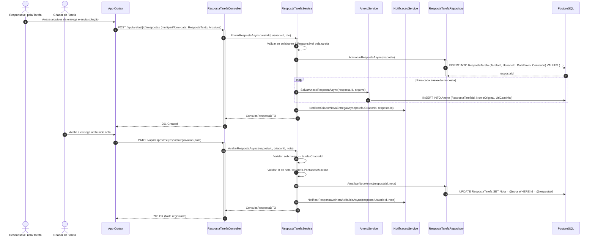

---

#### 4.0.7. sd RF004 - Submeter e Avaliar Sugestões de Alteração
Mapeia a proposição de modificações por colaboradores atribuídos e a aprovação ou recusa pelo criador.

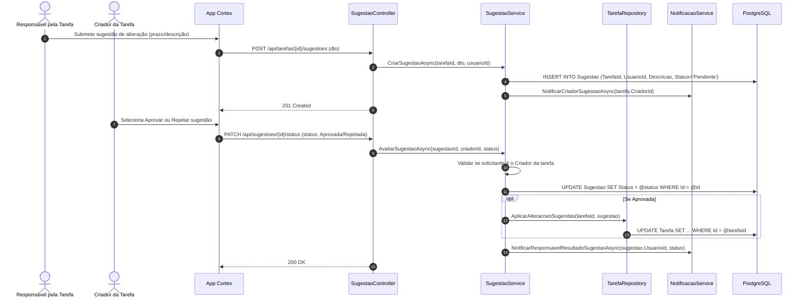

---

#### 4.0.8. sd RF005 - Gerenciar Tickets de Impedimento
Mapeia abertura de impedimento por responsáveis em tarefas não concluídas e encerramento por perfis autorizados.

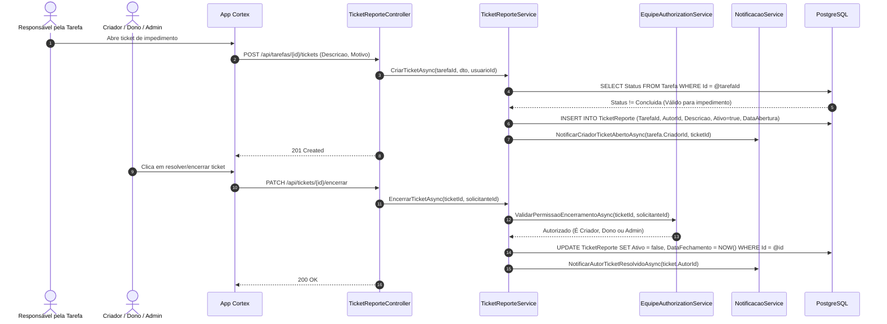

---

#### 4.0.9. sd RF006 - Gerenciar Equipes, Membros e Cargos
Mapeia criação de equipe (criador como Dono), gestão de membros por Dono/Admin e alteração de cargos exclusiva do Dono.

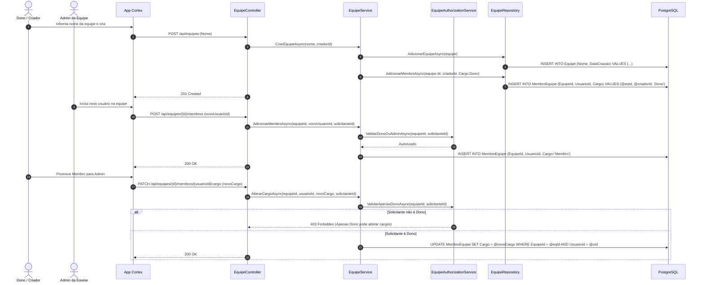

---

#### 4.0.10. sd RF007 - Gerenciar Metas e Recalcular Conclusão
Mapeia a criação, acompanhamento e recálculo dinâmico da conclusão da meta a partir do status das tarefas vinculadas.

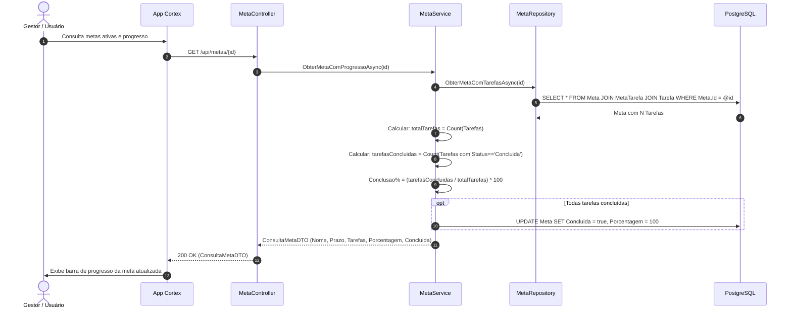

---

#### 4.0.11. sd RF008 - Configurar Canais e Antecedência de Alertas
Mapeia a personalização de canais de notificação (E-mail, Push, SMS) e janelas temporais de alertas para eventos-chave.

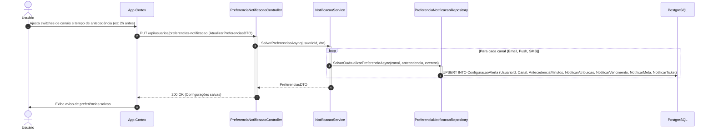

---

#### 4.0.12. sd RF009 - Central de Notificações no Cabeçalho
Mapeia a central interativa no cabeçalho com contagem de não lidas, listagem, marcação em lote e exclusão de histórico.

```mermaid
sequenceDiagram
    autonumber
    actor Usuario as Usuário
    participant AppCortex as App Cortex (Header)
    participant Controller as NotificacaoController
    participant Service as NotificacaoService
    participant Repo as NotificacaoRepository
    participant DB as PostgreSQL

    AppCortex->>Controller: GET /api/notificacoes/nao-lidas/count
    Controller->>Repo: ContarNaoLidasAsync(usuarioId)
    Repo->>DB: SELECT COUNT(*) FROM Notificacao WHERE UsuarioId = @uId AND Lida = false
    DB-->>Repo: 5
    Repo-->>Controller: 5
    Controller-->>AppCortex: { naoLidas: 5 } (Badge vermelho exibido)

    Usuario->>AppCortex: Clica no sino do cabeçalho
    AppCortex->>Controller: GET /api/notificacoes (filtro: ultimas 20)
    Controller->>DB: SELECT * FROM Notificacao WHERE UsuarioId = @uId ORDER BY DataEnvio DESC
    DB-->>Controller: listaNotificacoes
    Controller-->>AppCortex: 200 OK (Lista de Notificações)

    Usuario->>AppCortex: Clica em "Marcar todas como lidas"
    AppCortex->>Controller: PATCH /api/notificacoes/marcar-todas-lidas
    Controller->>Service: MarcarTodasComoLidasAsync(usuarioId)
    Service->>DB: UPDATE Notificacao SET Lida = true WHERE UsuarioId = @uId AND Lida = false
    Controller-->>AppCortex: 200 OK (Badge zerado)

    Usuario->>AppCortex: Clica em limpar histórico
    AppCortex->>Controller: DELETE /api/notificacoes/historico
    Controller->>Service: LimparHistoricoAsync(usuarioId)
    Service->>DB: DELETE FROM Notificacao WHERE UsuarioId = @uId
    Controller-->>AppCortex: 204 No Content
```

---

#### 4.0.13. sd RF010 e RF011 - Relatórios de Desempenho e Métricas de Tarefas
Mapeia a emissão de relatórios analíticos com restrição de escopo por RBAC e agregação de indicadores de desempenho.

```mermaid
sequenceDiagram
    autonumber
    actor Solicitante as Usuário / Liderança
    participant AppCortex as App Cortex
    participant Controller as RelatorioController
    participant Service as RelatorioService
    participant EquipeAuth as EquipeAuthorizationService
    participant Repo as RelatorioRepository
    participant DB as PostgreSQL

    Solicitante->>AppCortex: Aplica filtros (Período, Status, Prioridade, EquipeId) e emite relatório
    AppCortex->>Controller: GET /api/relatorios/tarefas (FiltrosDTO)
    activate Controller

    Controller->>Service: GerarRelatorioTarefasAsync(filtros, solicitanteId)
    activate Service

    alt Filtro contém EquipeId
        Service->>EquipeAuth: ValidarDonoOuAdminAsync(equipeId, solicitanteId)
        alt Não tem autorização
            EquipeAuth-->>Controller: 403 Forbidden (Usuário comum só acessa dados próprios)
        end
    else Sem EquipeId (Usuário Comum)
        Service->>Service: Forçar filtro para usuarioId = solicitanteId
    end

    Service->>Repo: ObterDadosConsolidadosAsync(filtros)
    activate Repo
    Repo->>DB: SELECT COUNT(*), Status, Prioridade, AVG(Nota), AVG(TempoConclusao) FROM Tarefa GROUP BY ...
    DB-->>Repo: Dados brutos de tarefas e respostas
    deactivate Repo

    Service->>Service: Calcular TaxaConclusao = (Concluidas / Total) * 100
    Service->>Service: Mapear Distribuição por Prioridade e Desempenho por Responsável
    Service-->>Controller: RelatorioTarefasDTO (Métricas, Gráficos, Totalizadores)
    deactivate Service

    Controller-->>AppCortex: 200 OK (RelatorioTarefasDTO)
    deactivate Controller
    AppCortex->>Solicitante: Renderiza gráficos de barras, pizza e métricas consolidadas
```

---

#### 4.0.14. sd RF012 - Anexar, Consultar e Excluir Arquivos
Mapeia o ciclo de vida de arquivos anexos vinculados a tarefas, entregas e perfis de usuários com validação de formato e tamanho.

```mermaid
sequenceDiagram
    autonumber
    actor Usuario as Usuário
    participant AppCortex as App Cortex
    participant Controller as AnexoController
    participant Service as AnexoService
    participant Validador as ArquivoValidacaoService
    participant Storage as FileStorage (Disco/uploads)
    participant Repo as AnexoRepository
    participant DB as PostgreSQL

    alt 1. Enviar / Anexar Arquivo
        Usuario->>AppCortex: Seleciona arquivo para upload (ex.: foto de perfil ou anexo de tarefa)
        AppCortex->>Controller: POST /api/anexos/upload (IFormFile, entidadeTipo, entidadeId)
        Controller->>Service: SalvarArquivoAsync(file, entidadeTipo, entidadeId)
        Service->>Validador: ValidarExtensaoETamanho(file)
        Validador-->>Service: OK (Tamanho <= 20MB, Extensão segura)
        Service->>Storage: Gravar em /wwwroot/uploads/{entidade}/
        Storage-->>Service: caminhoRelativo
        Service->>Repo: AdicionarAsync(anexo)
        Repo->>DB: INSERT INTO Anexo (NomeOriginal, MimeType, UrlCaminho, TipoEntidade, EntidadeId)
        Controller-->>AppCortex: 201 Created (AnexoDTO com URL)

    else 2. Download / Visualização
        Usuario->>AppCortex: Clica no anexo para download
        AppCortex->>Controller: GET /api/anexos/{id}/download
        Controller->>Service: ObterArquivoFisicoAsync(id)
        Service->>DB: SELECT * FROM Anexo WHERE Id = @id
        Service->>Storage: Ler bytes do arquivo
        Controller-->>AppCortex: 200 OK (FileContentResult / Stream com Content-Type)

    else 3. Excluir Arquivo
        Usuario->>AppCortex: Clica em remover anexo
        AppCortex->>Controller: DELETE /api/anexos/{id}
        Controller->>Service: ExcluirAnexoAsync(id, solicitanteId)
        Service->>Storage: Excluir arquivo físico do disco
        Service->>DB: DELETE FROM Anexo WHERE Id = @id
        Controller-->>AppCortex: 204 No Content
    end
```

---

#### 4.0.15. sd RF013 - Configuração e Persistência de Acessibilidade e Tema
Mapeia a seleção e armazenamento de preferências visuais (tema claro/escuro, alto contraste e tamanho de fonte par entre 12 e 24 pixels).

```mermaid
sequenceDiagram
    autonumber
    actor Usuario as Usuário
    participant AppCortex as App Cortex
    participant Controller as PreferenciaAcessibilidadeController
    participant Service as PreferenciaUsuarioService
    participant Repo as PreferenciaRepository
    participant DB as PostgreSQL

    Usuario->>AppCortex: Altera tema (Escuro), Alto Contraste (Ativo) e Tamanho de Fonte (16px)
    activate AppCortex

    AppCortex->>AppCortex: Aplica classes CSS localmente (preview imediato)

    AppCortex->>Controller: PUT /api/usuarios/preferencias-acessibilidade (Tema, AltoContraste, TamanhoFonte)
    activate Controller

    Controller->>Service: AtualizarPreferenciasAcessibilidadeAsync(usuarioId, dto)
    activate Service

    Service->>Service: Validar: TamanhoFonte >= 12 && TamanhoFonte <= 24
    Service->>Service: Validar: TamanhoFonte % 2 == 0 (Apenas valores pares)
    alt Valor ímpar ou fora do range
        Service-->>Controller: ArgumentException ("Tamanho de fonte deve ser par entre 12 e 24px")
        Controller-->>AppCortex: 400 Bad Request
    else Valores Válidos
        Service->>Repo: SalvarPreferenciaAsync(usuarioId, preferencias)
        activate Repo
        Repo->>DB: UPDATE PreferenciaUsuario SET Tema = @t, AltoContraste = @ac, TamanhoFonte = @tf WHERE UsuarioId = @uId
        Repo-->>Service: OK
        deactivate Repo
        Service-->>Controller: PreferenciasAcessibilidadeDTO
        Controller-->>AppCortex: 200 OK
    end
    deactivate Service
    deactivate Controller

    AppCortex->>Usuario: Exibe confirmação e persiste configurações no perfil
    deactivate AppCortex
```

---


### 4.1. sd CadastrarEConfirmarConta (UC01)

Mapeia o ciclo completo de cadastro de novos colaboradores com verificação de unicidade de e-mail (**RN01**), hashing irreversível BCrypt com salt dinâmico (**RN02**), despacho de token e confirmação obrigatória de conta (**RN13**).

`mermaid
sequenceDiagram
    autonumber
    actor Visitante as Usuário Não Autenticado
    participant Controller as AuthController / UsuarioController
    participant UsuarioService as UsuarioService
    participant PasswordService as PasswordService
    participant VerifService as VerificacaoEmailService
    participant EmailGateway as IEmailGateway (SMTP)
    participant Repo as IUsuarioRepository
    participant DB as PostgreSQL (Database)

    Visitante->>Controller: POST /api/usuarios (CriarContaDTO: Nome, Email, Senha, Telefone)
    activate Controller
    Controller->>UsuarioService: AdicionarUsuarioAsync(dto)
    activate UsuarioService

    UsuarioService->>Repo: ObterPorEmailAsync(email)
    activate Repo
    Repo->>DB: SELECT * FROM Usuario WHERE Email = @email
    DB-->>Repo: null (email disponível - RN01)
    Repo-->>UsuarioService: null
    deactivate Repo

    UsuarioService->>PasswordService: HashPassword(senha)
    activate PasswordService
    PasswordService-->>UsuarioService: hashBCrypt (RN02)
    deactivate PasswordService

    UsuarioService->>Repo: AdicionarUsuarioAsync(usuario)
    activate Repo
    Repo->>DB: INSERT INTO Usuario (Nome, Email, SenhaHash, Telefone, EmailVerificado, ...)
    DB-->>Repo: Usuario criado (EmailVerificado = false)
    Repo-->>UsuarioService: usuario
    deactivate Repo

    UsuarioService->>VerifService: GerarTokenVerificacaoAsync(usuario.Id)
    activate VerifService
    VerifService->>Repo: SalvarTokenVerificacaoAsync(usuario.Id, tokenHash, expiracao)
    activate Repo
    Repo->>DB: UPDATE Usuario SET CodigoVerificacaoHash = @hash, ...
    DB-->>Repo: OK
    Repo-->>VerifService: OK
    deactivate Repo
    VerifService-->>UsuarioService: tokenPlano
    deactivate VerifService

    UsuarioService->>EmailGateway: EnviarEmailAsync(email, "Confirmação de Cadastro", linkComToken)
    activate EmailGateway
    EmailGateway-->>UsuarioService: true
    deactivate EmailGateway

    UsuarioService-->>Controller: ConsultaUsuarioDTO
    deactivate UsuarioService
    Controller-->>Visitante: 201 Created (ConsultaUsuarioDTO)
    deactivate Controller

    Note over Visitante, DB: Confirmação do e-mail cadastrado (RN13)
    Visitante->>Controller: POST /api/auth/verificar-email (codigoConfirmacao)
    activate Controller
    Controller->>VerifService: ValidarTokenVerificacaoAsync(codigoConfirmacao)
    activate VerifService
    VerifService->>Repo: ObterPorTokenAsync(tokenHash)
    activate Repo
    Repo->>DB: SELECT * FROM Usuario WHERE CodigoVerificacaoHash = @hash
    DB-->>Repo: usuario
    Repo-->>VerifService: usuario
    deactivate Repo
    VerifService->>Repo: MarcarEmailVerificadoAsync(usuario.Id)
    activate Repo
    Repo->>DB: UPDATE Usuario SET EmailVerificado = true, CodigoVerificacaoHash = NULL
    DB-->>Repo: OK
    Repo-->>VerifService: true
    deactivate Repo
    VerifService-->>Controller: true
    deactivate VerifService
    Controller-->>Visitante: 200 OK ("E-mail verificado com sucesso")
    deactivate Controller
`

---

### 4.2. sd ConfigurarAlertasECanais (UC02)

Mapeia a parametrização das preferências de mensageria do colaborador, validando a janela de antecedência entre 1h e 168h (**RN11**) e o canal de alerta preferencial (Push, Email, Sms).

`mermaid
sequenceDiagram
    autonumber
    actor Usuario as Colaborador Autenticado
    participant Controller as NotificacaoController
    participant Service as NotificacaoService
    participant Repo as IPreferenciaNotificacaoRepository
    participant DB as PostgreSQL (Database)

    Usuario->>Controller: PUT /api/notificacoes/preferencias (PreferenciasDTO)
    activate Controller
    Controller->>Controller: ObterUsuarioIdAutenticado()
    Controller->>Service: AtualizarPreferenciasAsync(usuarioId, dto)
    activate Service

    Service->>Service: Validar intervalo: 1 <= AntecedenciaHoras <= 168 (RN11)
    Service->>Repo: ObterPorUsuarioIdAsync(usuarioId)
    activate Repo
    Repo->>DB: SELECT * FROM PreferenciaNotificacao WHERE UsuarioId = @uId
    DB-->>Repo: registro existente
    Repo-->>Service: preferencias
    deactivate Repo

    Service->>Repo: AtualizarAsync(preferenciasAtualizadas)
    activate Repo
    Repo->>DB: UPDATE PreferenciaNotificacao SET Canal = @canal, AntecedenciaHoras = @horas, ...
    DB-->>Repo: OK
    Repo-->>Service: OK
    deactivate Repo

    Service-->>Controller: PreferenciaNotificacaoDTO
    deactivate Service
    Controller-->>Usuario: 200 OK (PreferenciaNotificacaoDTO)
    deactivate Controller
`

---

### 4.3. sd ExcluirPropriaConta (UC03)

Mapeia a solicitação de auto-exclusão de conta, aplicando o bloqueio de segurança mandatória caso o usuário conste como responsável por tarefas ativas ou pendentes no sistema (**RN05**).

`mermaid
sequenceDiagram
    autonumber
    actor Usuario as Colaborador Autenticado
    participant Controller as UsuarioController
    participant UsuarioService as UsuarioService
    participant TarefaRepo as ITarefaRepository
    participant UsuarioRepo as IUsuarioRepository
    participant DB as PostgreSQL (Database)

    Usuario->>Controller: DELETE /api/usuarios/minha-conta
    activate Controller
    Controller->>Controller: ObterUsuarioIdAutenticado()
    Controller->>UsuarioService: ExcluirContaAsync(usuarioId)
    activate UsuarioService

    UsuarioService->>TarefaRepo: PossuiTarefasPendentesOuAtivasAsync(usuarioId)
    activate TarefaRepo
    TarefaRepo->>DB: SELECT COUNT(*) FROM ResponsavelTarefa rt JOIN Tarefa t ON rt.TarefaId = t.Id WHERE rt.UsuarioId = @uId AND t.Status != 'Concluida'
    DB-->>TarefaRepo: count > 0 ? bloqueia : permite
    TarefaRepo-->>UsuarioService: temTarefasPendentes (bool)
    deactivate TarefaRepo

    alt Possui tarefas ativas ou pendentes (RN05)
        UsuarioService-->>Controller: InvalidOperationException ("Não é possível excluir conta com tarefas pendentes")
        Controller-->>Usuario: 400 Bad Request / 422 Unprocessable Entity
    else Sem pendências impeditivas
        UsuarioService->>UsuarioRepo: ExcluirUsuarioAsync(usuarioId)
        activate UsuarioRepo
        UsuarioRepo->>DB: DELETE FROM Usuario WHERE Id = @uId (Cascata em dados dependentes)
        DB-->>UsuarioRepo: OK
        UsuarioRepo-->>UsuarioService: OK
        deactivate UsuarioRepo
        UsuarioService-->>Controller: true
        Controller-->>Usuario: 204 No Content
    end
    deactivate UsuarioService
    deactivate Controller
`

---

### 4.4. sd CriarEquipe (UC04)

Mapeia a criação de uma nova equipe organizacional (**RF009**), associando imediatamente o criador autenticado com o cargo de Dono da equipe (**RN03**).

`mermaid
sequenceDiagram
    autonumber
    actor Usuario as Dono / Criador
    participant Controller as EquipeController
    participant Service as EquipeService
    participant EquipeRepo as IEquipeRepository
    participant MembroRepo as IMembroEquipeRepository
    participant DB as PostgreSQL (Database)

    Usuario->>Controller: POST /api/equipes (CriarEquipeDTO: Nome)
    activate Controller
    Controller->>Controller: ObterUsuarioIdAutenticado()
    Controller->>Service: CriarEquipeAsync(dto, criadorId)
    activate Service

    Service->>EquipeRepo: CriarEquipeAsync(equipe)
    activate EquipeRepo
    EquipeRepo->>DB: INSERT INTO Equipe (Nome, DataCriacao) VALUES (...)
    DB-->>EquipeRepo: Equipe criada (Id)
    EquipeRepo-->>Service: novaEquipe
    deactivate EquipeRepo

    Note over Service, DB: O criador torna-se automaticamente Dono da Equipe (RF009, RN03)
    Service->>MembroRepo: AdicionarMembroAsync(equipe.Id, criadorId, Cargo.Dono)
    activate MembroRepo
    MembroRepo->>DB: INSERT INTO MembroEquipe (EquipeId, UsuarioId, Cargo, DataEntrada) VALUES (...)
    DB-->>MembroRepo: OK
    MembroRepo-->>Service: MembroEquipe
    deactivate MembroRepo

    Service-->>Controller: ConsultaEquipeDTO
    deactivate Service
    Controller-->>Usuario: 201 Created (ConsultaEquipeDTO)
    deactivate Controller
`

---

### 4.5. sd GerenciarMembros (UC05)

Mapeia a inclusão de integrantes na equipe com controle hierárquico estrito (somente Dono ou Admin da equipe podem adicionar membros — **RN04**) e emissão de notificação in-app.

`mermaid
sequenceDiagram
    autonumber
    actor Gestor as Dono / Admin
    participant Controller as EquipeController
    participant Service as EquipeService
    participant AuthService as EquipeAuthorizationService
    participant MembroRepo as IMembroEquipeRepository
    participant NotifService as INotificacaoService
    participant DB as PostgreSQL (Database)

    Gestor->>Controller: POST /api/equipes/{id}/membros (AdicionarMembroDTO: UsuarioId, Cargo)
    activate Controller
    Controller->>Controller: ObterUsuarioIdAutenticado()
    Controller->>Service: AdicionarMembroAsync(equipeId, dto, solicitanteId)
    activate Service

    Service->>AuthService: EhAdminOuDonoDaEquipeAsync(solicitanteId, equipeId)
    activate AuthService
    AuthService-->>Service: true (RN04)
    deactivate AuthService

    Service->>MembroRepo: MembroExisteAsync(equipeId, dto.UsuarioId)
    activate MembroRepo
    MembroRepo->>DB: SELECT COUNT(*) FROM MembroEquipe WHERE EquipeId = @eId AND UsuarioId = @uId
    DB-->>MembroRepo: 0 (não pertence ainda)
    MembroRepo-->>Service: false
    deactivate MembroRepo

    Service->>MembroRepo: AdicionarMembroAsync(membro)
    activate MembroRepo
    MembroRepo->>DB: INSERT INTO MembroEquipe (EquipeId, UsuarioId, Cargo, DataEntrada) VALUES (...)
    DB-->>MembroRepo: OK
    MembroRepo-->>Service: membro
    deactivate MembroRepo

    Service->>NotifService: CriarNotificacaoAsync(dto.UsuarioId, "equipe", "Você foi adicionado à equipe", ...)
    activate NotifService
    NotifService-->>Service: OK
    deactivate NotifService

    Service-->>Controller: ConsultaMembroEquipeDTO
    deactivate Service
    Controller-->>Gestor: 201 Created (ConsultaMembroEquipeDTO)
    deactivate Controller
`

---

### 4.6. sd AlterarCargoMembro (UC06)

Mapeia a alteração do nível de acesso de um integrante (Membro para Admin), obedecendo à regra estrita de que **somente o Dono** possui autoridade para conceder ou revogar cargos (**RN03**).

`mermaid
sequenceDiagram
    autonumber
    actor Dono as Dono da Equipe
    participant Controller as EquipeController
    participant Service as EquipeService
    participant AuthService as EquipeAuthorizationService
    participant MembroRepo as IMembroEquipeRepository
    participant DB as PostgreSQL (Database)

    Dono->>Controller: PATCH /api/equipes/{id}/membros/{membroId}/cargo (AlterarCargoDTO: NovoCargo)
    activate Controller
    Controller->>Controller: ObterUsuarioIdAutenticado()
    Controller->>Service: AlterarCargoAsync(equipeId, membroId, novoCargo, solicitanteId)
    activate Service

    Service->>AuthService: EhDonoDaEquipeAsync(solicitanteId, equipeId)
    activate AuthService
    AuthService-->>Service: true (Apenas Dono pode alterar cargo - RN03)
    deactivate AuthService

    Service->>MembroRepo: ObterPorIdAsync(membroId)
    activate MembroRepo
    MembroRepo->>DB: SELECT * FROM MembroEquipe WHERE Id = @mId
    DB-->>MembroRepo: membro
    MembroRepo-->>Service: membro
    deactivate MembroRepo

    Service->>MembroRepo: AtualizarCargoAsync(membroId, novoCargo)
    activate MembroRepo
    MembroRepo->>DB: UPDATE MembroEquipe SET Cargo = @novoCargo WHERE Id = @mId
    DB-->>MembroRepo: OK
    MembroRepo-->>Service: atualizado
    deactivate MembroRepo

    Service-->>Controller: ConsultaMembroEquipeDTO
    deactivate Service
    Controller-->>Dono: 200 OK (ConsultaMembroEquipeDTO)
    deactivate Controller
`

---

### 4.7. sd CriarTarefaComAnexos (UC07)

Mapeia a criação de nova atividade com controle de prazo de entrega futuro, prioridade e pontuação (**RF003**), validando arquivos em formato binário e gravando metadados relacionais (Anexo).

`mermaid
sequenceDiagram
    autonumber
    actor Criador as Colaborador Autenticado
    participant Controller as TarefaController
    participant TarefaService as TarefaService
    participant AnexoService as AnexoService
    participant ValidadorService as ArquivoValidacaoService
    participant TarefaRepo as ITarefaRepository
    participant AnexoRepo as IAnexoRepository
    participant DB as PostgreSQL (Database)

    Criador->>Controller: POST /api/tarefas (multipart/form-data: Titulo, Descricao, DataVencimento, Prioridade, Pontuacao, Arquivos)
    activate Controller
    Controller->>Controller: ObterUsuarioIdAutenticado()
    Controller->>TarefaService: CriarTarefaAsync(dto, criadorId)
    activate TarefaService

    TarefaService->>TarefaService: Validar: DataVencimento > UtcNow (Data futura)
    TarefaService->>TarefaRepo: AdicionarTarefaAsync(tarefa)
    activate TarefaRepo
    TarefaRepo->>DB: INSERT INTO Tarefa (Titulo, Descricao, DataVencimento, Prioridade, Status, CriadorId, ...)
    DB-->>TarefaRepo: Tarefa criada (Id)
    TarefaRepo-->>TarefaService: tarefaCriada
    deactivate TarefaRepo

    opt Contém arquivos anexos
        loop Para cada arquivo
            TarefaService->>ValidadorService: ValidarArquivoAsync(arquivo)
            activate ValidadorService
            ValidadorService-->>TarefaService: validado (tamanho <= 20MB, extensão permitida)
            deactivate ValidadorService

            TarefaService->>AnexoService: SalvarAnexoTarefaAsync(tarefa.Id, arquivo)
            activate AnexoService
            AnexoService->>AnexoService: Gravar arquivo físico em wwwroot/uploads
            AnexoService->>AnexoRepo: AdicionarAnexoAsync(anexo)
            activate AnexoRepo
            AnexoRepo->>DB: INSERT INTO Anexo (UrlCaminho, NomeOriginal, MimeType, TarefaId, TipoEntidade) VALUES (...)
            DB-->>AnexoRepo: OK
            AnexoRepo-->>AnexoService: Anexo
            deactivate AnexoRepo
            AnexoService-->>TarefaService: AnexoDTO
            deactivate AnexoService
        end
    end

    TarefaService-->>Controller: ConsultaTarefaDTO
    deactivate TarefaService
    Controller-->>Criador: 201 Created (ConsultaTarefaDTO)
    deactivate Controller
`

---

### 4.8. sd AtribuirResponsavelEquipe (UC08)

Mapeia a delegação de tarefas com suporte duplo: atribuição individual de colaborador ou atribuição coletiva de toda uma equipe via validação de liderança (EquipeAuthorizationService), evitando duplicações.

`mermaid
sequenceDiagram
    autonumber
    actor Gestor as Criador / Liderança
    participant Controller as TarefaController
    participant Service as TarefaService
    participant AuthService as EquipeAuthorizationService
    participant RespRepo as IResponsavelTarefaRepository
    participant MembroRepo as IMembroEquipeRepository
    participant NotifService as INotificacaoService
    participant DB as PostgreSQL (Database)

    alt Atribuição Individual
        Gestor->>Controller: POST /api/tarefas/{id}/responsaveis (AtribuirResponsavelDTO: UsuarioId)
        activate Controller
        Controller->>Controller: ObterUsuarioIdAutenticado()
        Controller->>Service: AtribuirResponsavelAsync(tarefaId, usuarioId, solicitanteId)
        activate Service

        Service->>Service: Validar: solicitante é criador ou Dono/Admin
        Service->>RespRepo: ResponsavelJaAtribuidoAsync(tarefaId, usuarioId)
        activate RespRepo
        RespRepo->>DB: SELECT COUNT(*) FROM ResponsavelTarefa WHERE TarefaId = @tId AND UsuarioId = @uId
        DB-->>RespRepo: 0 (não atribuído)
        RespRepo-->>Service: false
        deactivate RespRepo

        Service->>RespRepo: AdicionarResponsavelAsync(tarefaId, usuarioId)
        activate RespRepo
        RespRepo->>DB: INSERT INTO ResponsavelTarefa (TarefaId, UsuarioId) VALUES (...)
        DB-->>RespRepo: OK
        RespRepo-->>Service: ResponsavelTarefa
        deactivate RespRepo

        Service->>NotifService: CriarNotificacaoAsync(usuarioId, "tarefa", "Nova Tarefa Atribuída", ...)
        activate NotifService
        NotifService-->>Service: OK
        deactivate NotifService

        Service-->>Controller: true
        deactivate Service
        Controller-->>Gestor: 200 OK ("Responsável atribuído com sucesso")
        deactivate Controller

    else Atribuição Coletiva por Equipe
        Gestor->>Controller: POST /api/tarefas/{id}/responsaveis/equipe (AtribuirEquipeDTO: EquipeId)
        activate Controller
        Controller->>Controller: ObterUsuarioIdAutenticado()
        Controller->>Service: AtribuirEquipeAsync(tarefaId, equipeId, solicitanteId)
        activate Service

        Service->>AuthService: EhAdminOuDonoDaEquipeAsync(solicitanteId, equipeId)
        activate AuthService
        AuthService-->>Service: true
        deactivate AuthService

        Service->>MembroRepo: ObterMembrosEquipePorEquipeIdAsync(equipeId)
        activate MembroRepo
        MembroRepo->>DB: SELECT * FROM MembroEquipe WHERE EquipeId = @eId
        DB-->>MembroRepo: Lista de membros
        MembroRepo-->>Service: List<MembroEquipe>
        deactivate MembroRepo

        loop Para cada membro da equipe não atribuído
            Service->>RespRepo: AdicionarResponsavelAsync(tarefaId, membro.UsuarioId)
            activate RespRepo
            RespRepo->>DB: INSERT INTO ResponsavelTarefa (TarefaId, UsuarioId) VALUES (...)
            DB-->>RespRepo: OK
            RespRepo-->>Service: ResponsavelTarefa
            deactivate RespRepo

            Service->>NotifService: CriarNotificacaoAsync(membro.UsuarioId, "tarefa", "Nova Tarefa de Equipe", ...)
            activate NotifService
            NotifService-->>Service: OK
            deactivate NotifService
        end

        Service-->>Controller: true
        deactivate Service
        Controller-->>Gestor: 200 OK ("Equipe atribuída com sucesso")
        deactivate Controller
    end
`

---

### 4.9. sd ConcluirTarefaEEnviarResposta (UC09)

Mapeia a submissão de evidências e resposta técnica por um colaborador responsável, transição de status para Concluida e disparo de recálculo em cascata para metas associadas (**RN08**).

`mermaid
sequenceDiagram
    autonumber
    actor Responsavel as Responsável pela Tarefa
    participant Controller as TarefaController / RespostaTarefaController
    participant TarefaService as TarefaService
    participant RespostaService as RespostaTarefaService
    participant MetaService as MetaService
    participant AnexoService as AnexoService
    participant TarefaRepo as ITarefaRepository
    participant RespostaRepo as IRespostaTarefaRepository
    participant NotifService as INotificacaoService
    participant DB as PostgreSQL (Database)

    Responsavel->>Controller: POST /api/tarefas/{id}/respostas (multipart/form-data: Mensagem, Arquivos)
    activate Controller
    Controller->>Controller: ObterUsuarioIdAutenticado()
    Controller->>RespostaService: AdicionarRespostaAsync(tarefaId, dto, usuarioId)
    activate RespostaService

    RespostaService->>RespostaRepo: AdicionarRespostaTarefaAsync(resposta)
    activate RespostaRepo
    RespostaRepo->>DB: INSERT INTO RespostaTarefa (TarefaId, UsuarioId, DataResposta, ...) VALUES (...)
    DB-->>RespostaRepo: RespostaTarefa criada (Id)
    RespostaRepo-->>RespostaService: resposta
    deactivate RespostaRepo

    opt Contém evidências/anexos
        loop Para cada anexo
            RespostaService->>AnexoService: SalvarAnexoRespostaAsync(resposta.Id, arquivo)
            activate AnexoService
            AnexoService->>DB: INSERT INTO Anexo (UrlCaminho, RespostaTarefaId, TipoEntidade, ...)
            AnexoService-->>RespostaService: AnexoDTO
            deactivate AnexoService
        end
    end

    RespostaService-->>Controller: ConsultaRespostaTarefaDTO
    deactivate RespostaService

    Responsavel->>Controller: PATCH /api/tarefa/{id}/concluir
    Controller->>TarefaService: ConcluirTarefaAsync(tarefaId, usuarioId)
    activate TarefaService

    TarefaService->>TarefaRepo: ObterTarefaPorIdAsync(tarefaId)
    activate TarefaRepo
    TarefaRepo->>DB: SELECT * FROM Tarefa WHERE Id = @id (Include Responsáveis)
    DB-->>TarefaRepo: tarefa
    TarefaRepo-->>TarefaService: tarefa
    deactivate TarefaRepo

    TarefaService->>TarefaService: Atualizar Status = Status.Concluida
    TarefaService->>TarefaRepo: AtualizarTarefaAsync(tarefa)
    activate TarefaRepo
    TarefaRepo->>DB: UPDATE Tarefa SET Status = 'Concluida' WHERE Id = @id
    DB-->>TarefaRepo: OK
    TarefaRepo-->>TarefaService: tarefaAtualizada
    deactivate TarefaRepo

    Note over TarefaService, DB: Dispara recálculo automático de metas dependentes (RN08)
    TarefaService->>MetaService: RecalcularMetasVinculadasAsync(tarefaId)
    activate MetaService
    MetaService->>DB: UPDATE Meta SET Concluida = true WHERE todas as tarefas concluídas
    MetaService-->>TarefaService: OK
    deactivate MetaService

    TarefaService->>NotifService: CriarNotificacaoAsync(tarefa.CriadorId, "tarefa", "Tarefa Concluída", ...)
    activate NotifService
    NotifService-->>TarefaService: OK
    deactivate NotifService

    TarefaService-->>Controller: DetalhesTarefaDTO
    deactivate TarefaService
    Controller-->>Responsavel: 200 OK (DetalhesTarefaDTO)
`

---

### 4.10. sd SubmeterSugestaoAlteracao (UC10)

Mapeia a proposição de modificação em prazos ou requisitos submetida exclusivamente por colaboradores atribuídos à tarefa (**RF004**), persistida com status Pendente.

`mermaid
sequenceDiagram
    autonumber
    actor Responsavel as Responsável pela Tarefa
    participant Controller as SugestaoController
    participant Service as SugestaoService
    participant RespRepo as IResponsavelTarefaRepository
    participant SugRepo as ISugestaoRepository
    participant NotifService as INotificacaoService
    participant DB as PostgreSQL (Database)

    Responsavel->>Controller: POST /api/tarefas/{id}/sugestoes (CriarSugestaoDTO: Descricao)
    activate Controller
    Controller->>Controller: ObterUsuarioIdAutenticado()
    Controller->>Service: CriarSugestaoAsync(tarefaId, dto, usuarioId)
    activate Service

    Service->>RespRepo: ResponsavelJaAtribuidoAsync(tarefaId, usuarioId)
    activate RespRepo
    RespRepo->>DB: SELECT COUNT(*) FROM ResponsavelTarefa WHERE TarefaId = @tId AND UsuarioId = @uId
    DB-->>RespRepo: count > 0 (é responsável - RF004)
    RespRepo-->>Service: true
    deactivate RespRepo

    Service->>SugRepo: AdicionarSugestaoAsync(sugestao)
    activate SugRepo
    SugRepo->>DB: INSERT INTO Sugestao (Descricao, Status, TarefaId, UsuarioId, DataCriacao) VALUES (..., 'Pendente', ...)
    DB-->>SugRepo: Sugestao criada (Id)
    SugRepo-->>Service: sugestao
    deactivate SugRepo

    Service->>NotifService: CriarNotificacaoAsync(tarefa.CriadorId, "sugestao", "Nova Sugestão de Alteração", ...)
    activate NotifService
    NotifService-->>Service: OK
    deactivate NotifService

    Service-->>Controller: ConsultaSugestaoDTO
    deactivate Service
    Controller-->>Responsavel: 201 Created (ConsultaSugestaoDTO)
    deactivate Controller
`

---

### 4.11. sd AprovarOuRejeitarSugestao (UC11)

Mapeia o processo de decisão do criador da tarefa sobre alterações propostas, assegurando exclusividade decisória ao proprietário original (**RN14**).

`mermaid
sequenceDiagram
    autonumber
    actor Criador as Criador da Tarefa
    participant Controller as SugestaoController
    participant Service as SugestaoService
    participant SugRepo as ISugestaoRepository
    participant TarefaRepo as ITarefaRepository
    participant NotifService as INotificacaoService
    participant DB as PostgreSQL (Database)

    Criador->>Controller: PATCH /api/sugestoes/{id}/aprovar (ou /rejeitar)
    activate Controller
    Controller->>Controller: ObterUsuarioIdAutenticado()
    Controller->>Service: DecidirSugestaoAsync(sugestaoId, aprovar, solicitanteId)
    activate Service

    Service->>SugRepo: ObterPorIdAsync(sugestaoId)
    activate SugRepo
    SugRepo->>DB: SELECT * FROM Sugestao WHERE Id = @id
    DB-->>SugRepo: sugestao
    SugRepo-->>Service: sugestao
    deactivate SugRepo

    Service->>TarefaRepo: ObterTarefaPorIdAsync(sugestao.TarefaId)
    activate TarefaRepo
    TarefaRepo->>DB: SELECT * FROM Tarefa WHERE Id = @tId
    DB-->>TarefaRepo: tarefa
    TarefaRepo-->>Service: tarefa
    deactivate TarefaRepo

    Service->>Service: Validar: solicitanteId == tarefa.CriadorId (Aprovação exclusiva do criador - RN14)

    alt Aprovar Sugestão
        Service->>SugRepo: AtualizarStatusAsync(sugestaoId, StatusSugestao.Aprovada)
        activate SugRepo
        SugRepo->>DB: UPDATE Sugestao SET Status = 'Aprovada' WHERE Id = @id
        DB-->>SugRepo: OK
        SugRepo-->>Service: OK
        deactivate SugRepo

        Service->>NotifService: CriarNotificacaoAsync(sugestao.UsuarioId, "sugestao", "Sua sugestão foi Aprovada", ...)
        activate NotifService
        NotifService-->>Service: OK
        deactivate NotifService

    else Rejeitar Sugestão
        Service->>SugRepo: AtualizarStatusAsync(sugestaoId, StatusSugestao.Rejeitada)
        activate SugRepo
        SugRepo->>DB: UPDATE Sugestao SET Status = 'Rejeitada' WHERE Id = @id
        DB-->>SugRepo: OK
        SugRepo-->>Service: OK
        deactivate SugRepo

        Service->>NotifService: CriarNotificacaoAsync(sugestao.UsuarioId, "sugestao", "Sua sugestão foi Rejeitada", ...)
        activate NotifService
        NotifService-->>Service: OK
        deactivate NotifService
    end

    Service-->>Controller: ConsultaSugestaoDTO
    deactivate Service
    Controller-->>Criador: 200 OK (ConsultaSugestaoDTO)
    deactivate Controller
`

---

### 4.12. sd AbrirTicketDeReporte (UC12)

Mapeia o relato formal de impedimentos técnicos ou bloqueios operacionais (**RF008**), roteando chamados prioritários diretamente aos donos e administradores de equipe com avisos urgentes.

`mermaid
sequenceDiagram
    autonumber
    actor Responsavel as Responsável pela Tarefa
    participant Controller as TicketReporteController
    participant Service as TicketReporteService
    participant RespRepo as IResponsavelTarefaRepository
    participant MembroRepo as IMembroEquipeRepository
    participant TicketRepo as ITicketReporteRepository
    participant NotifService as INotificacaoService
    participant SmsGateway as ISmsGateway (Twilio)
    participant DB as PostgreSQL (Database)

    Responsavel->>Controller: POST /api/tarefas/{id}/tickets (CriarTicketReporteDTO: Descricao)
    activate Controller
    Controller->>Controller: ObterUsuarioIdAutenticado()
    Controller->>Service: CriarTicketAsync(tarefaId, dto, usuarioId)
    activate Service

    Service->>RespRepo: ResponsavelJaAtribuidoAsync(tarefaId, usuarioId)
    activate RespRepo
    RespRepo->>DB: SELECT COUNT(*) FROM ResponsavelTarefa WHERE TarefaId = @tId AND UsuarioId = @uId
    DB-->>RespRepo: count > 0 (valida pertença)
    RespRepo-->>Service: true
    deactivate RespRepo

    Service->>TicketRepo: AdicionarTicketAsync(ticket)
    activate TicketRepo
    TicketRepo->>DB: INSERT INTO TicketReporte (Descricao, Ativo, TarefaId, UsuarioId, DataCriacao) VALUES (..., true, ...)
    DB-->>TicketRepo: Ticket criado (Id)
    TicketRepo-->>Service: ticket
    deactivate TicketRepo

    Note over Service, DB: Encaminha chamado de impedimento aos Donos e Administradores (RF008)
    Service->>MembroRepo: ObterLiderancasPorTarefaAsync(tarefaId)
    activate MembroRepo
    MembroRepo-->>Service: Lista de Gestores (Donos e Admins)
    deactivate MembroRepo

    loop Para cada líder/gestor
        Service->>NotifService: CriarNotificacaoAsync(lider.UsuarioId, "ticket_criador", "Alerta de Impedimento Técnico", ...)
        activate NotifService
        NotifService-->>Service: OK
        deactivate NotifService

        opt Gestor com canal SMS ativo
            Service->>SmsGateway: EnviarSmsAsync(lider.Telefone, "Cortex: Chamado urgente aberto na Tarefa #" + tarefaId)
            activate SmsGateway
            SmsGateway-->>Service: OK
            deactivate SmsGateway
        end
    end

    Service-->>Controller: ConsultaTicketReporteDTO
    deactivate Service
    Controller-->>Responsavel: 201 Created (ConsultaTicketReporteDTO)
    deactivate Controller
`

---

### 4.13. sd CriarMetaVinculada (UC13)

Mapeia o estabelecimento de metas de gamificação com vínculo obrigatório de ao menos uma tarefa válida (**RN07**), limite temporal de conclusão de até 12 meses (**RN15**) e relacionamento N:N.

`mermaid
sequenceDiagram
    autonumber
    actor Gestor as Usuário / Gestor
    participant Controller as MetaController
    participant Service as MetaService
    participant TarefaRepo as ITarefaRepository
    participant MetaRepo as IMetaRepository
    participant DB as PostgreSQL (Database)

    Gestor->>Controller: POST /api/metas (CriarMetaDTO: Nome, DataFechamento, TarefaIds, EquipeId, UsuarioId, XpRecompensa)
    activate Controller
    Controller->>Controller: ObterUsuarioIdAutenticado()
    Controller->>Service: CriarMetaAsync(dto, solicitanteId)
    activate Service

    Service->>Service: Validar: TarefaIds.Count >= 1 (Mínimo 1 tarefa - RN07)
    Service->>Service: Validar: DataFechamento <= UtcNow.AddYears(1) (Máximo 12 meses - RN15)
    Service->>Service: Validar: XpRecompensa >= 0

    loop Para cada tarefaId vinculado
        Service->>TarefaRepo: ObterTarefaPorIdAsync(tarefaId)
        activate TarefaRepo
        TarefaRepo->>DB: SELECT * FROM Tarefa WHERE Id = @tId
        DB-->>TarefaRepo: tarefa
        TarefaRepo-->>Service: tarefa
        deactivate TarefaRepo
    end

    Service->>MetaRepo: AdicionarMetaAsync(meta)
    activate MetaRepo
    MetaRepo->>DB: INSERT INTO Meta (Nome, DataFechamento, Concluida, UsuarioId) VALUES (...)
    DB-->>MetaRepo: Meta criada (Id)
    MetaRepo-->>Service: metaCriada
    deactivate MetaRepo

    loop Para cada tarefa associada
        Service->>MetaRepo: AdicionarMetaTarefaAsync(meta.Id, tarefaId)
        activate MetaRepo
        MetaRepo->>DB: INSERT INTO MetaTarefa (MetaId, TarefaId) VALUES (...)
        DB-->>MetaRepo: OK
        MetaRepo-->>Service: OK
        deactivate MetaRepo
    end

    opt Informou EquipeId para atribuição
        Service->>MetaRepo: AdicionarMetaEquipeAsync(meta.Id, equipeId, xpRecompensa)
        activate MetaRepo
        MetaRepo->>DB: INSERT INTO MetaEquipe (MetaId, EquipeId, XpRecompensa, DataVinculo) VALUES (...)
        DB-->>MetaRepo: OK
        MetaRepo-->>Service: OK
        deactivate MetaRepo
    end

    Service->>Service: Avaliar conclusão inicial (100% tarefas concluídas? - RN08)
    opt Concluída e vinculada à Equipe
        Service->>Service: IncrementarXpEAtualizarNivel(usuario, xpRecompensa)
        Service->>DB: UPDATE Usuario SET Nivel = @novoNivel, Experiencia = @novoXp
    end
    Service-->>Controller: ConsultaMetaDTO
    deactivate Service
    Controller-->>Gestor: 201 Created (ConsultaMetaDTO)
    deactivate Controller
`

---

### 4.14. sd GerarRelatorioPessoal (UC14)

Mapeia a emissão de métricas de produtividade individual, aplicando isolamento estrito de visibilidade para colaboradores comuns (**RN09**).

`mermaid
sequenceDiagram
    autonumber
    actor Membro as Membro da Equipe
    participant Controller as RelatorioController
    participant Service as RelatorioService
    participant TarefaRepo as ITarefaRepository
    participant DB as PostgreSQL (Database)

    Membro->>Controller: GET /api/relatorios/tarefas
    activate Controller
    Controller->>Controller: ObterUsuarioIdAutenticado()
    Controller->>Service: ObterRelatorioTarefasUsuarioAsync(usuarioId)
    activate Service

    Note over Service, DB: Restrição de privacidade: membro comum só acessa dados próprios (RN09)
    Service->>TarefaRepo: ObterTarefasPorUsuarioAsync(usuarioId)
    activate TarefaRepo
    TarefaRepo->>DB: SELECT * FROM Tarefa t JOIN ResponsavelTarefa rt ON t.Id = rt.TarefaId WHERE rt.UsuarioId = @uId
    DB-->>TarefaRepo: Lista de Tarefas do usuário
    TarefaRepo-->>Service: tarefas
    deactivate TarefaRepo

    Service->>Service: Consolidar métricas: Total, Concluídas, Atrasadas, Pontuação
    Service-->>Controller: RelatorioTarefasDTO
    deactivate Service
    Controller-->>Membro: 200 OK (RelatorioTarefasDTO)
    deactivate Controller
`

---

### 4.15. sd GerarRelatorioConsolidadoEquipe (UC15)

Mapeia a extração analítica de produtividade coletiva, gráficos de entregas e índices de cumprimento de metas, com acesso restrito a donos e administradores (**RN10**).

`mermaid
sequenceDiagram
    autonumber
    actor Gestor as Dono / Admin
    participant Controller as RelatorioController
    participant Service as RelatorioService
    participant AuthService as EquipeAuthorizationService
    participant EquipeRepo as IEquipeRepository
    participant DB as PostgreSQL (Database)

    Gestor->>Controller: GET /api/relatorios/equipes/{id}
    activate Controller
    Controller->>Controller: ObterUsuarioIdAutenticado()
    Controller->>Service: ObterRelatorioEquipeAsync(equipeId, solicitanteId)
    activate Service

    Service->>AuthService: EhAdminOuDonoDaEquipeAsync(solicitanteId, equipeId)
    activate AuthService
    AuthService-->>Service: true (Acesso consolidado exclusivo a lideranças - RN10)
    deactivate AuthService

    Service->>EquipeRepo: ObterMetricasEquipeAsync(equipeId)
    activate EquipeRepo
    EquipeRepo->>DB: Agrega tarefas, horas, status dos membros e metas vinculadas
    DB-->>EquipeRepo: Métricas consolidadas
    EquipeRepo-->>Service: Dados consolidados
    deactivate EquipeRepo

    Service->>Service: Compilar produtividade coletiva, gargalos e taxas de conclusão
    Service-->>Controller: RelatorioEquipeDTO
    deactivate Service
    Controller-->>Gestor: 200 OK (RelatorioEquipeDTO)
    deactivate Controller
`

---

### 4.16. sd TransicionarTarefasAtrasadas (UC16)

Mapeia a automação em segundo plano via TarefaStatusBackgroundService, que detecta periodicamente tarefas cujo prazo expirou (DataVencimento < UtcNow) e transiciona para Atrasada (**RN06**).

`mermaid
sequenceDiagram
    autonumber
    participant Worker as TarefaStatusBackgroundService (Worker)
    participant Scope as IServiceProvider (Scope)
    participant TarefaRepo as ITarefaRepository
    participant NotifService as INotificacaoService
    participant DB as PostgreSQL (Database)

    Note over Worker: Executa periodicamente a cada intervalo configurado
    Worker->>Scope: CreateScope()
    activate Scope
    Scope->>TarefaRepo: ObterTarefasExpiradasNaoAtrasadasAsync(DateTime.UtcNow)
    activate TarefaRepo
    TarefaRepo->>DB: SELECT * FROM Tarefa WHERE DataVencimento < NOW() AND Status = 'Pendente'
    DB-->>TarefaRepo: Lista de tarefas vencidas
    TarefaRepo-->>Scope: tarefasExpiradas
    deactivate TarefaRepo

    loop Para cada tarefa expirada (RN06)
        Scope->>TarefaRepo: AtualizarStatusAsync(tarefa.Id, Status.Atrasada)
        activate TarefaRepo
        TarefaRepo->>DB: UPDATE Tarefa SET Status = 'Atrasada' WHERE Id = @id
        DB-->>TarefaRepo: OK
        TarefaRepo-->>Scope: OK
        deactivate TarefaRepo

        Scope->>NotifService: CriarNotificacaoAsync(tarefa.CriadorId, "tarefa_vencida", "Tarefa Vencida e Atrasada", ..., destaque: true)
        activate NotifService
        NotifService-->>Scope: OK
        deactivate NotifService
    end
    deactivate Scope
`

---

### 4.17. sd DispararNotificacoesVencimento (UC17)

Mapeia o monitoramento contínuo de janelas de antecedência via AlertaVencimentoBackgroundService (**RN11**), assegurando idempotência contra envios retroativos (**RN12**).

`mermaid
sequenceDiagram
    autonumber
    participant Worker as AlertaVencimentoBackgroundService (Worker)
    participant Scope as IServiceProvider (Scope)
    participant TarefaRepo as ITarefaRepository
    participant PrefRepo as IPreferenciaNotificacaoRepository
    participant AlertaRepo as IAlertaEnviadoRepository
    participant NotifService as NotificacaoService
    participant Gateways as IPushGateway / IEmailGateway / ISmsGateway
    participant DB as PostgreSQL (Database)

    Note over Worker: Varredura periódica de janelas de vencimento (RN011, RN012, RNF010)
    Worker->>Scope: CreateScope()
    activate Scope

    Scope->>TarefaRepo: ObterTarefasProximasVencimentoAsync(janelaMaxima: 168h)
    activate TarefaRepo
    TarefaRepo->>DB: SELECT * FROM Tarefa WHERE Status = 'Pendente' AND DataVencimento BETWEEN NOW() AND NOW() + INTERVAL '7 days'
    DB-->>TarefaRepo: tarefasEmJanela
    TarefaRepo-->>Scope: tarefas
    deactivate TarefaRepo

    loop Para cada tarefa e seus executores
        Scope->>PrefRepo: ObterPorUsuarioIdAsync(executor.Id)
        activate PrefRepo
        PrefRepo->>DB: SELECT * FROM PreferenciaNotificacao WHERE UsuarioId = @uId
        DB-->>PrefRepo: config
        PrefRepo-->>Scope: preferencias
        deactivate PrefRepo

        Note over Scope: Calcula janela individual configurada pelo usuário (RN11: 1h a 168h)
        opt Agora + AntecedenciaHoras >= DataVencimento
            Scope->>AlertaRepo: AlertaJaEnviadoAsync(executor.Id, tarefa.Id, preferencias.Canal)
            activate AlertaRepo
            AlertaRepo->>DB: SELECT COUNT(*) FROM AlertaEnviado WHERE UsuarioId = @uId AND TarefaId = @tId AND Canal = @canal
            DB-->>AlertaRepo: 0 (ainda não disparado - Idempotência RN12)
            AlertaRepo-->>Scope: false
            deactivate AlertaRepo

            Scope->>NotifService: EnviarNotificacaoAsync(executor, tarefa, preferencias.Canal)
            activate NotifService
            NotifService->>Gateways: Disparo assíncrono para o canal configurado
            Gateways-->>NotifService: OK
            NotifService->>AlertaRepo: RegistrarAlertaEnviadoAsync(executor.Id, tarefa.Id, preferencias.Canal)
            activate AlertaRepo
            AlertaRepo->>DB: INSERT INTO AlertaEnviado (UsuarioId, TarefaId, Canal, EnviadoEm) VALUES (...)
            DB-->>AlertaRepo: OK
            AlertaRepo-->>NotifService: OK
            deactivate AlertaRepo
            NotifService-->>Scope: OK
            deactivate NotifService
        end
    end
    deactivate Scope
`

---

### 4.18. sd RecalcularConclusaoMetas (UC18)

Mapeia o algoritmo de avaliação de metas vinculadas que confere automaticamente o status Concluida = true assim que 100% das tarefas componentes forem finalizadas (**RN08**).

`mermaid
sequenceDiagram
    autonumber
    participant Evento as TarefaService / BackgroundWorker
    participant MetaService as MetaService
    participant MetaRepo as IMetaRepository
    participant UsuarioRepo as IUsuarioRepository
    participant NotifService as INotificacaoService
    participant DB as PostgreSQL (Database)

    Evento->>MetaService: RecalcularMetasVinculadasAsync(tarefaId)
    activate MetaService

    MetaService->>MetaRepo: ObterMetasPorTarefaIdAsync(tarefaId)
    activate MetaRepo
    MetaRepo->>DB: SELECT m.* FROM Meta m JOIN MetaTarefa mt ON m.Id = mt.MetaId WHERE mt.TarefaId = @tId
    DB-->>MetaRepo: Lista de Metas dependentes
    MetaRepo-->>MetaService: metasVinculadas
    deactivate MetaRepo

    loop Para cada meta vinculada não concluída
        MetaService->>MetaRepo: ObterTarefasDaMetaAsync(meta.Id)
        activate MetaRepo
        MetaRepo->>DB: SELECT t.* FROM Tarefa t JOIN MetaTarefa mt ON t.Id = mt.TarefaId WHERE mt.MetaId = @mId
        DB-->>MetaRepo: Todas as tarefas da meta
        MetaRepo-->>MetaService: tarefasDaMeta
        deactivate MetaRepo

        Note over MetaService: Regra RN08: Concluída = 100% das tarefas finalizadas com Status 'Concluida'
        alt Todas as tarefas com Status == Concluida
            MetaService->>MetaRepo: MarcarComoConcluidaAsync(meta.Id, DateTime.UtcNow)
            activate MetaRepo
            MetaRepo->>DB: UPDATE Meta SET Concluida = true, DataFechamento = NOW() WHERE Id = @mId
            DB-->>MetaRepo: OK
            MetaRepo-->>MetaService: OK
            deactivate MetaRepo

            alt Meta possui vínculo com Equipe (MetaEquipe)
                Note over MetaService: Gamificação: Meta de equipe bonifica XP; metas puramente individuais não acumulam XP
                MetaService->>UsuarioRepo: ObterUsuarioPorIdAsync(meta.UsuarioId)
                activate UsuarioRepo
                UsuarioRepo->>DB: SELECT * FROM Usuario WHERE Id = @usuarioId
                DB-->>UsuarioRepo: usuario
                UsuarioRepo-->>MetaService: usuario
                deactivate UsuarioRepo

                MetaService->>MetaService: ProcessarGanhoXp(usuario, xpRecompensa)
                loop Enquanto usuario.Experiencia >= LimiteXp(usuario.Nivel)
                    MetaService->>MetaService: usuario.Experiencia -= LimiteXp(usuario.Nivel)
                    MetaService->>MetaService: usuario.Nivel += 1 (mantém excedente para próximo nível)
                end

                MetaService->>UsuarioRepo: AtualizarUsuarioAsync(usuario)
                activate UsuarioRepo
                UsuarioRepo->>DB: UPDATE Usuario SET Nivel = @novoNivel, Experiencia = @novoXp WHERE Id = @usuarioId
                DB-->>UsuarioRepo: OK
                UsuarioRepo-->>MetaService: usuarioAtualizado
                deactivate UsuarioRepo
            else Meta puramente individual
                Note over MetaService: Nenhum acúmulo de XP é gerado para meta puramente individual
            end

            MetaService->>NotifService: CriarNotificacaoAsync(meta.UsuarioId, "meta", "Meta Estratégica Concluída com Sucesso!", ...)
            activate NotifService
            NotifService-->>MetaService: OK
            deactivate NotifService
        else Existem tarefas pendentes ou atrasadas
            Note over MetaService: Mantém meta com Concluida = false
        end
    end

    MetaService-->>Evento: OK
    deactivate MetaService
`

---

### 4.19. sd AtribuirMetaEquipe (UC19)

Mapeia a vinculação e atribuição corporativa de metas a equipes e seus integrantes por Donos e Administradores via tabela associativa MetaEquipe, com notificações a todo o grupo.

`mermaid
sequenceDiagram
    autonumber
    actor Gestor as Dono / Admin
    participant Controller as MetaController
    participant Service as MetaService
    participant AuthService as EquipeAuthorizationService
    participant MetaRepo as IMetaRepository
    participant MembroRepo as IMembroEquipeRepository
    participant NotifService as INotificacaoService
    participant DB as PostgreSQL (Database)

    Gestor->>Controller: POST /api/metas/{id}/equipe { equipeId: 5, xpRecompensa: 100 }
    activate Controller
    Controller->>Controller: ObterUsuarioIdAutenticado()
    Controller->>Service: AtribuirEquipeAsync(metaId, equipeId, currentUserId, xpRecompensa)
    activate Service

    Service->>MetaRepo: ObterMetaPorIdAsync(metaId)
    activate MetaRepo
    MetaRepo->>DB: SELECT * FROM Meta WHERE Id = @metaId
    DB-->>MetaRepo: meta
    MetaRepo-->>Service: meta
    deactivate MetaRepo

    Service->>AuthService: EhAdminOuDonoDaEquipeAsync(currentUserId, equipeId)
    activate AuthService
    AuthService-->>Service: true
    deactivate AuthService

    Service->>MetaRepo: MetaEquipeExisteAsync(metaId, equipeId)
    activate MetaRepo
    MetaRepo-->>Service: false
    deactivate MetaRepo

    Service->>MetaRepo: AdicionarMetaEquipeAsync(MetaEquipe)
    activate MetaRepo
    MetaRepo->>DB: INSERT INTO MetaEquipe (MetaId, EquipeId, XpRecompensa, DataVinculo) VALUES (...)
    DB-->>MetaRepo: OK
    MetaRepo-->>Service: salvo
    deactivate MetaRepo

    Service->>MembroRepo: ObterMembrosEquipePorEquipeIdAsync(equipeId)
    activate MembroRepo
    MembroRepo-->>Service: List<MembroEquipe>
    deactivate MembroRepo

    loop Para cada integrante (respeitando hierarquia de cargos)
        Service->>NotifService: CriarNotificacaoAsync(membroId, "meta", "Nova Meta de Equipe", ...)
        activate NotifService
        NotifService-->>Service: OK
        deactivate NotifService
    end

    Service->>MetaRepo: ObterMetaPorIdAsync(metaId)
    activate MetaRepo
    MetaRepo-->>Service: metaAtualizada
    deactivate MetaRepo

    Service-->>Controller: ConsultaMetaDTO
    deactivate Service
    Controller-->>Gestor: 200 OK (ConsultaMetaDTO)
    deactivate Controller
`

---

### 4.20. sd AtribuirNotaResposta

Fluxo complementar de atribuição de nota/avaliação à resposta de entrega submetida por um responsável na tarefa. O criador da tarefa ou administradores validam o trabalho e aplicam uma nota numérica entre 0 e a pontuação máxima configurada na tarefa.

`mermaid
sequenceDiagram
    autonumber
    actor Criador as Criador / Admin
    participant Controller as RespostaTarefaController
    participant Service as RespostaTarefaService
    participant RespRepo as IRespostaTarefaRepository
    participant TarefaRepo as ITarefaRepository
    participant DB as PostgreSQL (Database)

    Criador->>Controller: PATCH /api/respostas/{id}/nota { nota: 95 }
    activate Controller
    Controller->>Controller: ObterUsuarioIdAutenticado()
    Controller->>Service: AtribuirNotaAsync(respostaId, nota, solicitanteId)
    activate Service

    Service->>RespRepo: ObterRespostaTarefaPorIdAsync(respostaId)
    activate RespRepo
    RespRepo->>DB: SELECT * FROM RespostaTarefa WHERE Id = @id
    DB-->>RespRepo: registro RespostaTarefa
    RespRepo-->>Service: resposta
    deactivate RespRepo

    Service->>TarefaRepo: ObterTarefaPorIdAsync(resposta.TarefaId)
    activate TarefaRepo
    TarefaRepo->>DB: SELECT * FROM Tarefa WHERE Id = @tarefaId
    DB-->>TarefaRepo: registro Tarefa
    TarefaRepo-->>Service: tarefa
    deactivate TarefaRepo

    Service->>Service: Validar permissão (ehCriador || ehAdminOuDono)
    Service->>Service: Validar limite da nota (0 <= nota <= pontuacao)

    Service->>RespRepo: AtualizarRespostaAsync(resposta com nova Nota)
    activate RespRepo
    RespRepo->>DB: UPDATE RespostaTarefa SET Nota = @nota WHERE Id = @id
    DB-->>RespRepo: OK
    RespRepo-->>Service: atualizado
    deactivate RespRepo

    Service-->>Controller: ConsultaRespostaTarefaDTO
    deactivate Service
    Controller-->>Criador: 200 OK (ConsultaRespostaTarefaDTO)
    deactivate Controller
`

---

### 4.21. sd CancelarConclusaoTarefa

Fluxo complementar para desfazer/reverter a conclusão de uma tarefa. Caso a tarefa tenha sido marcada como concluída precipitadamente, o criador, responsável ou admin podem reabri-la. O sistema avalia dinamicamente se o prazo expirou: caso a data atual ultrapasse DataVencimento, o status torna-se Atrasada; caso contrário, reverte para Pendente.

`mermaid
sequenceDiagram
    autonumber
    actor Usuario as Colaborador / Criador
    participant Controller as TarefaController
    participant Service as TarefaService
    participant Repo as ITarefaRepository
    participant RespRepo as IRespostaTarefaRepository
    participant DB as PostgreSQL (Database)

    Usuario->>Controller: PATCH /api/tarefa/{id}/cancelar-conclusao
    activate Controller
    Controller->>Controller: ObterUsuarioIdAutenticado()
    Controller->>Service: CancelarConclusaoTarefaAsync(id, solicitanteId)
    activate Service

    Service->>Repo: ObterTarefaPorIdAsync(id)
    activate Repo
    Repo->>DB: SELECT * FROM Tarefa WHERE Id = @id (Include Respostas)
    DB-->>Repo: registro Tarefa com Respostas
    Repo-->>Service: tarefa
    deactivate Repo

    Service->>Service: Validar permissão (ehCriador || ehResponsavel || ehAdminOuDono)
    
    opt Solicitante possui RespostaTarefa sem nota e sem anexo
        Service->>RespRepo: RemoverRespostaTarefaAsync(respostaId)
        activate RespRepo
        RespRepo->>DB: DELETE FROM RespostaTarefa WHERE Id = @respId
        DB-->>RespRepo: OK
        RespRepo-->>Service: removido
        deactivate RespRepo
    end

    Service->>Service: Recalcular Status: DataVencimento < UtcNow ? Atrasada : Pendente

    Service->>Repo: AtualizarTarefaAsync(tarefa)
    activate Repo
    Repo->>DB: UPDATE Tarefa SET Status = @status WHERE Id = @id
    DB-->>Repo: OK
    Repo-->>Service: atualizado
    deactivate Repo

    Service-->>Controller: DetalhesTarefaDTO
    deactivate Service
    Controller-->>Usuario: 200 OK (DetalhesTarefaDTO)
    deactivate Controller
`

---

### 4.22. sd GerenciarNotificacoesInApp

Fluxo completo de interação com a Central de Notificações in-app: consulta do histórico ordenado, marcação de alertas lidos e expurgo do histórico pelo usuário autenticado.

`mermaid
sequenceDiagram
    autonumber
    actor Colaborador as Colaborador
    participant Controller as NotificacaoController
    participant Service as NotificacaoService
    participant Repo as INotificacaoRepository
    participant DB as PostgreSQL (Database)

    %% 1. Listar Notificações
    Colaborador->>Controller: GET /api/notificacoes
    activate Controller
    Controller->>Service: ObterNotificacoesUsuarioAsync(usuarioId)
    activate Service
    Service->>Repo: ObterPorUsuarioIdAsync(usuarioId)
    activate Repo
    Repo->>DB: SELECT * FROM Notificacao WHERE UsuarioId = @uId ORDER BY DataCriacao DESC
    DB-->>Repo: Lista de Notificacao
    Repo-->>Service: List<Notificacao>
    deactivate Repo
    Service-->>Controller: List<NotificacaoDTO>
    deactivate Service
    Controller-->>Colaborador: 200 OK (List<NotificacaoDTO>)
    deactivate Controller

    %% 2. Marcar como Lida
    Colaborador->>Controller: PUT /api/notificacoes/{id}/lida
    activate Controller
    Controller->>Service: MarcarComoLidaAsync(id, usuarioId)
    activate Service
    Service->>Repo: MarcarComoLidaAsync(id, usuarioId)
    activate Repo
    Repo->>DB: UPDATE Notificacao SET Lida = true WHERE Id = @id AND UsuarioId = @uId
    DB-->>Repo: 1 linha afetada
    Repo-->>Service: true
    deactivate Repo
    Service-->>Controller: true
    deactivate Service
    Controller-->>Colaborador: 204 No Content
    deactivate Controller
`

---

### 4.23. Diagramas de Sequência — Gateways de Mensageria (Push, E-mail e SMS)

Os diagramas a seguir representam o ciclo de envio assíncrono de notificações (**RNF010**) para os três canais suportados pelo Cortex Backend ([CanalNotificacao](file:///c:/Users/yuma2/Repositorios/Cortex-backend/Entities/ENUMS/CanalNotificacao.cs): `Push`, `Email` e `Sms`), seguindo a arquitetura de interação entre o **Colaborador**, o **App Cortex**, o **Servidor de Backend** e os **Gateways Externos** de comunicação.

---

#### 4.23.1. Envio de Notificação Push (FCM / APNs)

Mapeia o registro do token do dispositivo no primeiro logon do colaborador e o disparo de notificação push quando uma tarefa é atribuída ou quando um alerta de vencimento é processado.

##### Renderização Mermaid:
```mermaid
sequenceDiagram
    actor Colaborador as Colaborador
    participant AppCortex as App Cortex
    participant Backend as Servidor de Backend
    participant PushGateway as Serviço de Notificação Push (FCM/APNs)

    Colaborador->>AppCortex: Abrir App / Logar
    Note over AppCortex: *primeiro logon*
    AppCortex->>Backend: Registrar token do dispositivo (usuarioId, token)
    Backend-->>AppCortex: Confirmação de registro

    Backend->>Backend: Insere/recebe dados da tarefa
    Note over Backend: Servidor atribuiu tarefa ou processa alerta

    Backend->>PushGateway: Enviar Mensagem Push (token, payload)
    PushGateway-->>Backend: Confirmação de recebimento/erro
    PushGateway->>AppCortex: Enviar notificação para o dispositivo
    AppCortex->>Colaborador: Exibir notificação na tela
```

---

#### 4.23.2. Envio de Notificação por E-mail (SMTP / SendGrid)

Mapeia o ciclo de entrega de alertas por e-mail com a validação mandatória da regra **RN13** (o envio só é autorizado caso o e-mail do colaborador esteja com `EmailVerificado == true`).

##### Renderização Mermaid:
```mermaid
sequenceDiagram
    actor Colaborador as Colaborador
    participant AppCortex as App Cortex
    participant Backend as Servidor de Backend
    participant EmailGateway as Provedor de E-mail (SMTP / SendGrid)
    participant ClienteEmail as Cliente de E-mail (Gmail/Outlook)

    Colaborador->>AppCortex: Confirmar e-mail cadastrado
    AppCortex->>Backend: VerificarEmailAsync(codigoConfirmacao)
    Backend->>Backend: Validar token e marcar EmailVerificado = true (RN13)
    Backend-->>AppCortex: Confirmação de e-mail verificado

    Backend->>Backend: Evento: Tarefa próxima do vencimento (RN06/RN11)
    Note over Backend: Valida: usuario.EmailVerificado == true (RN13)

    Backend->>EmailGateway: EnviarEmailAsync(destinatario, assunto, mensagemCorpo)
    EmailGateway-->>Backend: Confirmação de envio (250 OK / Accepted)
    EmailGateway->>ClienteEmail: Entregar mensagem na caixa de entrada
    ClienteEmail->>Colaborador: Notificar novo e-mail recebido
```

---

#### 4.23.3. Envio de Notificação por SMS (Gateway de Telefonia)

Mapeia o envio de mensagens SMS via operadora de telefonia para eventos críticos (como abertura de chamado técnico de impedimento - **RF008** ou prazos iminentes), validando o número telefônico cadastrado.

##### Renderização Mermaid:
```mermaid
sequenceDiagram
    actor Colaborador as Colaborador
    participant AppCortex as App Cortex
    participant Backend as Servidor de Backend
    participant SmsGateway as Gateway de SMS (Twilio/Zenvia)
    participant Celular as Dispositivo Móvel (Rede Celular)

    Colaborador->>AppCortex: Cadastrar telefone celular no perfil
    AppCortex->>Backend: AtualizarUsuarioAsync(telefone)
    Backend-->>AppCortex: Confirmação de perfil atualizado

    Backend->>Backend: Evento: Ticket de Reporte aberto / Alerta de Prazo
    Note over Backend: Valida: telefone presente e canal SMS ativo

    Backend->>SmsGateway: EnviarSmsAsync(telefone, mensagem)
    SmsGateway-->>Backend: Confirmação de despacho / MessageId
    SmsGateway->>Celular: Transmitir SMS via operadora
    Celular->>Colaborador: Exibir mensagem SMS na tela
```

---

#### 4.23.4. Visão Arquitetural Unificada — Roteamento Multi-Canal (`NotificacaoService`)

Consolidação da lógica interna do método `EnviarNotificacaoAsync` no `NotificacaoService`, mostrando o roteamento assíncrono para cada gateway conforme as preferências do usuário ([RN11](file:///c:/Users/yuma2/Repositorios/Cortex-backend/AGENTS.md)) e persistência do histórico em `AlertasEnviados`.

##### Renderização Mermaid:
```mermaid
sequenceDiagram
    participant Backend as Cortex Backend (NotificacaoService)
    participant DB as PostgreSQL (Preferencias / Alertas)
    participant Push as IPushGateway (FCM/APNs)
    participant Email as IEmailGateway (SMTP)
    participant SMS as ISmsGateway (Twilio)

    Backend->>DB: ObterPreferenciasAsync(usuarioId)
    DB-->>Backend: PreferenciaNotificacao (Canal, Antecedencia, Ativo)

    alt Canal == Push
        Backend->>Push: EnviarPushAsync(usuarioId, assunto, mensagem)
        Push-->>Backend: bool sucesso
    else Canal == Email (Valida RN13: EmailVerificado)
        Backend->>Email: EnviarEmailAsync(email, assunto, mensagem)
        Email-->>Backend: bool sucesso
    else Canal == Sms (Valida telefone presente)
        Backend->>SMS: EnviarSmsAsync(telefone, mensagem)
        SMS-->>Backend: bool sucesso
    end

    opt Envio bem-sucedido
        Backend->>DB: RegistrarAlertaEnviadoAsync(usuarioId, tarefaId, canal)
    end
```

---

## 5. Diagrama de Componentes (4.4.7 Diagrama de Componentes)

O diagrama de componentes abaixo segue estritamente a modelagem arquitetural apresentada na especificação do sistema, estruturado em **4 pacotes principais** com o ator **Administrador** interagindo com a camada de apresentação:

1. **Camada de Apresentação**: Componente `Front-end Web` (contendo formulários e visualização de tarefas).
2. **Camada de Negócio / API**: Serviços de aplicação (`Serviço de Categorias`, `Serviço de Autenticação`, `Serviço de Usuários`, `Serviço de Tarefas`, `Serviço de Sugestões`, `Serviço de Relatórios`, `Serviço de Equipes`, `Serviço de Metas` e `Serviço de Tickets`).
3. **Camada de Persistência**: Componentes representando as tabelas do banco de dados relacional (`Tabela Usuário`, `Tabela Tarefa`, `Tabela Cargo`, `Tabela Prioridade`, `Tabela Anexo`, `Tabela Categoria`, `Tabela Status`, `Tabela Meta`, `Tabela Sugestão`, `Tabela TicketReport`).
4. **Serviços Externos**: Provedores de integração assíncrona (`Serviço de E-mail`, `Serviço de SMS`, `Serviço de Calendário`, `Serviço de Backup` e `Serviço de Push`).

### Diagrama em Mermaid

```mermaid
flowchart TB
    Admin(("👤 Administrador"))

    subgraph CamadaApresentacao["Camada de Apresentação"]
        Frontend["<b>Front-end Web</b><br/>• Formulários<br/>• Visualização de tarefas"]
    end

    subgraph CamadaNegocio["Camada de Negócio / API"]
        direction TB
        S_Cat["Serviço de Categorias"]
        S_Auth["Serviço de Autenticação"]
        S_User["Serviço de Usuários"]
        S_Tarefa["Serviço de Tarefas"]
        S_Sug["Serviço de Sugestões"]
        S_Rel["Serviço de Relatórios"]
        S_Equipe["Serviço de Equipes"]
        S_Meta["Serviço de Metas"]
        S_Ticket["Serviço de Tickets / Reportes"]
        S_Notif["Serviço de Notificações"]
    end

    subgraph CamadaPersistencia["Camada de Persistência"]
        direction TB
        T_User["Tabela Usuário"]
        T_Tarefa["Tabela Tarefa"]
        T_Cargo["Tabela Cargo"]
        T_Prioridade["Tabela Prioridade"]
        T_Anexo["Tabela Anexo"]
        T_Cat["Tabela Categoria"]
        T_Status["Tabela Status"]
        T_Meta["Tabela Meta"]
        T_MetaEquipe["Tabela MetaEquipe"]
        T_Sug["Tabela Sugestão"]
        T_Ticket["Tabela TicketReport"]
        T_Notif["Tabela Notificação"]
    end

    subgraph ServicosExternos["Serviços Externos"]
        direction TB
        Ext_Email["Serviço de E-mail"]
        Ext_SMS["Serviço de SMS"]
        Ext_Cal["Serviço de Calendário"]
        Ext_Backup["Serviço de Backup"]
        Ext_Push["Serviço de Push (FCM/APNs)"]
    end

    Admin --> Frontend
    Frontend --> CamadaNegocio
    CamadaNegocio --> CamadaPersistencia
    CamadaNegocio --> ServicosExternos
```

### Mapeamento dos Componentes para o Código do Backend

| Camada no Diagrama | Componente | Implementação Real no Projeto Cortex | Responsabilidade no Sistema |
| :--- | :--- | :--- | :--- |
| **Camada de Apresentação** | `Front-end Web` | SPA Web / App Mobile | Interface do usuário contendo formulários de criação/edição e telas de visualização e filtro de tarefas. |
| **Camada de Negócio / API** | `Serviço de Autenticação` | `TokenService` / `PasswordService` / `AuthController` | Geração de tokens JWT, hashing seguro via BCrypt e controle de sessão. |
| **Camada de Negócio / API** | `Serviço de Usuários` | `UsuarioService` / `UsuarioController` | Gerenciamento de perfil, cadastro e verificação de e-mail (**RN01**, **RN05**). |
| **Camada de Negócio / API** | `Serviço de Tarefas` | `TarefaService` / `TarefaController` | Workflow de criação, edição, delegação e conclusão de tarefas (**RF003**). |
| **Camada de Negócio / API** | `Serviço de Equipes` | `EquipeService` / `EquipeAuthorizationService` | Gestão de grupos e permissões baseadas em cargo: Dono, Admin, Membro (**RN03**, **RN04**). |
| **Camada de Negócio / API** | `Serviço de Metas` | `MetaService` / `MetaController` | Acompanhamento de metas vinculadas a tarefas e fechamento automático (**RN07**, **RN08**, **RN15**). |
| **Camada de Negócio / API** | `Serviço de Sugestões` | `SugestaoService` / `SugestaoController` | Submissão de propostas de alteração com aprovação pelo criador (**RF004**, **RN14**). |
| **Camada de Negócio / API** | `Serviço de Relatórios` | `RelatorioService` / `RelatorioController` | Emissão de relatórios e métricas com restrição de visibilidade por perfil (**RN09**, **RN10**). |
| **Camada de Negócio / API** | `Serviço de Tickets` | `TicketReporteService` / `TicketReporteController` | Canal de suporte e relato de impedimentos diretamente aos líderes (**RF008**). |
| **Camada de Persistência** | `Tabelas (Usuário, Tarefa, Meta, etc.)` | `CortexDbContext` & Repositórios EF Core 10 | Mapeamento relacional contra tabelas do PostgreSQL 16 com Enums nativos e constraints. |
| **Serviços Externos** | `Serviço de E-mail` | `IEmailGateway` (`EmailGatewayStub` / SMTP) | Disparo assíncrono de e-mails de confirmação e alertas de vencimento (**RN13**). |
| **Serviços Externos** | `Serviço de SMS` | `ISmsGateway` (`SmsGatewayStub` / Twilio) | Envio de mensagens curtas SMS para alertas críticos e tokens. |
| **Serviços Externos** | `Serviço de Calendário` | `AlertaVencimentoBackgroundService` | Agendamento e cálculo de janelas de vencimento (1 hora a 7 dias — **RN11**, **RN12**). |
| **Serviços Externos** | `Serviço de Backup` | Armazenamento de Anexos (`wwwroot/uploads`) | Persistência e backup de documentos e mídias anexadas às tarefas. |

---

## 6. Diagrama de Aplicação e Implantação (pkg)

O diagrama de aplicação abaixo reproduz com exatidão a modelagem de implantação física/lógica do exemplo de referência, inserido dentro do pacote **`pkg`**, evidenciando os nós computacionais com seus respectivos estereótipos UML (`<<desktop>>`, `<<servidor de aplicacao>>` e `<<Servidor DB>>`) e o protocolo de interconexão de rede **`TCP/IP`**.

### Diagrama em Mermaid

```mermaid
flowchart LR
    subgraph pkg["pkg"]
        direction LR
        Navegador["«desktop»<br/><b>Navegador</b>"]
        WEB["«servidor de aplicacao»<br/><b>WEB</b>"]
        PostgreSQL["«Servidor DB»<br/><b>PostgreSQL</b>"]

        Navegador ---|"TCP/IP"| WEB
        WEB ---|"TCP/IP"| PostgreSQL
    end
```

### Detalhamento dos Nós de Execução

| Nó no Diagrama | Estereótipo | Tecnologia e Runtime no Projeto | Descrição e Protocolos |
| :--- | :--- | :--- | :--- |
| **Navegador** | `<<desktop>>` | Browser Web (SPA React / Vue) | Dispositivo cliente do usuário final. Executa a interface web e estabelece conexão com a aplicação via protocolo HTTP/HTTPS sobre a pilha **TCP/IP** (Porta padrão 443/80). |
| **WEB** | `<<servidor de aplicacao>>` | ASP.NET Core Web API (.NET 10 / Kestrel) | Servidor de aplicação backend. Hospeda o pipeline de middlewares, controladores REST, serviços de negócio e *workers* em segundo plano, processando requisições e regras de negócio. |
| **PostgreSQL** | `<<Servidor DB>>` | PostgreSQL 16 Server Engine | Servidor de banco de dados relacional. Responsável pela persistência transacional ACID das tabelas e tipos Enums nativos, comunicando-se com a aplicação via driver Npgsql sobre **TCP/IP** (Porta 5432). |

---

## 7. Matriz de Rastreabilidade de Requisitos e Regras de Negócio

A matriz a seguir consolida os **Requisitos Funcionais (Quadro 3 — RF001 a RF013)**, os **Requisitos Não Funcionais (Quadro 4 — RNF001 a RNF010)** e as **Regras de Negócio (Seção 6.3 — RN001 a RN019)**, formalizados na especificação do sistema, apresentando tanto os quadros canônicos oficiais quanto a correspondência exaustiva de como cada item está refletido nos diagramas de arquitetura, entidades e código de implementação do **Cortex**:

### 7.1. Regras de Negócio (RN001 a RN019)

#### 6.3 Regras de Negócio
| Código | Descrição | Vinculada ao RF |
| :--- | :--- | :---: |
| **RN001** | Um e-mail só pode estar vinculado a uma única conta no sistema. | RF001 |
| **RN002** | A senha deve conter no mínimo 8 caracteres, incluindo letras maiúsculas, minúsculas, números e símbolos. | RF001 |
| **RN003** | Somente donos de equipes podem alterar o cargo de outro usuário. | RF006 |
| **RN004** | Somente donos e administradores podem adicionar ou remover usuários. | RF006 |
| **RN005** | Um usuário não pode excluir a própria conta se houver tarefas com status ‘Pendente’ ou ‘Atrasada’ atribuídas a ele. | RF001, RF002 |
| **RN006** | Uma tarefa vencida e não concluída muda automaticamente para o status ‘Atrasada’ e notifica o responsável. | RF010 |
| **RN007** | Cada meta deve estar vinculada a no mínimo uma tarefa para ser considerada válida. | RF007 |
| **RN008** | O sistema só contabiliza uma meta como ‘Concluida’ se todas as tarefas relacionadas estiverem concluídas. | RF007 |
| **RN009** | Usuários comuns só podem gerar relatórios de suas próprias tarefas. | RF011 |
| **RN010** | Donos e administradores de equipe podem gerar relatórios por equipe. | RF011 |
| **RN011** | O usuário deve configurar a antecedência mínima para receber notificações de expiração de tarefas (mínimo: 1 hora, máximo: 7 dias). | RF008 |
| **RN012** | Para notificações por e-mail, o usuário deve confirmar o endereço antes de ativar o envio. | RF001, RF008 |
| **RN013** | Sugestões de alteração de tarefa devem ser aprovadas ou recusadas pelo criador antes de serem aplicadas. | RF004 |
| **RN014** | Metas devem ter validade definida pelo usuário com prazo máximo de 12 meses. | RF007 |
| **RN015** | Entregas de tarefas só podem ser avaliadas com nota pelo criador da tarefa. | RF003 |
| **RN016** | Tickets de reporte só podem ser abertos em tarefas não concluídas e encerrados pelo criador da tarefa. | RF005 |
| **RN017** | O sistema deve bloquear o reenvio de alertas de vencimento para o mesmo usuário, tarefa e canal dentro da janela de antecedência configurada | RF010 |
| **RN018** | A configuração de tamanho de fonte por acessibilidade deve aceitar exclusivamente valores pares entre 12 e 24 pixels | RF013 |
| **RN019** | O sistema deve incrementar o saldo de experiência (XP) do usuário sempre que uma meta de equipe for marcada como concluída. Quando o limite de XP daquele nível for atingido, o sistema deve aumentar o nível da conta em +1 e manter o saldo de XP excedente para o próximo nível. Metas puramente individuais não devem gerar acúmulo de XP. | RF007 |

#### Matriz de Rastreabilidade Arquitetural das Regras de Negócio
| Código | Descrição da Regra de Negócio | Vinculada ao RF | Como está refletida nos Diagramas e no Código |
| :--- | :--- | :---: | :--- |
| **RN001** | Um e-mail só pode estar vinculado a uma única conta no sistema. | **RF001** | Constraint `UNIQUE` no diagrama de classes na entidade `Usuario`, índice único `IX_Usuario_Email` no modelo lógico relacional (DER), validação no `UsuarioService` e caso de uso **UC01**. |
| **RN002** | A senha deve conter no mínimo 8 caracteres, incluindo letras maiúsculas, minúsculas, números e símbolos. | **RF001** | Criptografia com hash irreversível e salt dinâmico via `PasswordService` (`BCrypt.Net`), validação de regex e DTO de cadastro no caso de uso **UC01**. |
| **RN003** | Somente donos de equipes podem alterar o cargo de outro usuário. | **RF006** | Modelagem do enum `Cargo` na entidade `MembroEquipe`, validação de autorização em `EquipeAuthorizationService` (`EhDonoDaEquipeAsync`) e caso de uso **UC06**. |
| **RN004** | Somente donos e administradores podem adicionar ou remover usuários. | **RF006** | Verificação de privilégios em `EquipeAuthorizationService` (`EhAdminOuDonoDaEquipeAsync`), diagrama de componentes e caso de uso **UC06**. |
| **RN005** | Um usuário não pode excluir a própria conta se houver tarefas com status ‘Pendente’ ou ‘Atrasada’ atribuídas a ele. | **RF001, RF002** | Verificação de pendências em `UsuarioService` com bloqueio de exclusão (`PossuiTarefasPendentesOuAtivasAsync`) e caso de uso **UC01**. |
| **RN006** | Uma tarefa vencida e não concluída muda automaticamente para o status ‘Atrasada’ e notifica o responsável. | **RF010** | Valor enumerado `Status.Atrasada`, execução do serviço em background `TarefaStatusBackgroundService` e caso de uso **UC10**. |
| **RN007** | Cada meta deve estar vinculada a no mínimo uma tarefa para ser considerada válida. | **RF007** | Instância associativa `MetaTarefa` no Diagrama de Objetos, validação de cardinalidade mínima no `MetaService` e caso de uso **UC07**. |
| **RN008** | O sistema só contabiliza uma meta como ‘Concluida’ se todas as tarefas relacionadas estiverem concluídas. | **RF007** | Atributo booleano `Meta.Concluida`, rotina reativa de verificação (`RecalcularMetasVinculadasAsync`) no `MetaService` e caso de uso **UC07 / UC10**. |
| **RN009** | Usuários comuns só podem gerar relatórios de suas próprias tarefas. | **RF011** | Cláusula `WHERE ResponsavelTarefa.UsuarioId = @solicitanteId` no `RelatorioService` e caso de uso **UC11**. |
| **RN010** | Donos e administradores de equipe podem gerar relatórios por equipe. | **RF011** | Consolidação de métricas por equipe com validação de liderança no `RelatorioService` e caso de uso **UC11**. |
| **RN011** | O usuário deve configurar a antecedência mínima para receber notificações de expiração de tarefas (mínimo: 1 hora, máximo: 7 dias). | **RF008** | Atributo `AntecedenciaHoras` em `PreferenciaNotificacao` (range 1h a 168h), agendador `AlertaVencimentoBackgroundService` e caso de uso **UC08**. |
| **RN012** | Para notificações por e-mail, o usuário deve confirmar o endereço antes de ativar o envio. | **RF001, RF008** | Atributo booleano `Usuario.EmailVerificado`, validação prévia em `NotificacaoService` e casos de uso **UC01 e UC08**. |
| **RN013** | Sugestões de alteração de tarefa devem ser aprovadas ou recusadas pelo criador antes de serem aplicadas. | **RF004** | Entidade `Sugestao` com enum `StatusSugestao.Pendente`, validação de decisão privativa em `SugestaoService` e caso de uso **UC04**. |
| **RN014** | Metas devem ter validade definida pelo usuário com prazo máximo de 12 meses. | **RF007** | Validação `DataFechamento <= UtcNow.AddYears(1)` no `MetaService`, anotações de validação e caso de uso **UC07**. |
| **RN015** | Entregas de tarefas só podem ser avaliadas com nota pelo criador da tarefa. | **RF003** | Verificação `solicitanteId == tarefa.CriadorId` no `RespostaTarefaService`, atributo `Nota` em `RespostaTarefa` e caso de uso **UC03**. |
| **RN016** | Tickets de reporte só podem ser abertos em tarefas não concluídas e encerrados pelo criador da tarefa. | **RF005** | Validação de status `tarefa.Status != Concluida` e encerramento com chave `Ativo = false` no `TicketReporteService` e caso de uso **UC05**. |
| **RN017** | O sistema deve bloquear o reenvio de alertas de vencimento para o mesmo usuário, tarefa e canal dentro da janela de antecedência configurada | **RF010** | Tabela física de idempotência `AlertaEnviado`, verificação prévia no worker de agendamento e caso de uso **UC10**. |
| **RN018** | A configuração de tamanho de fonte por acessibilidade deve aceitar exclusivamente valores pares entre 12 e 24 pixels | **RF013** | Constraint e validação em `PreferenciaNotificacao.TamanhoFonte` (`12, 14, 16, 18, 20, 22, 24`) e caso de uso **UC08**. |
| **RN019** | O sistema deve incrementar o saldo de experiência (XP) do usuário sempre que uma meta de equipe for marcada como concluída. Quando o limite de XP daquele nível for atingido, o sistema deve aumentar o nível da conta em +1 e manter o saldo de XP excedente para o próximo nível. Metas puramente individuais não devem gerar acúmulo de XP. | **RF007** | Atributos `Nivel` e `Experiencia` na entidade `Usuario`, coluna `XpRecompensa` em `MetaEquipe`, métodos `Usuario.IncrementarXp(xp)` e `UsuarioService.AdicionarExperienciaAsync(usuarioId, xp)` acionados no recálculo/conclusão de metas pelo `MetaService`, e caso de uso **UC07**. |

---

### 7.2. Requisitos Funcionais (RF001 a RF013)

#### Quadro 3 — Requisitos Funcionais
| Código | Descrição | Implementado? |
| :--- | :--- | :---: |
| **RF001** | O sistema deve permitir cadastrar, consultar, atualizar e excluir usuários, autenticar por e-mail e senha, verificar o e-mail por código de seis dígitos e solicitar/redefinir senha por código enviado ao e-mail. Dados: nome, e-mail, telefone e foto de perfil; a senha e os códigos não devem ser expostos em consultas. | Sim |
| **RF002** | O sistema deve permitir criar, consultar, editar, excluir, concluir e reabrir tarefas, bem como atribuir e remover responsáveis individualmente ou por todos os membros de uma equipe. Dados: título, descrição, vencimento, pontuação, status, prioridade, criador, responsáveis e anexos. | Sim |
| **RF003** | O sistema deve permitir que um responsável envie entregas de uma tarefa, com arquivos anexos, e que o criador avalie cada entrega com uma nota. Dados: tarefa, responsável, data de envio, nota e anexos. | Sim |
| **RF004** | O sistema deve permitir que responsáveis submetam sugestões de alteração de uma tarefa e que seu criador as aprove ou rejeite. Dados: tarefa, solicitante, descrição, data de criação e status. | Sim |
| **RF005** | O sistema deve permitir que responsáveis abram tickets de impedimento em tarefas não concluídas, que o criador seja notificado e que o criador encerre o ticket. Dados: tarefa, autor, descrição, data de abertura e situação ativa/fechada. | Sim |
| **RF006** | O sistema deve permitir criar, consultar, alterar e excluir equipes, bem como incluir, remover e listar membros. O criador torna-se dono; somente o dono pode alterar cargos, e dono/admin podem administrar membros. Dados: nome da equipe, data de criação, membro, cargo e dados de contato do usuário. | Sim |
| **RF007** | O sistema deve permitir criar, consultar, alterar e excluir metas associadas a uma ou mais tarefas e a um usuário proprietário ou pertencente a uma equipe, calculando a conclusão conforme o status das tarefas vinculadas. O sistema deve atribuir pontos de experiência (XP) para evolução do nível da conta dos usuários exclusivamente quando a meta concluída estiver vinculada a uma equipe. Dados: nome, prazo de fechamento, proprietário, conclusão, tarefas vinculadas e XP de recompensa (apenas para equipes). | Sim |
| **RF008** | O sistema deve permitir configurar, por canal (e-mail, push e SMS), a antecedência de alertas e a ativação de notificações para nova atribuição, vencimento, conclusão de meta e ticket. Dados: canal, antecedência e indicadores de ativação por evento. | Parcialmente, somente o canal de notificação de e-mail foi implementado. |
| **RF009** | O sistema deve disponibilizar uma central de notificações no cabeçalho para listar notificações do usuário, indicar a quantidade de não lidas, marcar uma ou todas como lidas e remover notificações individuais ou o histórico. Dados: tipo, título, mensagem, link, data, leitura e destaque. | Sim |
| **RF010** | O sistema deve identificar tarefas pendentes vencidas e atualizá-las para “Atrasada”, além de alertar responsáveis quando uma tarefa estiver dentro da antecedência configurada. O registro de alertas deve impedir reenvio para o mesmo usuário, tarefa e canal dentro da janela aplicável. | Sim |
| **RF011** | O sistema deve gerar relatórios de tarefas com filtros por status, prioridade, período, responsável, criador e equipe. Usuários comuns devem acessar apenas seus próprios dados; donos/admins devem acessar relatórios das equipes autorizadas. Métricas: total, contagens por status, taxa de conclusão, distribuição por prioridade, média de notas e desempenho por responsável. | Sim |
| **RF012** | O sistema deve permitir anexar, consultar e excluir arquivos relacionados a tarefas, entregas e perfis de usuário, disponibilizando visualização ou download quando suportado. Dados: nome original, tipo MIME, caminho/URL, data de envio e entidade relacionada. | Sim |
| **RF013** | O sistema deve permitir ao usuário configurar e persistir tema claro/escuro, alto contraste e tamanho de fonte entre 12 e 24 pixels, em valores pares. | Sim |

*Fonte: Os autores.*

#### Matriz de Rastreabilidade Arquitetural dos Requisitos Funcionais
| Requisito | Título / Escopo | Casos de Uso Vinculados | Camada de Implementação no Backend |
| :--- | :--- | :---: | :--- |
| **RF001** | Gestão de Usuários, Credenciais e Confirmação de E-mail | **UC01** | `AuthController`, `UsuarioController`, `UsuarioService`, `VerificacaoEmailService`. |
| **RF002** | Gestão e Ciclo Completo de Tarefas com Atribuição Coletiva/Individual | **UC02** | `TarefaController`, `TarefaService`, `ResponsavelTarefaService`. |
| **RF003** | Submissão de Entregas e Avaliação por Notas do Criador | **UC03** | `RespostaTarefaController`, `RespostaTarefaService`. |
| **RF004** | Submissão e Julgamento de Sugestões de Alteração | **UC04** | `SugestaoController`, `SugestaoService`. |
| **RF005** | Abertura e Encerramento de Tickets de Impedimento | **UC05** | `TicketReporteController`, `TicketReporteService`. |
| **RF006** | Gestão Organizacional de Equipes e Governança RBAC | **UC06** | `EquipeController`, `EquipeService`, `EquipeAuthorizationService`. |
| **RF007** | Gestão e Conclusão de Metas Vinculadas a Tarefas e Equipes com Gamificação (XP/Nível) | **UC07** | `MetaController`, `MetaService`, `UsuarioService`, tabelas `Meta`, `MetaTarefa`, `MetaEquipe`. |
| **RF008** | Parametrização de Alertas e Canais de Mensageria | **UC08** | `NotificacaoController`, `NotificacaoService`, tabela `PreferenciaNotificacao`. |
| **RF009** | Central e Histórico de Notificações In-App | **UC09** | `NotificacaoController`, tabela `Notificacao`, rotas de leitura e expurgo. |
| **RF010** | Automação em Segundo Plano (Transição de Atrasadas e Alertas Anti-Duplicação) | **UC10** | `TarefaStatusBackgroundService`, `AlertaVencimentoBackgroundService`, `AlertaEnviado`. |
| **RF011** | Emissão de Relatórios Pessoais e Consolidados por Equipe | **UC11** | `RelatorioController`, `RelatorioService`. |
| **RF012** | Gerenciamento e Download de Arquivos Anexos (Tarefas, Entregas e Perfil) | **UC01, UC02, UC03** | `AnexoController`, `AnexoService`, `ArquivoValidacaoService`, pasta `wwwroot/uploads`. |
| **RF013** | Preferências Visuais e Acessibilidade (Tema Claro/Escuro, Alto Contraste e Fonte) | **UC08** | `NotificacaoController`, colunas `Tema`, `AltoContraste`, `TamanhoFonte` em `PreferenciaNotificacao`. |

---

### 7.3. Requisitos Não Funcionais (RNF001 a RNF010)

#### Quadro 4 — Requisitos Não Funcionais
| Código | Descrição |
| :--- | :--- |
| **RNF001** | O sistema deve garantir a segurança e proteção dos dados dos usuários, incluindo criptografia de senhas e controle de acesso por níveis de permissão. |
| **RNF002** | O sistema deve apresentar uma interface amigável, responsiva e acessível a usuários com diferentes níveis de familiaridade tecnológica. |
| **RNF003** | O sistema deve ser compatível com os principais navegadores e dispositivos móveis. |
| **RNF004** | O sistema deve suportar múltiplos acessos simultâneos sem comprometer a performance. |
| **RNF005** | O sistema deve manter logs de atividades relevantes para auditoria e rastreabilidade de ações críticas (como login, alterações de tarefas e exclusão de dados). |
| **RNF006** | O sistema deve realizar backups periódicos para garantir a integridade e disponibilidade dos dados. |
| **RNF007** | O sistema deve utilizar um banco de dados relacional (PostgreSQL) para armazenar informações estruturadas de forma segura e eficiente. |
| **RNF008** | O sistema deve seguir boas práticas de desenvolvimento seguro, incluindo validação de dados de entrada, controle de erros e prevenção de vulnerabilidades conhecidas. |
| **RNF009** | O tempo de resposta para ações críticas (como salvar, editar ou excluir tarefas) não deve ultrapassar 2 segundos. |
| **RNF010** | O sistema deve processar notificações de forma assíncrona e encaminhá-las ao provedor configurado conforme o canal selecionado. Para aplicações web, o envio push poderá utilizar Web Push; para dispositivos Android, Firebase Cloud Messaging (FCM); e, para dispositivos Apple, Apple Push Notification service (APNs). |

*Fonte: Os autores.*

#### Matriz de Rastreabilidade Arquitetural dos Requisitos Não Funcionais
| Requisito | Título / Especificação | Como está refletido na Arquitetura e Código |
| :--- | :--- | :--- |
| **RNF001** | Segurança, Proteção de Dados e Controle de Acesso | Tokens JWT com validação de claims, cookies `HttpOnly`, hashing irreversível via BCrypt e políticas RBAC no ASP.NET Core. |
| **RNF002** | Interface Amigável, Responsiva e Acessível | Suporte a alto contraste, ajuste de fontes (12 a 24px) e contratos estruturados para consumo pela SPA Next.js/React. |
| **RNF003** | Compatibilidade Multi-Plataforma e Dispositivos Móveis | Endpoints REST padronizados em JSON (RFC 8259) compatíveis com navegadores desktop e clientes móveis (Android/iOS). |
| **RNF004** | Alta Concorrência e Performance Transacional | Métodos assíncronos não bloqueantes (`async/await`) ponta a ponta e connection pooling otimizado do driver Npgsql. |
| **RNF005** | Logs de Atividades, Auditoria e Rastreabilidade | Framework `Serilog` configurado no `Program.cs` gravando trilhas estruturadas com rotação diária de arquivos JSON em `logs/cortex-.json`. |
| **RNF006** | Backups Periódicos e Integridade dos Dados | Estratégia de backup transacional do PostgreSQL e persistência de arquivos anexos com caminhos seguros em disco. |
| **RNF007** | Banco de Dados Relacional PostgreSQL 16 | Mapeamento relacional com constraints estritas, integridade referencial `CASCADE` / `NO ACTION` e enums nativos via EF Core 10. |
| **RNF008** | Desenvolvimento Seguro e RFC 7807 | Middleware global de exceções formatando respostas em `ProblemDetails`, validações estritas de DTOs e prevenção contra injeção SQL. |
| **RNF009** | Tempo de Resposta para Ações Críticas $\le$ 2s | Consultas LINQ indexadas com `AsNoTracking` para leituras, otimização de índices compostos e limites de paginação. |
| **RNF010** | Processamento Assíncrono de Mensageria Multi-Canal | Workers desacoplados em segundo plano (`IHostedService`) e abstrações `IPushGateway` (Web Push / FCM / APNs), `IEmailGateway` (SMTP) e `ISmsGateway` (Twilio). |

---

## 8. Modelo Conceitual do Banco de Dados (MER)

O **Modelo Entidade-Relacionamento Conceitual (MER)** representa a visão abstrata e semântica do domínio de dados do **Cortex**, independente de particularidades físicas de implementação ou do SGBD PostgreSQL. O modelo descreve as entidades do negócio, seus atributos conceituais e os relacionamentos com suas respectivas cardinalidades (mínima e máxima).

### 8.1. Diagrama Conceitual (Mermaid)

```mermaid
erDiagram
    USUARIO {
        int id PK "Identificador único do usuário"
        string nome "Nome completo"
        string email UK "E-mail institucional único"
        string senha "Hash de autenticação"
        string telefone "Telefone para SMS"
        datetime data_criacao "Data de cadastro"
    }

    EQUIPE {
        int id PK "Identificador único da equipe"
        string nome "Nome da equipe"
        datetime data_criacao "Data de criação da equipe"
    }

    TAREFA {
        int id PK "Identificador único da tarefa"
        string titulo "Título sucinto da atividade"
        string descricao "Detalhamento e requisitos"
        datetime data_vencimento "Prazo limite para conclusão"
        int pontuacao "Pontuação de gamificação"
        enum status "Pendente, Atrasada ou Concluida"
        enum prioridade "Baixa, Media, Alta ou Urgente"
    }

    SUGESTAO {
        int id PK "Identificador único da sugestão"
        string descricao "Texto descritivo do ajuste sugerido"
        datetime data_criacao "Data de submissão"
        enum status "Pendente, Aprovada ou Rejeitada"
    }

    TICKET_REPORTE {
        int id PK "Identificador único do ticket"
        string descricao "Relato de impedimento ou problema"
        boolean ativo "Indicador de chamado ativo"
        datetime data_criacao "Data de abertura"
    }

    META {
        int id PK "Identificador único da meta"
        string nome "Objetivo estratégico"
        datetime data_fechamento "Prazo limite (máx 12 meses)"
        boolean concluida "Status de alcance da meta"
    }

    ANEXO {
        int id PK "Identificador único do anexo"
        string url_caminho "Localizador físico do arquivo"
        string nome_original "Nome original do arquivo"
        string mime_type "Tipo MIME validado"
        datetime data_envio "Timestamp do upload"
        enum tipo_entidade "Tarefa, ResponsavelTarefa, Usuario"
    }

    PREFERENCIA_NOTIFICACAO {
        int id PK "Identificador das preferências"
        enum canal "Email, Push ou Sms"
        int antecedencia_horas "Janela de alerta (1 a 168 horas)"
        boolean ativo_nova_atribuicao "Alerta para nova tarefa"
        boolean ativo_vencimento "Alerta para tarefa próxima do fim"
        boolean ativo_conclusao_meta "Alerta para alcance de meta"
        boolean ativo_ticket "Alerta para abertura de ticket"
    }

    ALERTA_ENVIADO {
        int id PK "Identificador do registro de envio"
        enum canal "Canal utilizado no disparo"
        datetime enviado_em "Timestamp de entrega no gateway"
    }

    %% Relacionamentos Semânticos
    USUARIO ||--o{ TAREFA : "cria"
    USUARIO }o--o{ EQUIPE : "integra (MembroEquipe: cargo, data)"
    USUARIO }o--o{ TAREFA : "atua_como_responsavel"
    USUARIO ||--o{ SUGESTAO : "submete"
    TAREFA ||--o{ SUGESTAO : "recebe"
    USUARIO ||--o{ TICKET_REPORTE : "abre"
    TAREFA ||--o{ TICKET_REPORTE : "origina_impedimento_em"
    USUARIO ||--o{ META : "gerencia"
    META }o--o{ TAREFA : "vincula_para_conclusao"
    EQUIPE }o--o{ META : "possui_metas_vinculadas"
    USUARIO ||--o{ PREFERENCIA_NOTIFICACAO : "configura"
    USUARIO ||--o{ ALERTA_ENVIADO : "recebe"
    TAREFA ||--o{ ALERTA_ENVIADO : "gera_alerta"
    TAREFA ||--o{ ANEXO : "possui_documento"
    USUARIO ||--o| ANEXO : "possui_foto_perfil"
```

### 8.2. Tabela de Cardinalidades Conceituais e Regras Semânticas

| Entidade Origem | Cardinalidade | Relacionamento | Cardinalidade | Entidade Destino | Regra de Negócio Associada |
| :--- | :---: | :---: | :---: | :--- | :--- |
| **USUARIO** | $1,1$ | *cria* | $0,N$ | **TAREFA** | Toda tarefa possui obrigatoriamente um único usuário criador (**RF002**). |
| **USUARIO** | $0,N$ | *integra* | $1,N$ | **EQUIPE** | Relacionamento N:N: usuário pode estar em várias equipes com cargos distintos (`Dono`, `Admin`, `Membro` — **RN003**, **RN004**, **RF006**). |
| **USUARIO** | $0,N$ | *atua como* | $1,N$ | **TAREFA** | Relacionamento N:N resolvido via `ResponsavelTarefa` para suporte à delegação individual ou por equipe (**RF002**). |
| **USUARIO** | $1,1$ | *submete* | $0,N$ | **SUGESTAO** | Apenas usuários atribuídos à tarefa podem emitir propostas de alteração (**RF004**, **RN013**). |
| **TAREFA** | $1,1$ | *origina* | $0,N$ | **TICKET_REPORTE** | Canal de reporte de impedimentos vinculado à tarefa específica e roteado ao criador da tarefa (**RF005**, **RN016**). |
| **META** | $0,N$ | *vincula* | $1,N$ | **TAREFA** | Toda meta deve conter no mínimo uma tarefa válida (**RN007**), validade de até 12 meses (**RN014**) e conclusão automática quando 100% das tarefas finalizarem (**RN008**). |
| **EQUIPE** | $0,N$ | *vincula* | $0,N$ | **META** | Donos e administradores vinculam metas às equipes via tabela associativa `MetaEquipe`, gerando XP de recompensa e progressão de nível exclusivamente na conclusão destas (**RF007**, **RN019**). |
| **USUARIO** | $1,1$ | *configura* | $0,N$ | **PREFERENCIA_NOTIFICACAO** | Configuração de canal (Push, E-mail, SMS), antecedência de 1h a 168h (**RN011**) e fonte acessível par de 12 a 24px (**RN018**). |
| **TAREFA** | $1,1$ | *gera* | $0,N$ | **ALERTA_ENVIADO** | Registro de alertas disparados para garantia de idempotência e bloqueio de reenvios duplicados na mesma janela (**RN006**, **RN017**). |
| **USUARIO** | $1,1$ | *possui foto* | $0,1$ | **ANEXO** | Vínculo opcional de anexo para foto de perfil do usuário (**RF001**, **RF012**). |

---

## 9. Modelo Lógico do Banco de Dados (DER / Relacional)

O **Modelo Lógico (DER Relacional)** traduz o modelo conceitual para a arquitetura relacional normalizada em **Terceira Forma Normal (3FN)**, estruturada especificamente para o motor **PostgreSQL 16**.

Nesta etapa:
1. Todos os relacionamentos muitos-para-muitos ($N:N$) são resolvidos com tabelas associativas físicas (`MembroEquipe`, `ResponsavelTarefa`, `MetaTarefa`).
2. São especificadas todas as **Chaves Primárias (PK)** com sequência automática (`SERIAL / IDENTITY`).
3. São mapeadas todas as **Chaves Estrangeiras (FK)** com as respectivas regras de integridade referencial (`ON DELETE CASCADE` ou `ON DELETE NO ACTION`).
4. Tipos de dados PostgreSQL estritos são aplicados (`INTEGER`, `VARCHAR`, `TIMESTAMPTZ`, `BOOLEAN` e `ENUMs`).

### 9.1. Diagrama Lógico Relacional (Mermaid Crow's Foot)

```mermaid
erDiagram
    Usuario ||--o{ Tarefa : "CriadorId -> Id [CASCADE]"
    Usuario ||--o{ MembroEquipe : "UsuarioId -> Id [CASCADE]"
    Equipe ||--o{ MembroEquipe : "EquipeId -> Id [CASCADE]"
    
    Usuario ||--o{ ResponsavelTarefa : "UsuarioId -> Id [CASCADE]"
    Tarefa ||--o{ ResponsavelTarefa : "TarefaId -> Id [CASCADE]"
    
    Usuario ||--o{ RespostaTarefa : "UsuarioId -> Id [CASCADE]"
    Tarefa ||--o{ RespostaTarefa : "TarefaId -> Id [CASCADE]"
    
    Usuario ||--o{ Sugestao : "UsuarioId -> Id [CASCADE]"
    Tarefa ||--o{ Sugestao : "TarefaId -> Id [CASCADE]"
    
    Usuario ||--o{ TicketReporte : "UsuarioId -> Id [NO ACTION]"
    Tarefa ||--o{ TicketReporte : "TarefaId -> Id [NO ACTION]"
    
    Usuario ||--o{ Meta : "UsuarioId -> Id [CASCADE]"
    
    Meta ||--o{ MetaTarefa : "MetaId -> Id [CASCADE]"
    Tarefa ||--o{ MetaTarefa : "TarefaId -> Id [CASCADE]"
    
    Meta ||--o{ MetaEquipe : "MetaId -> Id [CASCADE]"
    Equipe ||--o{ MetaEquipe : "EquipeId -> Id [CASCADE]"
    
    Usuario ||--o{ Anexo : "UsuarioId -> Id [CASCADE]"
    Tarefa ||--o{ Anexo : "TarefaId -> Id [CASCADE]"
    RespostaTarefa ||--o{ Anexo : "RespostaTarefaId -> Id [CASCADE]"
    
    Usuario ||--o{ Notificacao : "UsuarioId -> Id [CASCADE]"
    Tarefa ||--o{ Notificacao : "TarefaId -> Id [SET NULL]"
    Usuario ||--o{ PreferenciaNotificacao : "UsuarioId -> Id [CASCADE]"
    Usuario ||--o{ AlertaEnviado : "UsuarioId -> Id [CASCADE]"
    Tarefa ||--o{ AlertaEnviado : "TarefaId -> Id [CASCADE]"

    Usuario {
        int Id PK
        varchar(255) Nome "NOT NULL"
        varchar(255) Email UK "NOT NULL, UNIQUE"
        varchar(255) SenhaHash "NOT NULL"
        varchar(20) Telefone "NULL"
        boolean EmailVerificado "NOT NULL DEFAULT false"
        varchar(255) CodigoVerificacaoHash "NULL"
        timestamptz CodigoVerificacaoExpiracao "NULL"
        int Nivel "NOT NULL DEFAULT 1"
        int Experiencia "NOT NULL DEFAULT 0"
        timestamptz DataCriacao "NOT NULL DEFAULT CURRENT_TIMESTAMP"
    }

    Equipe {
        int Id PK
        varchar(255) Nome "NOT NULL"
        timestamptz DataCriacao "NOT NULL DEFAULT CURRENT_TIMESTAMP"
    }

    MembroEquipe {
        int Id PK
        int UsuarioId FK "NOT NULL"
        int EquipeId FK "NOT NULL"
        Cargo Cargo "NOT NULL (ENUM)"
        timestamptz DataEntrada "NOT NULL DEFAULT CURRENT_TIMESTAMP"
    }

    Tarefa {
        int Id PK
        varchar(255) Titulo "NOT NULL"
        varchar(1000) Descricao "NULL"
        timestamptz DataVencimento "NOT NULL, INDEX"
        int Pontuacao "NULL"
        Status Status "NOT NULL, INDEX (ENUM)"
        Prioridade Prioridade "NOT NULL, INDEX (ENUM)"
        int CriadorId FK "NOT NULL, INDEX"
    }

    ResponsavelTarefa {
        int Id PK
        int UsuarioId FK "NOT NULL"
        int TarefaId FK "NOT NULL"
    }

    RespostaTarefa {
        int Id PK
        timestamptz DataResposta "NOT NULL DEFAULT CURRENT_TIMESTAMP"
        int UsuarioId FK "NOT NULL"
        int TarefaId FK "NOT NULL"
    }

    Sugestao {
        int Id PK
        varchar(1000) Descricao "NOT NULL"
        timestamptz DataCriacao "NOT NULL DEFAULT CURRENT_TIMESTAMP"
        StatusSugestao Status "NOT NULL DEFAULT 'Pendente' (ENUM)"
        int TarefaId FK "NOT NULL"
        int UsuarioId FK "NOT NULL"
    }

    TicketReporte {
        int Id PK
        varchar(1000) Descricao "NOT NULL"
        boolean Ativo "NOT NULL DEFAULT true"
        timestamptz DataCriacao "NOT NULL DEFAULT CURRENT_TIMESTAMP"
        int TarefaId FK "NOT NULL"
        int UsuarioId FK "NOT NULL"
    }

    Meta {
        int Id PK
        varchar(255) Nome "NOT NULL"
        timestamptz DataFechamento "NULL"
        boolean Concluida "NOT NULL DEFAULT false"
        int UsuarioId FK "NOT NULL"
    }

    MetaTarefa {
        int Id PK
        int MetaId FK "NOT NULL"
        int TarefaId FK "NOT NULL"
    }

    MetaEquipe {
        int Id PK
        int MetaId FK "NOT NULL"
        int EquipeId FK "NOT NULL"
        int XpRecompensa "NOT NULL DEFAULT 0"
        timestamptz DataVinculo "NOT NULL DEFAULT CURRENT_TIMESTAMP"
    }

    Anexo {
        int Id PK
        varchar(255) UrlCaminho "NOT NULL"
        varchar(255) NomeOriginal "NOT NULL"
        varchar(100) MimeType "NOT NULL"
        timestamptz DataEnvio "NOT NULL DEFAULT CURRENT_TIMESTAMP"
        TipoEntidade TipoEntidade "NOT NULL (ENUM)"
        int UsuarioId FK "NULL"
        int TarefaId FK "NULL"
        int RespostaTarefaId FK "NULL"
    }

    Notificacao {
        int Id PK
        int UsuarioId FK "NOT NULL"
        varchar Tipo "NOT NULL (50)"
        varchar Titulo "NOT NULL (200)"
        varchar Mensagem "NOT NULL (2000)"
        varchar Link "NOT NULL (500)"
        boolean Lida "NOT NULL DEFAULT false"
        boolean Destaque "NOT NULL DEFAULT false"
        int TarefaId FK "NULL"
        timestamptz DataCriacao "NOT NULL DEFAULT CURRENT_TIMESTAMP"
    }

    PreferenciaNotificacao {
        int Id PK
        int UsuarioId FK "NOT NULL"
        CanalNotificacao Canal "NOT NULL (ENUM)"
        int AntecedenciaHoras "NOT NULL DEFAULT 24"
        boolean AtivoNovaAtribuicao "NOT NULL DEFAULT true"
        boolean AtivoVencimento "NOT NULL DEFAULT true"
        boolean AtivoConclusaoMeta "NOT NULL DEFAULT true"
        boolean AtivoTicket "NOT NULL DEFAULT true"
        varchar Tema "NOT NULL DEFAULT 'light' (20)"
        boolean AltoContraste "NOT NULL DEFAULT false"
        int TamanhoFonte "NOT NULL DEFAULT 16 (12 a 24 pares)"
    }

    AlertaEnviado {
        int Id PK
        int UsuarioId FK "NOT NULL"
        int TarefaId FK "NOT NULL"
        CanalNotificacao Canal "NOT NULL (ENUM)"
        timestamptz EnviadoEm "NOT NULL DEFAULT CURRENT_TIMESTAMP"
    }
```

### 9.2. Integridade Referencial e Estratégia de Deleção

| Tabela Filha | Chave Estrangeira (FK) | Tabela Pai | Ação ON DELETE | Justificativa de Negócio e Segurança |
| :--- | :--- | :--- | :---: | :--- |
| `Tarefa` | `CriadorId` | `Usuario(Id)` | `CASCADE` | Tarefas pertencem ao criador; exclusões de contas são bloqueadas se houver pendências (**RN05**). |
| `MembroEquipe` | `UsuarioId`, `EquipeId` | `Usuario(Id)`, `Equipe(Id)` | `CASCADE` | A exclusão do usuário ou equipe encerra automaticamente o vínculo de associação. |
| `ResponsavelTarefa`| `UsuarioId`, `TarefaId` | `Usuario(Id)`, `Tarefa(Id)` | `CASCADE` | Limpeza automática da fila de execução quando uma tarefa é removida. |
| `RespostaTarefa` | `UsuarioId`, `TarefaId` | `Usuario(Id)`, `Tarefa(Id)` | `CASCADE` | Histórico e mensagens da tarefa são purgados com a exclusão da mesma. |
| `Sugestao` | `UsuarioId`, `TarefaId` | `Usuario(Id)`, `Tarefa(Id)` | `CASCADE` | Propostas de alteração expiram junto com a tarefa de origem. |
| `TicketReporte` | `UsuarioId`, `TarefaId` | `Usuario(Id)`, `Tarefa(Id)` | **`NO ACTION`** | **RNF005 (Auditoria)**: Tickets de reporte a superiores são registros formais de auditoria e não podem ser apagados silenciosamente em cascata. |
| `Meta` | `UsuarioId` | `Usuario(Id)` | `CASCADE` | Metas acompanham a integridade do seu usuário criador/proprietário. |
| `MetaTarefa` | `MetaId`, `TarefaId` | `Meta(Id)`, `Tarefa(Id)` | `CASCADE` | Vínculos N:N mantidos em sincronia automática. |
| `MetaEquipe` | `MetaId`, `EquipeId` | `Meta(Id)`, `Equipe(Id)` | `CASCADE` | Vínculos associativos N:N com equipes mantidos em sincronia automática. |
| `Anexo` | `UsuarioId`, `TarefaId`, `RespostaTarefaId` | Tabelas de vínculo | `CASCADE` | Quando a entidade de origem é excluída, os metadados do anexo são deletados (com limpeza do arquivo físico em `wwwroot/uploads`). |
| `Notificacao` | `UsuarioId` | `Usuario(Id)` | `CASCADE` | Notificações in-app expurgadas caso o usuário encerre sua conta. |
| `Notificacao` | `TarefaId` | `Tarefa(Id)` | `SET NULL` | A notificação é mantida no histórico mesmo se a tarefa associada for excluída. |
| `PreferenciaNotificacao` | `UsuarioId` | `Usuario(Id)` | `CASCADE` | Configurações personalizadas vinculadas estritamente ao ciclo de vida da conta. |
| `AlertaEnviado` | `UsuarioId`, `TarefaId` | `Usuario(Id)`, `Tarefa(Id)` | `CASCADE` | Registro transitório de disparos efetuados. |

---

### 9.3. Visões do Modelo Lógico por Subdomínio

Para facilitar a leitura e inspeção modular do banco de dados, o modelo lógico é subdividido em quatro recortes contextuais correspondentes aos principais fluxos de negócio do sistema:

#### Subdomínio 1: Identidade, Equipes e Permissões (RBAC)
Mapeia o cadastro de contas, credenciais com hash, verificação de e-mail e a tabela associativa de membros de equipes com controle de cargos (**RN01**, **RN03**, **RN04**, **RN05**).

```mermaid
erDiagram
    Usuario ||--o{ MembroEquipe : "possui (UsuarioId -> Id)"
    Equipe ||--o{ MembroEquipe : "congrega (EquipeId -> Id)"

    Usuario {
        int Id PK "Identificador único"
        varchar(255) Nome "NOT NULL"
        varchar(255) Email UK "NOT NULL, UNIQUE (RN01)"
        varchar(255) SenhaHash "NOT NULL (BCrypt RN02)"
        varchar(20) Telefone "NULL (para SMS)"
        boolean EmailVerificado "NOT NULL DEFAULT false (RN13)"
        varchar(255) CodigoVerificacaoHash "NULL"
        timestamptz CodigoVerificacaoExpiracao "NULL"
        timestamptz DataCriacao "NOT NULL"
    }

    Equipe {
        int Id PK "Identificador único"
        varchar(255) Nome "NOT NULL (RF009)"
        timestamptz DataCriacao "NOT NULL"
    }

    MembroEquipe {
        int Id PK "Identificador associativo"
        int UsuarioId FK "NOT NULL (Usuario.Id)"
        int EquipeId FK "NOT NULL (Equipe.Id)"
        Cargo Cargo "NOT NULL (Dono, Admin, Membro - RN03/RN04)"
        timestamptz DataEntrada "NOT NULL"
    }
```

#### Subdomínio 2: Workflow de Tarefas, Colaboração e Anexos
Mapeia a atividade central (`Tarefa`), a atribuição de executores, o histórico de respostas técnicas, propostas de alteração com aprovação (**RN14**), canal de impedimentos (**RF008**) e persistência de arquivos.

```mermaid
erDiagram
    Tarefa ||--o{ ResponsavelTarefa : "possui_executores (TarefaId)"
    Tarefa ||--o{ RespostaTarefa : "historico_respostas (TarefaId)"
    Tarefa ||--o{ Sugestao : "vinculada (TarefaId)"
    Tarefa ||--o{ TicketReporte : "origina_impedimento (TarefaId)"
    Tarefa ||--o{ Anexo : "documentos (TarefaId)"
    RespostaTarefa ||--o{ Anexo : "evidencias (RespostaTarefaId)"

    Tarefa {
        int Id PK "Identificador único"
        varchar(255) Titulo "NOT NULL"
        varchar(1000) Descricao "NULL"
        timestamptz DataVencimento "NOT NULL, INDEX (RN06)"
        int Pontuacao "NULL (Gamificação)"
        Status Status "NOT NULL, INDEX (Pendente, Atrasada, Concluida)"
        Prioridade Prioridade "NOT NULL, INDEX (Baixa, Media, Alta, Urgente)"
        int CriadorId FK "NOT NULL (Usuario.Id)"
    }

    ResponsavelTarefa {
        int Id PK "Identificador associativo"
        int UsuarioId FK "NOT NULL (Usuario.Id)"
        int TarefaId FK "NOT NULL (Tarefa.Id)"
    }

    RespostaTarefa {
        int Id PK "Identificador único"
        timestamptz DataResposta "NOT NULL"
        int UsuarioId FK "NOT NULL (Usuario.Id)"
        int TarefaId FK "NOT NULL (Tarefa.Id)"
    }

    Sugestao {
        int Id PK "Identificador único"
        varchar(1000) Descricao "NOT NULL (RF004)"
        timestamptz DataCriacao "NOT NULL"
        StatusSugestao Status "NOT NULL (Pendente, Aprovada, Rejeitada - RN14)"
        int TarefaId FK "NOT NULL (Tarefa.Id)"
        int UsuarioId FK "NOT NULL (Usuario.Id)"
    }

    TicketReporte {
        int Id PK "Identificador único"
        varchar(1000) Descricao "NOT NULL (RF008)"
        boolean Ativo "NOT NULL DEFAULT true"
        timestamptz DataCriacao "NOT NULL"
        int TarefaId FK "NOT NULL (Tarefa.Id)"
        int UsuarioId FK "NOT NULL (Usuario.Id)"
    }

    Anexo {
        int Id PK "Identificador único"
        varchar(255) UrlCaminho "NOT NULL (/wwwroot/uploads)"
        varchar(255) NomeOriginal "NOT NULL"
        varchar(100) MimeType "NOT NULL"
        timestamptz DataEnvio "NOT NULL"
        TipoEntidade TipoEntidade "NOT NULL (Tarefa, ResponsavelTarefa, Usuario)"
        int TarefaId FK "NULL (Tarefa.Id)"
        int RespostaTarefaId FK "NULL (RespostaTarefa.Id)"
        int UsuarioId FK "NULL (Usuario.Id)"
    }
```

#### Subdomínio 3: Gamificação, Metas e Equipes
Mapeia o relacionamento $N:N$ entre Metas e múltiplas Tarefas via tabela associativa `MetaTarefa`, a vinculação e compartilhamento de Metas com Equipes via `MetaEquipe` (permitindo a atribuição a integrantes por donos e admins), os prazos limites de 12 meses (**RN15**) e a conclusão automática calculada (**RN08**).

```mermaid
erDiagram
    Usuario ||--o{ Meta : "proprietario (UsuarioId)"
    Meta ||--o{ MetaTarefa : "contem (MetaId)"
    Tarefa ||--o{ MetaTarefa : "vinculada (TarefaId)"
    Meta ||--o{ MetaEquipe : "atribuida_a (MetaId)"
    Equipe ||--o{ MetaEquipe : "recebe (EquipeId)"

    Usuario {
        int Id PK "Identificador único"
        varchar(255) Nome "NOT NULL"
        varchar(255) Email UK "NOT NULL"
        int Nivel "NOT NULL DEFAULT 1"
        int Experiencia "NOT NULL DEFAULT 0"
    }

    Equipe {
        int Id PK "Identificador único"
        varchar(255) Nome "NOT NULL"
    }

    Tarefa {
        int Id PK "Identificador único"
        varchar(255) Titulo "NOT NULL"
        Status Status "NOT NULL (Pendente, Atrasada, Concluida)"
        int Pontuacao "NULL"
    }

    Meta {
        int Id PK "Identificador único"
        varchar(255) Nome "NOT NULL (RF007)"
        timestamptz DataFechamento "NULL (máx 12 meses - RN15)"
        boolean Concluida "NOT NULL DEFAULT false (RN08)"
        int UsuarioId FK "NOT NULL (Usuario.Id)"
    }

    MetaTarefa {
        int Id PK "Identificador associativo N:N"
        int MetaId FK "NOT NULL (Meta.Id)"
        int TarefaId FK "NOT NULL (Tarefa.Id)"
    }

    MetaEquipe {
        int Id PK "Identificador associativo N:N"
        int MetaId FK "NOT NULL (Meta.Id)"
        int EquipeId FK "NOT NULL (Equipe.Id)"
        int XpRecompensa "NOT NULL DEFAULT 0 (Gamificação)"
        timestamptz DataVinculo "NOT NULL DEFAULT CURRENT_TIMESTAMP"
    }
```

#### Subdomínio 4: Notificações, Alertas e Idempotência
Mapeia a configuração de canais e antecedência de cada usuário (**RN11**) e o registro histórico dos alertas disparados para garantia de idempotência e descarte de notificações expiradas (**RN12**).

```mermaid
erDiagram
    Usuario ||--o{ PreferenciaNotificacao : "configura (UsuarioId)"
    Usuario ||--o{ AlertaEnviado : "recebe (UsuarioId)"
    Tarefa ||--o{ AlertaEnviado : "origina (TarefaId)"

    Usuario {
        int Id PK "Identificador único"
        varchar(255) Nome "NOT NULL"
        varchar(255) Email "NOT NULL (RN13)"
        varchar(20) Telefone "NULL (SMS)"
    }

    Tarefa {
        int Id PK "Identificador único"
        varchar(255) Titulo "NOT NULL"
        timestamptz DataVencimento "NOT NULL"
        Status Status "NOT NULL"
    }

    PreferenciaNotificacao {
        int Id PK "Identificador único"
        int UsuarioId FK "NOT NULL (Usuario.Id)"
        CanalNotificacao Canal "NOT NULL (Email, Push, Sms)"
        int AntecedenciaHoras "NOT NULL DEFAULT 24 (1h a 168h - RN11)"
        boolean AtivoVencimento "NOT NULL DEFAULT true"
        boolean AtivoNovaAtribuicao "NOT NULL DEFAULT true"
        boolean AtivoConclusaoMeta "NOT NULL DEFAULT true"
        boolean AtivoTicket "NOT NULL DEFAULT true"
        string Tema "NOT NULL DEFAULT 'light' (light, dark)"
        boolean AltoContraste "NOT NULL DEFAULT false"
        int TamanhoFonte "NOT NULL DEFAULT 16 (12 a 24 pares)"
    }

    AlertaEnviado {
        int Id PK "Identificador único"
        int UsuarioId FK "NOT NULL (Usuario.Id)"
        int TarefaId FK "NOT NULL (Tarefa.Id)"
        CanalNotificacao Canal "NOT NULL (Email, Push, Sms)"
        timestamptz EnviadoEm "NOT NULL (Idempotência - RN12)"
    }
```

---

## 10. Dicionário de Dados do Sistema

O **Dicionário de Dados** documenta minuciosamente a estrutura de armazenamento físico do banco de dados relacional **PostgreSQL 16** utilizado pelo **Cortex**, contendo tipos, chaves, valores padrão, obrigatoriedade e regras de negócio para cada coluna.

---

### 10.1. Tabela: `Usuario`
Armazena as informações cadastrais, de autenticação e credenciais dos usuários do sistema.

| Coluna | Tipo PostgreSQL | Chave | Nulo? | Padrão | Descrição & Regras de Negócio |
| :--- | :--- | :---: | :---: | :---: | :--- |
| `Id` | `INTEGER` | **PK** | NÃO | `IDENTITY` | Identificador único primário do usuário. |
| `Nome` | `VARCHAR(255)` | - | NÃO | - | Nome completo do usuário. |
| `Telefone` | `VARCHAR(20)` | - | SIM | `NULL` | Número de telefone com DDD para envio de SMS (**RN011**). |
| `Email` | `VARCHAR(255)` | **UK** | NÃO | - | Endereço de e-mail corporativo único. Índice exclusivo (**RN001**). |
| `SenhaHash` | `VARCHAR(255)` | - | NÃO | - | Hash criptográfico gerado via `BCrypt.Net` com Salt (**RN002**, **RNF001**). |
| `EmailVerificado` | `BOOLEAN` | - | NÃO | `false` | Indica se o e-mail foi validado para ativação de alertas (**RN012**). |
| `CodigoVerificacaoHash` | `VARCHAR(255)` | - | SIM | `NULL` | Hash do código de segurança de 6 dígitos enviado por e-mail. |
| `CodigoVerificacaoExpiracao` | `TIMESTAMPTZ` | - | SIM | `NULL` | Data e hora limite de expiração do código de verificação (janela de 15 min). |
| `Nivel` | `INTEGER` | - | NÃO | `1` | Nível de progressão e gamificação da conta do usuário. |
| `Experiencia` | `INTEGER` | - | NÃO | `0` | Saldo atual de experiência (XP) acumulado pelo usuário. |
| `DataCriacao` | `TIMESTAMPTZ` | - | NÃO | `CURRENT_TIMESTAMP` | Data e hora UTC em que o cadastro foi efetuado. |

---

### 10.2. Tabela: `Equipe`
Armazena os grupos de trabalho corporativos criados no Cortex.

| Coluna | Tipo PostgreSQL | Chave | Nulo? | Padrão | Descrição & Regras de Negócio |
| :--- | :--- | :---: | :---: | :---: | :--- |
| `Id` | `INTEGER` | **PK** | NÃO | `IDENTITY` | Identificador único primário da equipe. |
| `Nome` | `VARCHAR(255)` | - | NÃO | - | Nome identificador da equipe (**RF009**). |
| `DataCriacao` | `TIMESTAMPTZ` | - | NÃO | `CURRENT_TIMESTAMP` | Timestamp UTC da criação da equipe. |

---

### 10.3. Tabela: `MembroEquipe`
Tabela associativa que gerencia a participação de usuários em equipes e seus papéis hierárquicos (RBAC).

| Coluna | Tipo PostgreSQL | Chave | Nulo? | Padrão | Descrição & Regras de Negócio |
| :--- | :--- | :---: | :---: | :---: | :--- |
| `Id` | `INTEGER` | **PK** | NÃO | `IDENTITY` | Identificador primário do registro associativo. |
| `UsuarioId` | `INTEGER` | **FK** | NÃO | - | Referência à tabela `Usuario(Id)`. Exclusão em cascata. |
| `EquipeId` | `INTEGER` | **FK** | NÃO | - | Referência à tabela `Equipe(Id)`. Exclusão em cascata. |
| `Cargo` | `Cargo` (ENUM) | - | NÃO | - | Cargo na equipe: `Dono`, `Admin` ou `Membro` (**RN03**, **RN04**). |
| `DataEntrada` | `TIMESTAMPTZ` | - | NÃO | `CURRENT_TIMESTAMP` | Timestamp UTC de ingresso do usuário na equipe. |

---

### 10.4. Tabela: `Tarefa`
Entidade central do sistema responsável pelo ciclo de vida das atividades administrativas e colaborativas.

| Coluna | Tipo PostgreSQL | Chave | Nulo? | Padrão | Descrição & Regras de Negócio |
| :--- | :--- | :---: | :---: | :---: | :--- |
| `Id` | `INTEGER` | **PK** | NÃO | `IDENTITY` | Identificador primário da tarefa. |
| `Titulo` | `VARCHAR(255)` | - | NÃO | - | Título descritivo da tarefa (**RF003**). |
| `Descricao` | `VARCHAR(1000)` | - | SIM | `NULL` | Descrição detalhada dos critérios de aceite da atividade. |
| `DataVencimento` | `TIMESTAMPTZ` | **INDEX**| NÃO | - | Data e hora UTC de prazo final da tarefa. Índice de busca (**RN06**). |
| `Pontuacao` | `INTEGER` | - | SIM | `NULL` | Pontuação de gamificação atribuída à conclusão da tarefa. |
| `Status` | `Status` (ENUM) | **INDEX**| NÃO | - | Ciclo da tarefa: `Pendente`, `Atrasada` ou `Concluida` (**RN06**). |
| `Prioridade` | `Prioridade` (ENUM)| **INDEX**| NÃO | - | Nível de urgência: `Baixa`, `Media`, `Alta` ou `Urgente`. |
| `CriadorId` | `INTEGER` | **FK** | NÃO | - | Referência a `Usuario(Id)`. Dono original da tarefa (**RN14**). |

---

### 10.5. Tabela: `ResponsavelTarefa`
Tabela associativa que vincula executores a tarefas (atribuição individual ou em equipe).

| Coluna | Tipo PostgreSQL | Chave | Nulo? | Padrão | Descrição & Regras de Negócio |
| :--- | :--- | :---: | :---: | :---: | :--- |
| `Id` | `INTEGER` | **PK** | NÃO | `IDENTITY` | Identificador primário do registro de atribuição. |
| `UsuarioId` | `INTEGER` | **FK** | NÃO | - | Usuário designado executor (`Usuario(Id)`). |
| `TarefaId` | `INTEGER` | **FK** | NÃO | - | Tarefa vinculada (`Tarefa(Id)`). |

---

### 10.6. Tabela: `RespostaTarefa`
Registra interações, comentários e respostas técnicas submetidas pelos responsáveis durante a execução da tarefa.

| Coluna | Tipo PostgreSQL | Chave | Nulo? | Padrão | Descrição & Regras de Negócio |
| :--- | :--- | :---: | :---: | :---: | :--- |
| `Id` | `INTEGER` | **PK** | NÃO | `IDENTITY` | Identificador primário da resposta. |
| `DataResposta` | `TIMESTAMPTZ` | - | NÃO | `CURRENT_TIMESTAMP` | Data e hora UTC do envio da resposta. |
| `UsuarioId` | `INTEGER` | **FK** | NÃO | - | Autor da resposta (`Usuario(Id)`). |
| `TarefaId` | `INTEGER` | **FK** | NÃO | - | Tarefa associada (`Tarefa(Id)`). |

---

### 10.7. Tabela: `Sugestao`
Gerencia o fluxo colaborativo de sugestões de alteração em tarefas (prazo, escopo, requisitos).

| Coluna | Tipo PostgreSQL | Chave | Nulo? | Padrão | Descrição & Regras de Negócio |
| :--- | :--- | :---: | :---: | :---: | :--- |
| `Id` | `INTEGER` | **PK** | NÃO | `IDENTITY` | Identificador primário da sugestão. |
| `Descricao` | `VARCHAR(1000)` | - | NÃO | - | Detalhes da alteração proposta pelo responsável (**RF004**). |
| `DataCriacao` | `TIMESTAMPTZ` | - | NÃO | `CURRENT_TIMESTAMP` | Timestamp UTC da proposta. |
| `Status` | `StatusSugestao` (ENUM) | - | NÃO | `'Pendente'` | Estado da proposta: `Pendente`, `Aprovada` ou `Rejeitada` (**RN14**). |
| `TarefaId` | `INTEGER` | **FK** | NÃO | - | Tarefa sobre a qual a alteração foi proposta (`Tarefa(Id)`). |
| `UsuarioId` | `INTEGER` | **FK** | NÃO | - | Responsável que submeteu a sugestão (`Usuario(Id)`). |

---

### 10.8. Tabela: `TicketReporte`
Canal formal de suporte e reporte de impedimentos graves nas tarefas diretamente a administradores e líderes.

| Coluna | Tipo PostgreSQL | Chave | Nulo? | Padrão | Descrição & Regras de Negócio |
| :--- | :--- | :---: | :---: | :---: | :--- |
| `Id` | `INTEGER` | **PK** | NÃO | `IDENTITY` | Identificador primário do ticket (**RF008**). |
| `Descricao` | `VARCHAR(1000)` | - | NÃO | - | Relato do impedimento técnico ou operacional encontrado. |
| `Ativo` | `BOOLEAN` | - | NÃO | `true` | Indicador se o chamado está aberto (`true`) ou resolvido (`false`). |
| `DataCriacao` | `TIMESTAMPTZ` | - | NÃO | `CURRENT_TIMESTAMP` | Timestamp UTC de abertura do chamado. |
| `TarefaId` | `INTEGER` | **FK** | NÃO | - | Tarefa que gerou o impedimento (`Tarefa(Id)`). |
| `UsuarioId` | `INTEGER` | **FK** | NÃO | - | Usuário executor que reportou o problema (`Usuario(Id)`). |

---

### 10.9. Tabela: `Meta`
Armazena metas de produtividade e gamificação individuais ou de equipe.

| Coluna | Tipo PostgreSQL | Chave | Nulo? | Padrão | Descrição & Regras de Negócio |
| :--- | :--- | :---: | :---: | :---: | :--- |
| `Id` | `INTEGER` | **PK** | NÃO | `IDENTITY` | Identificador primário da meta. |
| `Nome` | `VARCHAR(255)` | - | NÃO | - | Nome descritivo da meta estratégica (**RF007**). |
| `DataFechamento` | `TIMESTAMPTZ` | - | SIM | `NULL` | Data limite para conclusão (máximo de 12 meses — **RN15**). |
| `Concluida` | `BOOLEAN` | - | NÃO | `false` | Conclusão calculada automaticamente via tarefas vinculadas (**RN08**). |
| `UsuarioId` | `INTEGER` | **FK** | NÃO | - | Proprietário gestor da meta (`Usuario(Id)`). |

---

### 10.10. Tabela: `MetaTarefa`
Tabela associativa que estabelece o relacionamento N:N entre Metas e múltiplas Tarefas.

| Coluna | Tipo PostgreSQL | Chave | Nulo? | Padrão | Descrição & Regras de Negócio |
| :--- | :--- | :---: | :---: | :---: | :--- |
| `Id` | `INTEGER` | **PK** | NÃO | `IDENTITY` | Identificador primário do vínculo associativo. |
| `MetaId` | `INTEGER` | **FK** | NÃO | - | Referência à tabela `Meta(Id)`. |
| `TarefaId` | `INTEGER` | **FK** | NÃO | - | Referência à tabela `Tarefa(Id)`. |

---

### 10.11. Tabela: `Anexo`
Armazena os metadados e os caminhos de persistência física dos arquivos e documentos anexados.

| Coluna | Tipo PostgreSQL | Chave | Nulo? | Padrão | Descrição & Regras de Negócio |
| :--- | :--- | :---: | :---: | :---: | :--- |
| `Id` | `INTEGER` | **PK** | NÃO | `IDENTITY` | Identificador primário do anexo. |
| `UrlCaminho` | `VARCHAR(255)` | - | NÃO | - | Caminho físico de armazenamento relativo em `wwwroot/uploads`. |
| `NomeOriginal` | `VARCHAR(255)` | - | NÃO | - | Nome original do arquivo enviado pelo usuário. |
| `MimeType` | `VARCHAR(100)` | - | NÃO | - | Tipo MIME validado (ex: `application/pdf`, `image/png`, etc.). |
| `DataEnvio` | `TIMESTAMPTZ` | - | NÃO | `CURRENT_TIMESTAMP` | Data e hora UTC do upload. |
| `TipoEntidade` | `TipoEntidade` (ENUM)| - | NÃO | - | Contexto do anexo: `Tarefa`, `ResponsavelTarefa` ou `Usuario`. |
| `UsuarioId` | `INTEGER` | **FK** | SIM | `NULL` | Vínculo se o anexo for foto de perfil (`Usuario(Id)`). |
| `TarefaId` | `INTEGER` | **FK** | SIM | `NULL` | Vínculo se o anexo for documento de tarefa (`Tarefa(Id)`). |
| `RespostaTarefaId` | `INTEGER` | **FK** | SIM | `NULL` | Vínculo se o anexo for evidência de resposta (`RespostaTarefa(Id)`). |

---

### 10.12. Tabela: `PreferenciaNotificacao`
Armazena as configurações customizadas de alerta, canais e opções de acessibilidade de cada usuário com sincronização entre dispositivos. Disponível também pela view `Preferencias`.

| Coluna | Tipo PostgreSQL | Chave | Nulo? | Padrão | Descrição & Regras de Negócio |
| :--- | :--- | :---: | :---: | :---: | :--- |
| `Id` | `INTEGER` | **PK** | NÃO | `IDENTITY` | Identificador primário da preferência (**RF005**). |
| `UsuarioId` | `INTEGER` | **FK** | NÃO | - | Usuário titular da configuração (`Usuario(Id)`). |
| `Canal` | `CanalNotificacao` (ENUM)| - | NÃO | - | Canal preferencial: `Email`, `Push` ou `Sms`. |
| `AntecedenciaHoras` | `INTEGER` | - | NÃO | `24` | Horas de antecedência do alerta (mín. 1h, máx. 168h — **RN11**). |
| `AtivoNovaAtribuicao` | `BOOLEAN` | - | NÃO | `true` | Ativa alerta ao receber nova tarefa atribuída. |
| `AtivoVencimento` | `BOOLEAN` | - | NÃO | `true` | Ativa alerta de proximidade de vencimento. |
| `AtivoConclusaoMeta` | `BOOLEAN` | - | NÃO | `true` | Ativa alerta ao atingir/concluir uma meta vinculada. |
| `AtivoTicket` | `BOOLEAN` | - | NÃO | `true` | Ativa alerta ao receber abertura de ticket de reporte. |
| `Tema` | `VARCHAR(20)` | - | NÃO | `'light'` | Tema da interface sincronizado entre dispositivos (`light` ou `dark`). |
| `AltoContraste` | `BOOLEAN` | - | NÃO | `false` | Modo de alto contraste para visibilidade e legibilidade. |
| `TamanhoFonte` | `INTEGER` | - | NÃO | `16` | Tamanho base da fonte em px. Range de 12px a 24px, somente números pares (`12, 14, 16, 18, 20, 22, 24`). |

---

### 10.13. Tabela: `AlertaEnviado`
Registra os disparos de notificação concluídos para controle de idempotência e auditoria.

| Coluna | Tipo PostgreSQL | Chave | Nulo? | Padrão | Descrição & Regras de Negócio |
| :--- | :--- | :---: | :---: | :---: | :--- |
| `Id` | `INTEGER` | **PK** | NÃO | `IDENTITY` | Identificador primário do log de envio. |
| `UsuarioId` | `INTEGER` | **FK** | NÃO | - | Destinatário da mensagem (`Usuario(Id)`). |
| `TarefaId` | `INTEGER` | **FK** | NÃO | - | Tarefa de referência do alerta (`Tarefa(Id)`). |
| `Canal` | `CanalNotificacao` (ENUM)| - | NÃO | - | Canal utilizado no disparo (`Email`, `Push`, `Sms`). |
| `EnviadoEm` | `TIMESTAMPTZ` | - | NÃO | `CURRENT_TIMESTAMP` | Timestamp UTC do envio para evitar disparos retroativos (**RN12**). |

---

### 10.14. Tabela: `Notificacao`
Central de notificações in-app persistidas no PostgreSQL para alimentação do modal flutuante do front-end e histórico do usuário.

| Coluna | Tipo PostgreSQL | Constraint | Permite Nulo | Default | Descrição / Regra de Negócio |
| :--- | :--- | :--- | :--- | :--- | :--- |
| `Id` | `INTEGER` | PK | NÃO | AUTOINCREMENT | Identificador numérico serial único da notificação. |
| `UsuarioId` | `INTEGER` | FK (`Usuario.Id`) | NÃO | - | Destinatário da notificação (**CASCADE** na exclusão do usuário). |
| `Tipo` | `VARCHAR(50)` | - | NÃO | - | Tipo de notificação (`tarefa`, `tarefa_vencida`, `tarefa_urgente`, `sugestao`, `ticket_criador`, `resposta_ticket`). |
| `Titulo` | `VARCHAR(200)` | - | NÃO | - | Título resumido apresentado no cabeçalho do item. |
| `Mensagem` | `VARCHAR(2000)`| - | NÃO | - | Texto explicativo detalhado sobre o evento. |
| `Link` | `VARCHAR(500)` | - | NÃO | - | Rota interna relativa para redirecionamento imediato no frontend. |
| `Lida` | `BOOLEAN` | - | NÃO | `false` | Status de leitura do alerta pelo usuário destinatário. |
| `Destaque` | `BOOLEAN` | - | NÃO | `false` | Flag visual de ênfase (destaque vermelho para tarefas vencidas, azul para urgentes). |
| `TarefaId` | `INTEGER` | FK (`Tarefa.Id`) | SIM | `NULL` | Chave estrangeira opcional vinculada à tarefa de origem (**SET NULL**). |
| `DataCriacao` | `TIMESTAMPTZ` | - | NÃO | `CURRENT_TIMESTAMP` | Timestamp UTC de disparo e inserção da notificação. |

> **Índices de Performance:**
> - `IX_Notificacao_UsuarioId_Lida` (`UsuarioId`, `Lida`) para contagem ultra-rápida de notificações não lidas.
> - `IX_Notificacao_UsuarioId_DataCriacao` (`UsuarioId`, `DataCriacao`) para ordenação cronológica decrescente eficiente.

---

### 10.15. Tabela: `MetaEquipe`
Tabela associativa que gerencia a vinculação e atribuição de metas a equipes e seus integrantes por donos e administradores.

| Coluna | Tipo PostgreSQL | Chave | Nulo? | Padrão | Descrição & Regras de Negócio |
| :--- | :--- | :---: | :---: | :---: | :--- |
| `Id` | `INTEGER` | **PK** | NÃO | `IDENTITY` | Identificador único primário do vínculo da meta com a equipe. |
| `MetaId` | `INTEGER` | **FK** | NÃO | - | Referência à tabela `Meta(Id)`. Exclusão em cascata (**CASCADE**). |
| `EquipeId` | `INTEGER` | **FK** | NÃO | - | Referência à tabela `Equipe(Id)`. Exclusão em cascata (**CASCADE**). |
| `XpRecompensa` | `INTEGER` | - | NÃO | `0` | Quantidade de pontos de experiência (XP) concedida na conclusão da meta de equipe. |
| `DataVinculo` | `TIMESTAMPTZ` | - | NÃO | `CURRENT_TIMESTAMP` | Timestamp UTC do momento da vinculação da meta à equipe. |

> **Índices de Performance:**
> - `IX_MetaEquipe_MetaId` (`MetaId`) para busca rápida de equipes vinculadas à meta.
> - `IX_MetaEquipe_EquipeId` (`EquipeId`) para consulta eficiente de metas atribuídas a uma equipe.
> - `IX_MetaEquipe_MetaId_EquipeId` (`MetaId`, `EquipeId`) para garantia de integridade e consultas compostas.

---

### 10.16. Tipos Enumerados Customizados do PostgreSQL (ENUMs)

O Cortex utiliza tipos `ENUM` nativos registrados no banco de dados via driver `Npgsql` para assegurar integridade de domínio estrita no nível de banco:

| Tipo ENUM | Valores Permitidos | Significado Funcional e Regras Associadas |
| :--- | :--- | :--- |
| **`Status`** | `'Pendente'`, `'Atrasada'`, `'Concluida'` | Controla o ciclo da tarefa. Transiciona para `Atrasada` automaticamente se `DataVencimento < UtcNow` (**RN06**). |
| **`Prioridade`** | `'Baixa'`, `'Media'`, `'Alta'`, `'Urgente'` | Nível de urgência e criticidade para ordenação nas filas de atendimento. |
| **`Cargo`** | `'Dono'`, `'Admin'`, `'Membro'` | Níveis hierárquicos RBAC da equipe. Apenas `Dono` altera cargos (**RN03**); apenas `Dono` e `Admin` adicionam/removem membros (**RN04**). |
| **`TipoEntidade`** | `'Tarefa'`, `'ResponsavelTarefa'`, `'Usuario'` | Define o vínculo polimórfico de armazenamento dos arquivos anexados. |
| **`CanalNotificacao`** | `'Email'`, `'Push'`, `'Sms'` | Provedores de mensageria assíncrona suportados pelo Cortex (**RN10**). |
| **`StatusSugestao`** | `'Pendente'`, `'Aprovada'`, `'Rejeitada'` | Fluxo de aprovação exclusivo sob decisão do criador da tarefa (**RN14**). |

---

## 11. Ferramentas Utilizadas

### Tabela Síntese das Ferramentas e Tecnologias

| Camada / Função | Ferramenta / Tecnologia | Versão Utilizada | Papel e Justificativa no Projeto Cortex |
| :--- | :--- | :---: | :--- |
| **Front-end Web & Mobile** | `Next.js` / `React` | 16.3 / 19.2 | Construção da SPA responsiva, SSR/CSR, painéis Kanban, gráficos e formulários adaptáveis a qualquer tela. |
| **Linguagem do Front-end** | `TypeScript` | 5.x | Tipagem estática, contratos de DTOs e detecção de inconsistências em tempo de compilação. |
| **Back-end / Web API** | `ASP.NET Core` (.NET) | 10.0 | API RESTful com pipeline de middlewares, injeção de dependência nativa e processamento assíncrono. |
| **Linguagem do Back-end** | `C#` | 13 (.NET 10) | Implementação das regras de negócio, serviços de domínio e controladores fortemente tipados. |
| **Banco de Dados (SGBD)** | `PostgreSQL` | 16.x | Persistência relacional transacional ACID, índices compostos e tipos enumerados (`ENUM`) nativos. |
| **Mapeador Relacional (ORM)**| `EF Core` / `Npgsql` | 10.0.9 / 10.0.2 | Mapeamento objeto-relacional fluente, consultas LINQ tipadas e controle de migrações automáticas. |
| **Autenticação & Segurança** | `JWT Bearer` + `BCrypt.Net` | 10.0 / 4.0.3 | Gestão de credenciais com hash criptográfico e emissão de tokens de sessão sem estado (*stateless*). |
| **Logging & Auditoria** | `Serilog` | 10.0.0 | Registro estruturado em JSON com rotação diária para monitoramento e auditoria de ações críticas (**RNF005**). |

---


