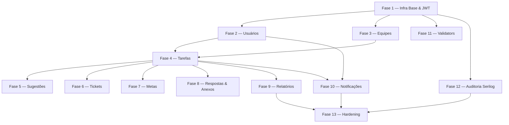

# 📋 Plano de Implementação — Cortex Backend

> **Baseado em:** [AGENTS.md](file:///c:/Users/yuma2/Repositorios/Cortex-backend/AGENTS.md)  
> **Data:** Outubro de 2026  
> **Stack:** .NET 10 · ASP.NET Core Web API · EF Core · PostgreSQL

---

## 🔍 Estado Atual do Projeto

### ✅ O que já existe

| Camada | Status | Detalhe |
|---|---|---|
| **Entities** | ✅ Completo | Todas as 10 entidades criadas (`Usuario`, `Tarefa`, `Equipe`, `MembroEquipe`, `ResponsavelTarefa`, `RespostaTarefa`, `Sugestao`, `TicketReporte`, `Meta`, `Anexo`) |
| **Enums** | ✅ Completo | `Status`, `Prioridade`, `Cargo`, `TipoEntidade` — com mapeamento Npgsql |
| **Infra/Configuration** | ✅ Completo | Fluent API configurada para todas as entidades |
| **Infra/Persistence** | ✅ Completo | `CortexDbContext` com todos os `DbSet`s e enums registrados |
| **Migrations** | ✅ Existe | Migration inicial `InitialCreate` gerada |
| **Infra/Repositories (Interfaces)** | ✅ Completo | 10 interfaces criadas, incluindo `IResponsavelTarefaRepository` |
| **Infra/Repositories (Implementations)** | ✅ Completo | 10 repositórios implementados e operacionais |
| **DTOs/Request** | ✅ Completo | 19 DTOs de Request criados para todas as entidades |
| **DTOs/Response** | ✅ Completo | 11 DTOs de Response / Consulta criados |
| **Services/Interfaces** | ⚠️ Parcial | `IUsuarioService`, `IPasswordService`, `ITokenService`, `IEquipeService`, `IMembroEquipeService`, `ITarefaService`, `IResponsavelTarefaService`, `ISugestaoService`, `ITicketReporteService` |
| **Services/Implementations** | ⚠️ Parcial | `UsuarioService`, `PasswordService`, `TokenService`, `EquipeService`, `MembroEquipeService`, `TarefaService`, `ResponsavelTarefaService`, `TarefaStatusBackgroundService`, `SugestaoService`, `TicketReporteService` |
| **Controllers** | ⚠️ Parcial | `AuthController`, `UsuarioController`, `EquipeController`, `TarefaController`, `SugestaoController` e `TicketReporteController` implementados |
| **Autenticação JWT** | ✅ Completo | Configurada com Bearer tokens, Claims e `TokenService` |
| **FluentValidation** | ⚠️ Parcial | Validadores de usuário, autenticação, equipes, tarefas, sugestões e tickets implementados |
| **Serilog** | ✅ Completo | Configurado com sinks de Console e File estruturado (JSON) |
| **Injeção de Dependências** | ✅ Completo | Todos os repositórios e serviços base registrados no `Program.cs` |

---

## 🗺️ Roadmap de Implementação

As fases estão ordenadas por dependência técnica. **Não pule fases.**

---

## Fase 1 — Infraestrutura Base & Segurança (Pré-requisito de tudo)

> **Objetivo:** Ter a aplicação funcional com autenticação JWT e injeção de dependências operacional.

### 1.1 — Corrigir `IResponsavelTarefaRepository`
- A interface `IResponsavelTarefaRepository` está faltando em `Infra/Repositories/Interfaces/`
- [`ResponsavelTarefaRepository.cs`](file:///c:/Users/yuma2/Repositorios/Cortex-backend/Infra/Repositories/Implementations/ResponsavelTarefaRepository.cs) já implementa operações — criar a interface correspondente

### 1.2 — Configurar Serilog no `Program.cs`
- Adicionar `builder.Host.UseSerilog(...)` com sinks: Console (dev) e File (prod)
- Configurar output em JSON estruturado para facilitar auditoria (RNF05)
- Logar eventos críticos: login, alteração/conclusão de tarefas, exclusão, tickets

### 1.3 — Instalar e Configurar JWT
- Adicionar pacote `Microsoft.AspNetCore.Authentication.JwtBearer`
- Configurar seção `Jwt` no `appsettings.json` (`Secret`, `Issuer`, `Audience`, `ExpiresInMinutes`)
- Registrar `AddAuthentication().AddJwtBearer(...)` no `Program.cs`
- Adicionar middlewares `app.UseAuthentication()` e `app.UseAuthorization()`

### 1.4 — Criar `TokenService`
- **Interface:** `Services/Interfaces/ITokenService.cs`
- **Implementação:** `Services/Implementations/TokenService.cs`
- Método: `string GerarToken(Usuario usuario, string cargo)` — gera JWT com Claims: `sub` (userId), `email`, `cargo` (Dono/Admin/Membro), `equipeId`
- Registrar no `Program.cs`

### 1.5 — Registrar todos os Serviços e Repositórios no `Program.cs`
Registrar via `builder.Services.AddScoped<>()`:
- Todos os `IXRepository` → `XRepository`
- Todos os `IXService` → `XService` (conforme forem criados)
- Configurar FluentValidation: `builder.Services.AddFluentValidationAutoValidation()`

### 1.6 — Criar Middleware de Tratamento Global de Exceções
- Criar `Infra/Middleware/ExceptionHandlingMiddleware.cs`
- Mapear exceções de domínio para respostas `ProblemDetails` (RFC 7807):
  - `KeyNotFoundException` → `404 Not Found`
  - `InvalidOperationException` → `409 Conflict`
  - `UnauthorizedAccessException` → `401 Unauthorized`
  - `ArgumentException` → `400 Bad Request`
  - `ForbiddenException` (criar custom) → `403 Forbidden`
- Registrar no pipeline: `app.UseMiddleware<ExceptionHandlingMiddleware>()`

---

## Fase 2 — Autenticação & Gestão de Usuários (RF001)

> **Objetivo:** Endpoint de login funcional + CRUD completo de usuários protegido por JWT.

### 2.1 — Criar `AuthController`
- `POST /api/auth/login` — recebe `DadosLoginDTO`, valida credenciais via `UsuarioService.ValidarSenhaAsync`, retorna JWT
- `POST /api/auth/alterar-senha` — `[Authorize]` — recebe senha atual + nova, delega para `UsuarioService.AlterarSenhaAsync`

### 2.2 — Criar Validators FluentValidation para Usuário
- `CriarUsuarioValidator`: valida `Nome` (required, max 255), `Email` (formato RFC), `Senha` (RN02: min 8, maiúscula, minúscula, número, especial), `Telefone` (max 20, opcional)
- `AtualizarUsuarioValidator`: mesmas regras mas campos opcionais
- `DadosLoginValidator`: `Email` obrigatório + formato, `Senha` obrigatório

### 2.3 — Criar `UsuarioController`
Todos os endpoints protegidos com `[Authorize]` salvo criação:

| Método | Rota | Auth | Descrição |
|---|---|---|---|
| `POST` | `/api/usuarios` | ❌ Público | Criar usuário (RN01, RN02) |
| `GET` | `/api/usuarios` | ✅ Admin/Dono | Listar usuários |
| `GET` | `/api/usuarios/{id}` | ✅ | Obter por ID |
| `PUT` | `/api/usuarios/{id}` | ✅ Próprio usuário | Atualizar dados |
| `DELETE` | `/api/usuarios/{id}` | ✅ Próprio usuário | Deletar (RN05) |

### 2.4 — Upload Real de Foto de Perfil
- Implementar upload de arquivo físico (ex: pasta `wwwroot/uploads/usuarios/`)
- Gerar `UrlCaminho` dinâmica com nome único (ex: GUID + extensão)
- Substituir o placeholder hardcoded `"uploads/usuarios/foto.png"` no `UsuarioService`

---

## Fase 3 — Gestão de Equipes (RF009)

> **Objetivo:** CRUD de equipes com controle de membros e cargos (RN03, RN04).

### 3.1 — Criar `IEquipeService` e `EquipeService`
- `CriarEquipeAsync(dto, criadorId)` — cria equipe e adiciona criador como `Dono`
- `ObterEquipePorIdAsync(id)`
- `ListarEquipesAsync()`
- `AtualizarEquipeAsync(id, dto, solicitanteId)` — apenas Dono/Admin
- `DeletarEquipeAsync(id, solicitanteId)` — apenas Dono

### 3.2 — Criar `IMembroEquipeService` e `MembroEquipeService`
- `AdicionarMembroAsync(dto, solicitanteId)` — RN04: apenas Dono/Admin podem adicionar
- `RemoverMembroAsync(membroId, solicitanteId)` — RN04: apenas Dono/Admin
- `AlterarCargoAsync(membroId, novoCargo, solicitanteId)` — RN03: apenas Dono
- `ListarMembrosPorEquipeAsync(equipeId)`

### 3.3 — Criar `EquipeController`

| Método | Rota | Cargo Mínimo | Descrição |
|---|---|---|---|
| `POST` | `/api/equipes` | ✅ Autenticado | Criar equipe |
| `GET` | `/api/equipes/{id}` | ✅ Membro | Ver equipe |
| `PUT` | `/api/equipes/{id}` | Admin | Atualizar equipe |
| `DELETE` | `/api/equipes/{id}` | Dono | Deletar equipe |
| `POST` | `/api/equipes/{id}/membros` | Admin | Adicionar membro |
| `DELETE` | `/api/equipes/{id}/membros/{membroId}` | Admin | Remover membro |
| `PATCH` | `/api/equipes/{id}/membros/{membroId}/cargo` | Dono | Alterar cargo |

---

## Fase 4 — Gestão de Tarefas (RF003)

> **Objetivo:** CRUD completo de tarefas com atribuição de responsáveis e controle de status.

### 4.1 — Criar `ITarefaService` e `TarefaService`
- `CriarTarefaAsync(dto, criadorId)` — cria tarefa com status `Pendente`
- `ObterTarefaPorIdAsync(id)` — retorna `DadosDetalhesTarefaDTO` (com responsáveis, anexos, etc.)
- `ListarTarefasAsync(filtros)` — suporte a filtros por status, prioridade, responsável, período
- `AtualizarTarefaAsync(id, dto, solicitanteId)` — apenas criador ou Admin/Dono
- `DeletarTarefaAsync(id, solicitanteId)` — apenas criador ou Admin/Dono
- `ConcluirTarefaAsync(id, solicitanteId)` — muda status para `Concluida`, dispara verificação de Metas (RN08)
- `VerificarTarefasAtrasadasAsync()` — varre tarefas `Pendente` com `DataVencimento < UtcNow` e muda para `Atrasada` (RN06)

### 4.2 — Criar `IResponsavelTarefaService` e `ResponsavelTarefaService`
- `AtribuirResponsavelAsync(dto, solicitanteId)` — atribui usuário a tarefa
- `AtribuirEquipeAsync(tarefaId, equipeId, solicitanteId)` — atribui todos os membros de uma equipe
- `RemoverResponsavelAsync(responsavelId, solicitanteId)`
- `ListarResponsaveisPorTarefaAsync(tarefaId)`

### 4.3 — Criar `TarefaController`

| Método | Rota | Descrição |
|---|---|---|
| `POST` | `/api/tarefas` | Criar tarefa |
| `GET` | `/api/tarefas` | Listar com filtros |
| `GET` | `/api/tarefas/{id}` | Detalhe completo |
| `PUT` | `/api/tarefas/{id}` | Atualizar tarefa |
| `DELETE` | `/api/tarefas/{id}` | Deletar tarefa |
| `PATCH` | `/api/tarefas/{id}/concluir` | Concluir tarefa |
| `POST` | `/api/tarefas/{id}/responsaveis` | Atribuir responsável |
| `DELETE` | `/api/tarefas/{id}/responsaveis/{respId}` | Remover responsável |

### 4.4 — Background Service para Tarefas Atrasadas (RN06)
- Criar `Services/Background/TarefaStatusBackgroundService.cs` (herda `BackgroundService`)
- Executar `VerificarTarefasAtrasadasAsync()` periodicamente (ex: a cada 5 minutos)
- Registrar no `Program.cs`: `builder.Services.AddHostedService<TarefaStatusBackgroundService>()`

---

## Fase 5 — Sugestões de Alteração (RF004)

> **Objetivo:** Fluxo de sugestão → aprovação/rejeição pelo criador da tarefa (RN14).

### 5.1 — Criar `ISugestaoService` e `SugestaoService`
- `CriarSugestaoAsync(dto, solicitanteId)` — apenas responsável pela tarefa pode sugerir
- `AprovarSugestaoAsync(sugestaoId, solicitanteId)` — apenas o **criador** da tarefa; aplica as alterações na tarefa (RN14)
- `RejeitarSugestaoAsync(sugestaoId, solicitanteId)` — apenas o criador
- `ListarSugestoesPorTarefaAsync(tarefaId, solicitanteId)`

### 5.2 — Criar `SugestaoController`

| Método | Rota | Descrição |
|---|---|---|
| `POST` | `/api/tarefas/{id}/sugestoes` | Criar sugestão |
| `GET` | `/api/tarefas/{id}/sugestoes` | Listar sugestões da tarefa |
| `PATCH` | `/api/sugestoes/{id}/aprovar` | Aprovar sugestão (criador) |
| `PATCH` | `/api/sugestoes/{id}/rejeitar` | Rejeitar sugestão (criador) |

---

## Fase 6 — Tickets de Reporte (RF008)

> **Objetivo:** Mecanismo de reporte de impedimentos por responsáveis, roteado a Donos/Admins.

### 6.1 — Criar `ITicketReporteService` e `TicketReporteService`
- `CriarTicketAsync(dto, solicitanteId)` — apenas responsáveis pela tarefa podem abrir ticket
- `FecharTicketAsync(ticketId, solicitanteId)` — Dono/Admin fecha o ticket (`Ativo = false`)
- `ListarTicketsPorTarefaAsync(tarefaId, solicitanteId)` — Membro vê só os seus (RN09); Admin/Dono vê todos
- `ListarTicketsAbertosAsync(equipeId, solicitanteId)` — apenas Admin/Dono

### 6.2 — Criar `TicketReporteController`

| Método | Rota | Descrição |
|---|---|---|
| `POST` | `/api/tarefas/{id}/tickets` | Criar ticket |
| `GET` | `/api/tarefas/{id}/tickets` | Listar tickets da tarefa |
| `PATCH` | `/api/tickets/{id}/fechar` | Fechar ticket |
| `GET` | `/api/equipes/{id}/tickets` | Tickets abertos da equipe |

---

## Fase 7 — Gestão de Metas (RF007)

> **Objetivo:** CRUD de metas vinculadas a tarefas com cálculo automático de conclusão (RN07, RN08, RN15).

### 7.1 — Criar `IMetaService` e `MetaService`
- `CriarMetaAsync(dto, solicitanteId)` — validar: mínimo 1 tarefa vinculada (RN07); `DataFechamento` máx 12 meses (RN15)
- `ObterMetaPorIdAsync(id, solicitanteId)`
- `ListarMetasPorUsuarioAsync(usuarioId, solicitanteId)` — Membro só vê as próprias (RN09)
- `AtualizarMetaAsync(id, dto, solicitanteId)`
- `DeletarMetaAsync(id, solicitanteId)`
- `VerificarConclusaoMetaAsync(tarefaId)` — chamado ao concluir tarefa; verifica se todas as tarefas da meta estão concluídas → seta `Concluida = true` (RN08)

### 7.2 — Criar `MetaController`

| Método | Rota | Descrição |
|---|---|---|
| `POST` | `/api/metas` | Criar meta |
| `GET` | `/api/metas` | Listar metas do usuário autenticado |
| `GET` | `/api/metas/{id}` | Detalhe da meta |
| `PUT` | `/api/metas/{id}` | Atualizar meta |
| `DELETE` | `/api/metas/{id}` | Deletar meta |

---

## Fase 8 — Respostas de Tarefas & Anexos

> **Objetivo:** Permitir comentários/respostas em tarefas e upload de arquivos vinculados.

### 8.1 — Criar `IRespostaTarefaService` e `RespostaTarefaService`
- `CriarRespostaAsync(dto, solicitanteId)` — apenas responsáveis/criador da tarefa
- `ListarRespostasPorTarefaAsync(tarefaId, solicitanteId)`
- `DeletarRespostaAsync(respostaId, solicitanteId)` — apenas o autor

### 8.2 — Criar `IAnexoService` e `AnexoService`
- `AdicionarAnexoAsync(dto, arquivo, solicitanteId)` — salva arquivo físico + registro no banco
- `ObterAnexoPorIdAsync(id)`
- `ListarAnexosPorEntidadeAsync(tipoEntidade, entidadeId)`
- `DeletarAnexoAsync(id, solicitanteId)` — deleta registro + arquivo físico

### 8.3 — Criar `RespostaTarefaController` e `AnexoController`

| Método | Rota | Descrição |
|---|---|---|
| `POST` | `/api/tarefas/{id}/respostas` | Criar resposta |
| `GET` | `/api/tarefas/{id}/respostas` | Listar respostas |
| `DELETE` | `/api/respostas/{id}` | Deletar resposta |
| `POST` | `/api/tarefas/{id}/anexos` | Upload de anexo para tarefa |
| `GET` | `/api/tarefas/{id}/anexos` | Listar anexos da tarefa |
| `DELETE` | `/api/anexos/{id}` | Deletar anexo |

---

## Fase 9 — Relatórios (RF006)

> **Objetivo:** Geração de relatórios com filtros e restrição de visibilidade por cargo (RN09, RN10).

### 9.1 — Criar DTOs de Filtro
- `FiltroRelatorioDTO`: `Status?`, `Prioridade?`, `EquipeId?`, `ResponsavelId?`, `DataInicio?`, `DataFim?`
- `RelatorioTarefasDTO`: agrupamentos e métricas (total, concluídas, atrasadas, pendentes, por prioridade)

### 9.2 — Criar `IRelatorioService` e `RelatorioService`
- `GerarRelatorioTarefasAsync(filtro, solicitanteId, cargo)`:
  - `Membro` → filtra automaticamente apenas tarefas do próprio usuário (RN09)
  - `Admin`/`Dono` → aplica todos os filtros livremente (RN10)
- `GerarRelatorioEquipeAsync(equipeId, filtro, solicitanteId)` — apenas Admin/Dono

### 9.3 — Criar `RelatorioController`

| Método | Rota | Cargo Mínimo | Descrição |
|---|---|---|---|
| `GET` | `/api/relatorios/tarefas` | Membro | Relatório de tarefas (com filtros) |
| `GET` | `/api/relatorios/equipes/{id}` | Admin | Relatório por equipe |

---

## Fase 10 — Notificações & Alertas (RF005)

> **Objetivo:** Sistema de alertas configuráveis por canal (e-mail, push, SMS) com regras de janela e validade (RN11, RN12, RN13).

### 10.1 — Modelar Preferências de Notificação
- Criar entidade `PreferenciaNotificacao` (tabela `PreferenciasNotificacao`):
  - `UsuarioId`, `Canal` (enum: `Email`, `Push`, `SMS`), `AntecedenciaHoras` (int, 1–168), `AtivoNovaAtribuicao`, `AtivoVencimento`, `AtivoConclusaoMeta`, `AtivoTicket`
- Adicionar ao `CortexDbContext`, Fluent API, e gerar nova migration
- Criar DTO Request/Response correspondentes

### 10.2 — Criar `INotificacaoService` e `NotificacaoService`
- `EnviarNotificacaoAsync(usuarioId, canal, mensagem)` — abstração sobre gateways
- `ConfigurarPreferenciasAsync(usuarioId, dto)` — CRUD de preferências (RN11: validar antecedência 1h–7 dias)
- `ObterPreferenciasAsync(usuarioId)`
- Validar RN13: bloquear envio por e-mail se e-mail não verificado

### 10.3 — Gateways de Entrega (Stubs + Interfaces)
- Criar interfaces: `IEmailGateway`, `IPushGateway`, `ISmsGateway`
- Criar implementações stub que logam via Serilog (sem integração real por ora)
- Ponto de extensão para conectar SMTP, FCM/APNs e gateway SMS futuramente

### 10.4 — Background Service de Alertas de Vencimento (RNF10)
- Criar `Services/Background/AlertaVencimentoBackgroundService.cs`
- Executar a cada hora: buscar tarefas próximas do vencimento conforme `AntecedenciaHoras` configurada
- Respeitar RN12 (não enviar retroativamente) e RN13 (e-mail só se verificado)
- Enviar notificação de forma assíncrona (sem bloquear requisições HTTP)

### 10.5 — Criar `NotificacaoController`

| Método | Rota | Descrição |
|---|---|---|
| `GET` | `/api/notificacoes/preferencias` | Obter preferências do usuário |
| `PUT` | `/api/notificacoes/preferencias` | Atualizar preferências |

---

## Fase 11 — Validadores FluentValidation (Todas as Entidades)

> **Objetivo:** Cobrir todos os contratos de entrada com validação declarativa.

Criar em `DTOs/Validators/` (ou pasta dedicada) um validator por DTO de Request:

| Validator | Regras Principais |
|---|---|
| `CriarTarefaValidator` | `Titulo` obrigatório/max 255, `DataVencimento` obrigatória/futura, `Prioridade` válida |
| `AtualizarTarefaValidator` | Campos opcionais com mesmas regras |
| `CriarEquipeValidator` | `Nome` obrigatório/max 255 |
| `CriarMembroEquipeValidator` | `UsuarioId` e `EquipeId` requeridos, `Cargo` válido |
| `CriarSugestaoValidator` | `Descricao` obrigatória, `TarefaId` requerido |
| `CriarTicketValidator` | `Descricao` obrigatória, `TarefaId` requerido |
| `CriarMetaValidator` | `Nome` obrigatório/max 255, `DataFechamento` ≤ 12 meses (RN15) |
| `PreferenciaNotificacaoValidator` | `AntecedenciaHoras` entre 1 e 168 (RN11) |

---

## Fase 12 — Auditoria com Serilog (RNF05)

> **Objetivo:** Log estruturado de todos os eventos críticos do sistema.

### Eventos a Logar

| Evento | Nível | Campos Obrigatórios |
|---|---|---|
| Login bem-sucedido | `Information` | `UserId`, `Email`, `IP`, `Timestamp` |
| Tentativa de login falhada | `Warning` | `Email`, `IP`, `Timestamp` |
| Criação de tarefa | `Information` | `TarefaId`, `CriadorId`, `Titulo` |
| Alteração de tarefa | `Information` | `TarefaId`, `AlteradoPor`, `CamposAlterados` |
| Conclusão de tarefa | `Information` | `TarefaId`, `ConcluidaPor`, `Timestamp` |
| Exclusão de registro | `Warning` | `Entidade`, `Id`, `DeletadoPor` |
| Abertura de ticket | `Information` | `TicketId`, `TarefaId`, `UsuarioId` |
| Aprovação/Rejeição de sugestão | `Information` | `SugestaoId`, `TarefaId`, `Acao`, `SolicitanteId` |

---

## Fase 13 — Hardening & Qualidade (RNF08)

> **Objetivo:** Garantir segurança, performance e conformidade com RNFs.

### 13.1 — Sanitização e Proteção
- Confirmar que todo acesso ao banco é via EF Core (sem SQL raw desnecessário) — prevenção SQL Injection
- Adicionar rate limiting no endpoint de login (`AddRateLimiter` do ASP.NET Core)
- Revisar Claims nas controllers: verificar se o `solicitanteId` extraído do JWT é sempre usado

### 13.2 — Verificação de E-mail (RN13)
- Adicionar campo `EmailVerificado` (`bool`, default `false`) na entidade `Usuario`
- Criar endpoint `POST /api/auth/verificar-email` (token de verificação por e-mail)
- Bloquear ativação de notificações por e-mail enquanto `EmailVerificado = false`

### 13.3 — Performance (RNF09)
- Revisar queries EF Core: usar `.AsNoTracking()` em queries de leitura pura
- Adicionar índices nas colunas de filtragem mais usadas: `TarefaId`, `UsuarioId`, `Status`, `DataVencimento`
- Gerar migration para os novos índices

### 13.4 — Testes
- Criar projeto de testes `Cortex.Tests` (xUnit)
- Cobrir com testes unitários: validadores, `UsuarioService`, `TarefaService`, `MetaService`
- Cobrir com testes de integração: endpoints de autenticação, criação de tarefa, fluxo de sugestão

---

## 📦 Pacotes NuGet a Adicionar

| Pacote | Motivo |
|---|---|
| `Microsoft.AspNetCore.Authentication.JwtBearer` | Autenticação JWT (Fase 1) |
| `System.IdentityModel.Tokens.Jwt` | Geração de tokens JWT (Fase 1) |
| `Microsoft.AspNetCore.RateLimiting` | Rate limiting no login (Fase 13) |
| `xunit` + `Moq` + `Microsoft.EntityFrameworkCore.InMemory` | Testes (Fase 13) |

---

## 🔗 Dependências Entre Fases

---

## ✅ Checklist Resumido por Fase

- [x] **Fase 1** — Infra Base: Serilog, JWT, DI, Middleware de exceções, `IResponsavelTarefaRepository`
- [x] **Fase 2** — Usuários: `AuthController`, `UsuarioController`, Validators, upload real de foto
- [x] **Fase 3** — Equipes: `EquipeService`, `MembroEquipeService`, `EquipeController`
- [x] **Fase 4** — Tarefas: `TarefaService`, `ResponsavelTarefaService`, `TarefaController`, Background Service de atraso
- [x] **Fase 5** — Sugestões: `SugestaoService`, `SugestaoController`
- [x] **Fase 6** — Tickets: `TicketReporteService`, `TicketReporteController`
- [x] **Fase 7** — Metas: `MetaService`, `MetaController`
- [x] **Fase 8** — Respostas & Anexos: `RespostaTarefaService`, `AnexoService`, controllers
- [x] **Fase 9** — Relatórios: `RelatorioService`, `RelatorioController`
- [x] **Fase 10** — Notificações: entidade, `NotificacaoService`, Background Service, gateways stub
- [x] **Fase 11** — FluentValidation: validators para todos os DTOs
- [x] **Fase 12** — Serilog: log estruturado de todos os eventos críticos
- [ ] **Fase 13** — Hardening: rate limiting, `EmailVerificado`, índices, testes
